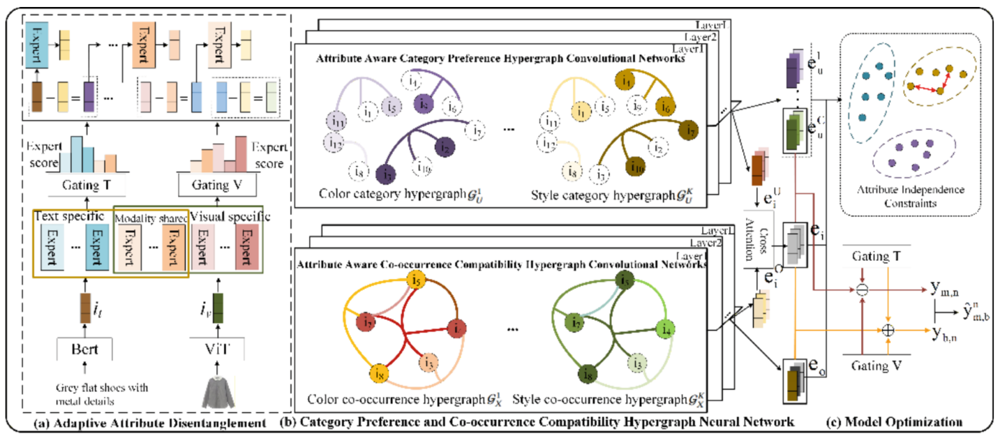

# 个性化搭配推荐：属性按重要性逐个拆，两张超图分别学用户偏好和 outfit 兼容

关注我，每天为你精挑细选最优质、最新鲜的推荐算法paper，陪你一起保持进步、不断精进！

> [English version](qust-pcm-adhl.full.en.md)

### 论文：Personalized Compatibility Modeling with Adaptive Disentanglement and Hypergraph Learning
### 网址：https://doi.org/10.1007/978-981-92-3391-5_19
### 公司：青岛科技大学
### 思想：属性解耦、属性专家网络、超图神经网络
### 方向：i2i（个性化兼容）

## 解读：
用户正在搭一套 outfit，已经选了几件，要从候选里挑下一件：既要和这套里已有的单品搭，又要符合这个用户在这个品类上的偏好，比如他上衣常选的颜色。trigger 是这套不完整的 outfit，另外带上用户。

本文先把每件单品的图文特征拆成颜色、风格这类属性向量，拆的顺序按这件单品各属性的重要性定；再在两张超图上传播，一张学「用户在某个品类上的偏好」，一张学同一套 outfit 里单品的共现；最后对每个属性分别打偏好分和兼容分，按属性重要性加权求和。

### 模型侧

分三步：先把每件单品拆成若干属性向量；再在两张超图上按属性分别传播，得到用户、单品、outfit 的属性级表示；最后按属性打分、加权求和。

#### （1）按重要性拆属性
对应图中（a）。这一步把每件单品的图文特征拆成若干属性向量（颜色、风格这类），并给出这件单品上各属性的重要性（每件单品各算各的）。属性向量给（2）当超图节点的初始特征，重要性在（3）里给各属性的分数加权。

* **编码。** 文本过 BERT、图片过 ViT（图 1），各得一个特征。
* **属性专家。** 每个专家是一个小网络，负责抽一种属性，分三组（文本专属 2 个、视觉专属 2 个、图文共享 4 个，这是最优配置）。
* **打重要性分。** 每个专家先各抽一次，门控网络据此给这件单品的各属性打分，过 softmax。不同单品重要的属性不同，这件可能颜色最重要，那件可能是材质。
* **按重要性依次抽取。** 专家按重要性排队。第一个专家从原始特征里抽出它的属性，把这部分减掉，残差交给下一个专家，依次抽完；最后剩下的残差也算一个专属属性。
* **合并。** 图文两路的共享属性取平均。最终每件单品有文本专属 3 个（2 个 + 1 个残差）、视觉专属 3 个、图文共享 4 个属性向量。

**约束。** 每个属性向量和最后那个残差属性之间加正交约束（余弦平方），让各属性和残差分开。

**为什么要拆属性。** 让后面的偏好和兼容都按属性分开算，颜色配不配、风格配不配各算各的。

#### （2）在超图上学用户偏好和搭配兼容
对应图中（b）。这一步在每个共享属性上建两张超图（品类偏好、共现兼容），在图上传播，最后把每件单品（图上所有单品，打分时再取出候选单品那份）在两张图上的向量融合成一份。超图的一条边（超边）可以同时连多个节点。（1）的 10 个属性向量里只有 4 个共享属性进超图（6 个专属属性只用在正交约束里），所以两类图各 4 张（图中示意为颜色、风格），每张只在该属性的向量上传播。

**品类偏好超图。**
* **建边。** 一个用户在一个品类上交互过的单品连成一条超边（比如这个用户交互过的所有上衣；一套 outfit 里的单品则分属不同品类），超边的向量就是「这个用户在这个品类上的偏好」（用户–品类向量）。每个用户在每个品类上有 4 个，每个共享属性一个；第 0 层的初始值怎么来，论文没说。
* **连接权重。** 单品和超边之间的权重是学出来的，用户–品类向量和单品在该属性上的向量算相似度，再在各属性之间做 softmax。
* **传播。** 以（1）的属性向量为初始值，每层先从单品聚到超边、更新用户–品类向量，再从超边分回单品、更新单品向量；共 3 层，各层结果取平均。一件单品被多个用户交互过，也只有一个节点，每个属性上一个向量，共 4 个。

**共现兼容超图。** 每套 outfit 的单品连成一条超边，传播方式同上，得到每套 outfit 的属性级向量，单品向量也被更新一遍（混进了同一套里其他单品的信息，和偏好图上更新出的那份不同）。一件单品在多套 outfit 里出现，也只有一个节点，每个属性上一个向量，共 4 个。

**融合。** 在每个共享属性上，同一件单品在两张图上各有一份向量，用 cross-attention 融合成一份（偏好图上的向量作 query，兼容图上的作 key 和 value），最终每件单品得到 4 个融合向量。

**产出。** 每个属性上得到三种向量，都给（3）打分用。用户–品类向量和候选单品的向量算偏好分；outfit 向量和候选单品的向量算兼容分；融合后的单品向量就是打分时的候选向量。

#### （3）按属性打分
对应图中（c）。这一步给候选单品打一个总分，先在每个共享属性上分别打分，再跨属性加权求和。

* **偏好分。** 在每个共享属性上，用户在候选所属品类上的向量，和候选单品在该属性上的融合向量做内积，共 4 个偏好分。
* **兼容分。** 在每个共享属性上，outfit 的向量（这套不完整 outfit 在共现超图上的超边向量；超边里是否包含候选单品本身，论文没说）和候选单品在该属性上的融合向量拼起来，过两层 MLP，共 4 个兼容分（式里 MLP 参数没有属性下标，4 个属性共用一个）。
* **每个属性合成一个分。** 每个属性上 β × 偏好分 + (1 − β) × 兼容分，得到 4 个属性分，β 是固定超参（太小个性化不够，太大过分依赖用户历史）。
* **跨属性加权求和。** 4 个属性分按这件候选单品的属性重要性加权求和，得到总分。重要性就是（1）里门控打出的 α（式 (10) 记作 α^{t/v}）。但每一路门控给 6 个专家打分，这里只要 4 个共享属性的；怎么取、要不要重新归一化、文本和视觉两路怎么合成一套，论文都没写。

**训练。** 下面几项加在一起，端到端一起优化（式 (14)，另有 L2 正则）。
* **BPR。** 同一个（用户，outfit）下，正样本候选的总分要高于负样本（正样本推测是 outfit 里被拿掉的那件；负样本怎么采样、是否同品类，论文没写）。
* **正交约束。** 即（1）里的那个。
* **独立性约束。** 作用在（2）产出的用户、outfit、单品向量上，一个让不同属性之间区分开，一个让同一属性内部不塌缩。

### 数据侧
三个公开时尚数据集：IQON3000（3568 个用户、31 万套 outfit、67 万件单品）、Polyvore-U（630 个用户、16 万套、20 万件）和阿里 iFashion（357 万用户、101 万套、446 万件）。每件单品有文本描述、图片和品类。

## 心得：

## 愚见

## 可信度：离线

## 推荐等级：有时间看看

**请帮忙点赞、转发，谢谢。欢迎干货投稿 \ 论文宣传\ 合作交流**

### 【铁粉】请入微信群，群内我会给出更深入的解读，还可以共同讨论技术方案、发招聘广告、内推和交友等。
* 铁粉标准：关注公众号一个月以上，且在公众号上累计15次互动（评论、爱心、转发）、或投稿1次，只欢迎技术同学。
* 入群方法：请您加个人微信lmxhappy，我拉您入群，请备注【公司】（只我个人看，不公开）。

## 推荐您继续阅读：
