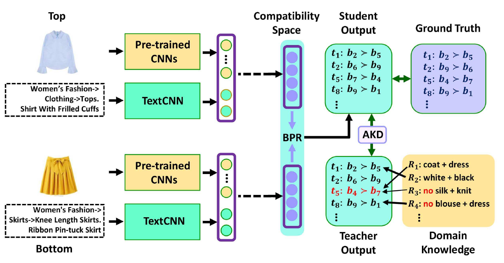

# Tops to bottoms: hand-screen 15 matching rules, let attention weight the rules per sample, and use them as an auxiliary task for an image-text scoring network

> [中文版](sdu-akd.md)

### Paper: Neural Compatibility Modeling with Attentive Knowledge Distillation (SIGIR 2018)
### Link: https://arxiv.org/abs/1805.00313
### Institution: Shandong University, National University of Singapore, Tencent AI Lab
### Ideas: rule-based auxiliary loss, posterior-regularization distillation, attention over rules, BPR, image-text item encoder, complementary clothing matching
### Area: i2i (complementary recommendation, outfit matching)

## Breakdown:
Given a top, rank candidate bottoms by how well they match (tops and bottoms that fashion experts put together on Polyvore are the positives). The paper first counts candidate rules in the training data and then hand-picks 15 matching rules (e.g., "coats go with dresses", "silk tops shouldn't go with knit bottoms"), then trains an image-text scoring network. On every training sample, the rules it triggers correct the network's scores toward the side the rules prefer, an attention network sets each rule's weight per sample, and the network learns both from the real matches and from the corrected distribution (the paper calls the scoring network the student, the corrected distribution the teacher, and the whole thing knowledge distillation).

Existing matching models are purely data-driven and ignore the common sense accumulated in fashion. Rules, on the other hand, are fuzzy: the same rule (e.g., "stripes go with stripes") fits some samples and not others, so giving it one weight for all samples is a poor fit.

### Method
There is only one scoring network, and it is the only part used at test time. The rules are not a separate model; during training they only correct the network's scores, and the corrected scores serve as the target of an auxiliary task. During training, each batch first has the network score ((1), the main task), then the rules correct the scores and the network learns from both the ground truth and the corrected distribution ((2), the auxiliary task).

#### (1) Main task: an image-text scoring network fit to real matches
Each item has two inputs (the image goes through an ImageNet-pretrained AlexNet and the 4096-dim fc7 output is taken; the title and category text goes through a TextCNN over word2vec word vectors, giving 400 dims). Vision and text are not scored separately: the two are concatenated and passed through one fully connected layer (1024 dims, sigmoid) to get the item's vector. The image model and the text model are shared by tops and bottoms (AlexNet is frozen and its features are extracted in advance; in the code, the TextCNN is trained with the model, with word vectors frozen); only the final fully connected layer has separate weights for tops and bottoms. The match score m_ij between top i and bottom j is the inner product of their vectors.

**Loss.** A BPR pairwise loss. Each sample is a triplet "top i, a positive bottom j, a random bottom k", and m_ij should be higher than m_ik; k is drawn at random from bottoms never paired with i, 3 per positive pair.

#### (2) Auxiliary task: correct the scores with the rules and pull the network toward the correction
On each triplet (top i, positive bottom j, random bottom k), the rules correct the network's scores into a corrected distribution, and the network is then pulled toward it. The corrected distribution is built in four steps: step 1 is done once offline, and steps 2 to 4 are done for each triplet during training.
* **Step 1: compile the rules (offline: candidates by counting, final set by hand).** Each rule has the form "a top with attribute value X goes with (or should not go with) a bottom with attribute value Y".
    * **Attribute values.** The authors take five attributes as the main drivers of matching (color, material, pattern, category, brand) and collect each attribute's values from the titles and categories in the training data (e.g., black, white, green for color; knit, silk, leather for material).
    * **Candidate rules.** Over the positive pairs in the training set, count how often each "top value + bottom value" combination co-occurs per attribute, and keep the 10 most frequent pairs (candidate positive rules, e.g., "black top with black bottom") and the 10 least frequent pairs (candidate negative rules, e.g., "blouses shouldn't go with dresses") for each attribute.
    * **Manual screening.** Three fashion enthusiasts screen them by hand, leaving 15 rules (9 positive, 6 negative).
* **Step 2: find the rules that apply.**
    * **Trigger.** This is checked separately for (i, j) and (i, k). Take "coats go with dresses": if "coat" appears in the top's text (title and categories) and "dress" appears in the bottom's text, the pair triggers the rule. It is plain string matching.
    * **Apply.** A rule applies only when exactly one of (i, j) and (i, k) triggers it. For a positive rule, the bottom in the triggering pair is rewarded; for a negative rule, the bottom in the non-triggering pair is rewarded. If both pairs or neither trigger it, the rule does not apply.
* **Step 3: weight the applicable rules (attention).** A softmax over the applicable rules gives the rule weights. In the paper the three items are represented by their raw image-text features; in the code, by the scoring network's 1024-dim vectors. The weights are used in step 4 to decide how hard each rule pushes the scores.
    * Attention: each rule gets a rule vector from an embedding layer; the representations of the top, the positive bottom and the negative bottom are each multiplied by a matrix to project them to the same dimension (the two bottoms share one matrix); the four are summed, passed through a sigmoid activation (the paper doesn't say which activation; the code uses sigmoid), and passed through a fully connected layer with a 1-dim output to get the rule's score (equivalent to concatenating the four and passing them through a one-hidden-layer network).
* **Step 4: correct the scores.** The network's two scores [m_ij, m_ik] are first normalized into a distribution that sums to 1. Some applicable rules may reward j and others k: the j side is multiplied by exp(C × the sum of the weights of rules rewarding j), the k side by exp(C × the sum of the weights of rules rewarding k), and the result is renormalized to give the corrected distribution; rules pointing in opposite directions partly cancel. For example, if the top is a coat, j is a dress and k is shorts, "coat + dress" rewards j, and the corrected distribution leans toward j more than the network's original one.

**Loss.** The total loss is (1 − ρ) × BPR loss + ρ × cross-entropy (corrected distribution as the target, the network's distribution as the prediction) + L2 regularization, and the attention network and the scoring network are trained together on it. ρ starts at 0 and grows during training (in the code, 1 − 0.95 to the power of the epoch).

**Why a rule triggered by both pairs does not apply.** The correction multiplies probabilities and then renormalizes by ratio, so multiplying both sides by the same exp(C × rule weight) cancels in numerator and denominator, and the corrected distribution equals the network's original one (in logit terms this adds the same constant to both logits, which leaves the softmax unchanged, unlike a temperature). Also, the softmax in step 3 runs only over applicable rules, so leaving such a rule out keeps it from taking weight away from the rules that do apply.

**Why weight rules per sample.** Rules are triggered only by whether a word appears in the text, which is coarse. Two samples can both trigger "stripes + stripes": in one the stripes on top and bottom really echo each other, in the other the stripe width and colors clash, and the rule shouldn't decide the latter. Attention sees the items themselves and can lower the weight in the second case.

**Why ρ grows over time.** The corrected distribution is derived from the network's scores; early on the network hasn't learned much, so the correction isn't reliable either. Training therefore fits the ground truth first and gradually shifts weight toward the auxiliary task.

**Code vs. paper.** The official code (model/matching_attention_classes.py and model/matching_attention.py, in Theano) differs from the paper in a few places. The attention input is the scoring network's item vectors rather than the raw image-text features; the coefficient C is applied before the softmax (acting as a temperature, set to 3) and not again when rewriting the scores; the corrected distribution is computed directly from the network's scores without stopping gradients, so the cross-entropy gradient flows through it back into the network (on triplets where no rule applies, the corrected distribution equals the network's and the term reduces to the entropy of the network's distribution, which only pushes the network toward higher confidence); training runs for 25 epochs (40 in the paper) and the fully connected layer uses a hard sigmoid; and the released script configures only 3 rules.

### Inference
Only the scoring network is used; the rules and the attention are not needed. Tops and bottoms are encoded separately and their inner product is the match score; bottom vectors can be precomputed, and by the formula maximum inner product search works directly (the paper does not retrieve from the full catalog and only ranks randomly sampled candidates).

### Data and results
FashionVC (20,726 expert outfits from Polyvore, 14,871 tops and 13,663 bottoms). Positive pairs are split 8:1:1 into train, validation and test, and each positive pair gets 3 random negatives. The main metric is AUC over triplets (the fraction where the positive outscores the negative), reported for both the scoring network (AKD-DBPR-p) and the corrected distribution (AKD-DBPR-q, which corrects the scores on each test triplet as in training). Offline experiments only.
* **Overall.** Scoring network AUC 0.7843, corrected distribution 0.7852; the same architecture without the auxiliary task (DBPR) gets 0.7704, and the strongest external baseline, BPR-DAE (the group's earlier image-text autoencoder method), 0.7616.
* **Attention.** With uniform rule weights, the scoring network gets 0.7785 and the corrected distribution 0.7760.
* **Single modality.** Image only: DBPR 0.6826, and with rules the corrected distribution gets 0.7302 and the scoring network 0.6961. Text only: DBPR 0.7181, corrected distribution 0.7374, scoring network 0.7345.
* **Single rules.** Using one rule at a time, scoring-network AUC ranges from 0.7714 to 0.7814; negative rules and category rules generally do better, and the best is "no blouses + dress" (0.7814).
* **Retrieval.** Each test top is paired with T random bottoms (exactly 1 positive), ranked by the scoring network's inner product, and MRR is computed. 64.59% of the test tops never appear in the training set. MRR is only shown as curves: with 10 candidates the scoring network is about 0.50 versus about 0.48 for DBPR, and with 50 candidates both are about 0.22.

The code is open source.

## Takeaways
* Using a handful of rules to correct the network's own pairwise scores, as an auxiliary target, injects domain knowledge without changing the model that serves.
* Negative rules ("X shouldn't go with Y") and category rules helped more than color or material rules.
* Per-sample rule weights beat uniform weights, but the total gain over the no-rule network is about 1.4 AUC points.

## Caveats
* The released training script keeps the epoch and hyperparameter setting with the best test-set accuracy rather than the best validation accuracy, while the paper says it reports test performance after a fixed 40 epochs; no significance tests are given for gaps of around 0.01 AUC.
* A single rule ("no blouses + dress", 0.7814) already brings the scoring network close to the full attentive version with 15 rules (0.7843) and above the uniform-weight version with all rules (0.7785), so the separate contribution of the attention over many rules is small.
* Despite the teacher/student naming, there is a single network: the "teacher" is the network's own scores corrected by the rules, so the method is a rule-based auxiliary loss rather than conventional two-model distillation. In the code, this corrected distribution is not detached: gradients flow through it into both the attention network and the scoring network. The rule weights are therefore pushed toward whichever bottom the network already prefers, and on triplets where no rule applies the auxiliary term is the entropy of the network's own distribution, so part of the reported gain may come from confidence sharpening rather than from the rules.
* The paper and the code differ in the attention input (raw features vs. scoring-network vectors), where C is applied, the number of epochs (40 vs. 25), and the activation, and the released script configures 3 of the 15 rules.

## Credibility: offline

## Recommendation level: worth a look if you have time
