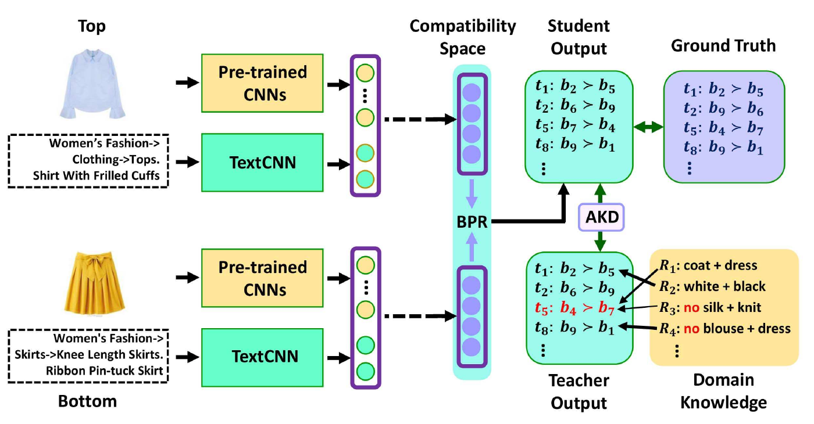

# 上衣配下装：人工筛出 15 条搭配规则，注意力按样本给规则定权重，再蒸馏进图文打分网络

关注我，每天为你精挑细选最优质、最新鲜的推荐算法paper，陪你一起保持进步、不断精进！

> [English version](sdu-akd.full.en.md)

### 论文：Neural Compatibility Modeling with Attentive Knowledge Distillation
### 网址：https://arxiv.org/abs/1805.00313
### 公司：山东大学、新加坡国立大学、腾讯 AI Lab
### 思想：
### 方向：i2i（互补推荐、穿搭搭配）

## 解读：
给定一件上衣，从候选下装里排出最搭的几件（Polyvore 上达人搭在一起的上下装作正样本）。本文先从训练数据里挖出 15 条搭配规则（如「大衣配连衣裙」「丝绸上衣别配针织下装」），再训练一个图文打分网络（学生）。每个训练样本上，用命中的规则改写学生的打分得到教师，注意力网络按样本给每条规则定权重，学生一边拟合真实搭配、一边向教师靠拢。

已有的搭配模型都是纯数据驱动，没用上穿搭领域积累的常识。规则本身又很模糊，同一条规则（如「条纹配条纹」）对有的样本适用、对有的不适用，给所有样本统一权重不合适。

### 方法
先离线挖规则（（1））；训练时每个 batch 依次做三件事，学生打分（（2）），按规则改写学生打分得到教师（（3）），让学生同时学真值和教师（（4））。

#### （1）挖搭配规则
* **属性取值。** 作者认为影响搭配的主要是颜色、材质、图案、品类、品牌五种属性，从训练数据的标题和类目里整理出每种属性的取值（如颜色有黑、白、绿，材质有针织、丝绸、皮革）。
* **候选规则。** 在训练集的正样本对里，按属性统计「上衣取值 + 下装取值」的共现次数，每种属性留共现最多的 10 对（候选正规则，如「黑上衣配黑下装」）和最少的 10 对（候选负规则，如「衬衫别配连衣裙」）。
* **人工筛选。** 三位时尚爱好者手工筛，最后留下 15 条（9 条正规则、6 条负规则）。
* **判定命中。** 上衣的文本（标题和类目）里出现规则的取值 1、下装文本里出现取值 2，就算这对衣服命中这条规则，纯字符串匹配。

#### （2）学生网络：上衣、下装各自编码，内积打分
学生是最终用来打分的网络。每件衣服有两种输入（图片过 ImageNet 预训练的 AlexNet 取 fc7 层 4096 维，标题和类目文本用 word2vec 词向量过 TextCNN 得到 400 维），视觉、文本不各自打分，两者拼起来过一层全连接（1024 维，sigmoid），得到这件衣服的向量。上衣和下装各用一套全连接参数，不共享；按代码，TextCNN 由上下装共用并随模型一起训练（词向量固定），图片特征提前抽好不训练。上衣 i 和下装 j 的搭配分 m_ij 就是两个向量的内积。

**损失。** BPR 成对损失。每条样本是「上衣 i、它的正样本下装 j、随机下装 k」三元组，要求 m_ij 高于 m_ik；k 从没和 i 搭过的下装里随机抽，每个正样本对抽 3 个。

#### （3）教师网络：按规则改写学生的打分
教师没有自己的编码器，就是把学生在这个三元组上的打分按规则调一调。
* **规则是否起作用。** 一条规则只有能区分 j 和 k 时才起作用（正规则下 j、k 恰有一件和上衣命中，就奖励命中的那件；负规则下恰有一件命中，就奖励另一件）。两件都命中或都不命中，这条规则不起作用。
* **改写打分。** 学生的两个分 [m_ij, m_ik] 先归一化成和为 1 的分布；每条起作用的规则，让被奖励那一侧乘以 exp(C × 规则权重)，再重新归一化，就是教师的分布。比如上衣是大衣、j 是连衣裙、k 是短裤，「大衣配连衣裙」命中 j，教师就比学生更偏向 j。
* **规则权重（注意力）。** 同一个三元组可能有多条规则起作用。对每条规则，把上衣、正样本下装、负样本下装的表示和这条规则的 one-hot 编码各乘一个矩阵后相加（两件下装共用一个矩阵），过一层非线性，再点乘一个向量得到分数；在这个三元组起作用的规则之间做 softmax，作为各规则的权重。论文里三件衣服的表示是原始图文特征，按代码是学生输出的 1024 维向量。注意力网络和学生一起，用（4）的损失训练。

**为什么要按样本定权重。** 规则只看文本里有没有某个词，比较粗。两个样本都命中「条纹配条纹」，一个上下装的条纹确实呼应，另一个条纹粗细、颜色都不搭，后者就不该让这条规则说了算。注意力能看到衣服本身，可以把后者的权重压低。

#### （4）蒸馏：学生同时学真值和教师
**损失。** 总损失是 (1 − ρ) × BPR 损失 + ρ × 交叉熵（教师分布作目标、学生分布作预测）+ L2 正则。ρ 从 0 开始随训练逐步变大（按代码是 1 − 0.95 的 epoch 次方）。

**为什么 ρ 要逐渐变大。** 教师是从学生改出来的，训练初期学生没学好，教师也不可靠，所以先主要拟合真值，再逐步加大向教师学的比重。

**代码和论文的出入。** 官方代码（model/matching_attention_classes.py、model/matching_attention.py，Theano 实现）和论文有几处不同。注意力的输入是学生的衣服向量而不是原始图文特征；系数 C 乘在 softmax 之前（相当于温度），改写打分时不再乘 C；训练 25 个 epoch（论文 40 个），全连接激活是 hard sigmoid；公开脚本里只配了 3 条规则。

### 推理
* **学生打分（AKD-DBPR-p）。** 上衣、下装各自算向量，内积就是搭配分，用不到规则和教师，下装向量可以提前算好。
* **教师打分（AKD-DBPR-q）。** 也可以在测试三元组上用规则改写学生打分，但要知道两件下装各自命中哪些规则，只能比较一对下装。
* **检索实验。** 每件测试上衣随机配 T 件下装（只有 1 件正样本），按学生内积排序，算正样本的排名。

### 数据与效果
FashionVC 数据集（Polyvore 上 20,726 套达人穿搭，14,871 件上衣、13,663 件下装），正样本对按 8:1:1 切训练、验证、测试，每个正样本对配 3 个随机负样本。主指标是三元组上的 AUC（正样本分高于负样本的比例）。只有离线实验。
* **整体。** 学生 AUC 0.7843、教师 0.7852；同结构但不用教师（DBPR）0.7704，最强外部基线 BPR-DAE（同组之前的图文自编码器方法）0.7616。
* **注意力。** 规则权重改成均匀后，学生 0.7785、教师 0.7760。
* **单一模态。** 只用图片时 DBPR 0.6826，加规则后教师 0.7302、学生 0.6961；只用文本时 DBPR 0.7181，教师 0.7374、学生 0.7345。
* **单条规则。** 每次只用一条规则，学生 AUC 在 0.7714 到 0.7814 之间；负规则、品类规则普遍更好，最好的是「衬衫别配连衣裙」（0.7814）。
* **检索。** 测试上衣里 64.59% 没在训练集出现过。MRR 只给了曲线，候选 10 件时学生约 0.50、DBPR 约 0.48，候选 50 件时两者都约 0.22。

代码开源。

## 心得：

## 愚见

## 可信度：离线

## 推荐等级：有时间看看

**请帮忙点赞、转发，谢谢。欢迎干货投稿 \ 论文宣传\ 合作交流**

### 【铁粉】请入微信群，群内我会给出更深入的解读，还可以共同讨论技术方案、发招聘广告、内推和交友等。
* 铁粉标准：关注公众号一个月以上，且在公众号上累计15次互动（评论、爱心、转发）、或投稿1次，只欢迎技术同学。
* 入群方法：请您加个人微信lmxhappy，我拉您入群，请备注【公司】（只我个人看，不公开）。

## 推荐您继续阅读：
