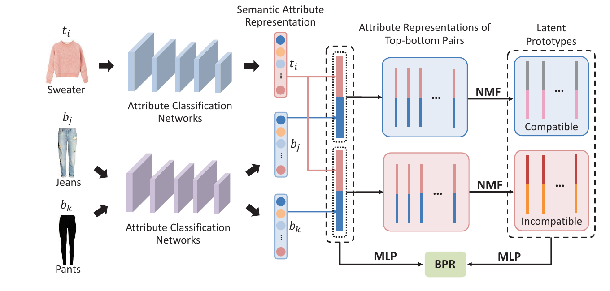

# Top-bottom matching: two-tower inner-product scoring on attribute vectors whose every dimension is readable, NMF prototypes of good and bad matches as an auxiliary task, and for a mismatch, swap the attribute that differs most from the nearest good prototype

> [中文版](sdu-paicm.md)

### Paper: Prototype-guided Attribute-wise Interpretable Scheme for Clothing Matching (SIGIR 2019)
### Link: https://doi.org/10.1145/3331184.3331245
### Institution: Shandong University, Shandong Computer Science Center (National Supercomputer Center in Jinan)
### Ideas: frozen attribute classifiers as interpretable features, separate top/bottom MLPs with inner-product scoring, BPR, non-negative matrix factorization, compatible/incompatible prototypes, prototype-level BPR, attribute-wise discordance localization, attribute replacement and retrieval
### Area: i2i (complementary recommendation, outfit matching, explainable recommendation)

## Breakdown:
Given a top and a bottom, decide whether they go together; if not, point out which attribute clashes (e.g., the color of the bottom) and suggest a replacement item that differs only in that attribute. The paper first turns each item into an attribute-probability vector with frozen attribute classifiers (each dimension is the probability of an attribute value such as "is jeans" or "is black"). The top and the bottom each pass through their own MLP, and the inner product of the outputs is the compatibility score. In parallel, non-negative matrix factorization (NMF) learns a set of "attribute-combination templates" (prototypes) from compatible pairs and another from incompatible pairs, and the model is required to score compatible prototypes above incompatible ones. At inference, scoring uses only the MLP inner product; an incompatible pair is compared attribute by attribute with its nearest compatible prototype, the attribute that differs most is replaced with the prototype's value, and the closest real item is retrieved.

Most existing matching models learn item vectors with deep networks whose dimensions have no explicit meaning, so they can answer "do these match" but not "what doesn't match" or "what to swap in". Attribute-level approaches used only a handful of attributes (such as color and texture), so their explanations are incomplete.

### Method
First compute each item's attribute representation offline ((1)), then use it as input to jointly train the scoring network and the prototypes ((2)).

#### (1) Attribute representation of items
Each item is represented as one attribute vector built from three parts: visual-attribute probabilities, category and dominant color. Each dimension corresponds to a readable attribute value. In the code it has 362 dimensions (303 + 35 + 24; category and color each get one extra dimension that is always 0, because the last line of each label file lacks a newline), precomputed, stored on disk and not updated during training.
* **Visual attributes.** On DeepFashion, which has attribute labels (34k items, 18 attributes with 303 attribute values in total, such as trouser type, sleeve length, style, fabric), a separate classification network is trained for each attribute (5 conv layers plus 3 fully connected layers, AlexNet-like). The average AUC, weighted by the number of attribute values, is about 0.79 to 0.83. Each network is a single-choice multi-class classifier (sleeve length, for example, takes exactly one of long, short and so on) that outputs a probability distribution over that attribute's values; the 18 distributions concatenated give 303 dimensions. The networks are then frozen and output these 303 probabilities for every item image in the matching dataset. In the code, the 18 classification networks are replaced by a single network (ResNet-101 plus label graph convolution) that outputs all 303 raw scores at once; at feature-extraction time they are grouped by the 18 attributes and a softmax is applied within each group, so the output has the same form as in the paper.
* **Category.** The item's structured category, a single discrete value, one-hot encoded directly; the data has 34 categories.
* **Color.** DeepFashion has no color labels, so color doesn't come from a classifier; instead a color histogram of the image is computed in HSV space and the dominant color, a single discrete value, is one-hot encoded. In the code, the white background is removed first, each remaining pixel is mapped by its HSV value to a named color (black, white, gray, maroon, camel and so on), and the most frequent one is taken; the data has 23 colors.

#### (2) Joint training: scoring network and prototypes
There is only one scoring network, and it is the only thing used at test time. The prototypes are an auxiliary task that constrains it during training through the same scoring network; at inference they are used separately to locate and replace the discordant attribute (see Inference). The two parts are trained together.
* **Main task: the scoring network, fitting real matches.**
    * **Network.** The top and the bottom each have their own MLP (no shared parameters, one fully connected layer plus sigmoid) that maps the attribute vector to a 256-dim "compatibility space" vector; this is the learned item vector. The inner product of the top vector and the bottom vector is the compatibility score, a similarity: larger means a better match.
    * **Loss (item-level BPR).** Top-bottom pairs put together by fashion experts are positives. For each positive pair, 3 bottoms never paired with that top are sampled at random as negatives, and the positive pair's inner product must exceed the negative pair's.
* **Auxiliary task: prototypes that constrain the scoring network.** A prototype is an "attribute-combination template" as long as a top-bottom pair (2 × 362 dims); its upper half can be read as a "prototype top" and its lower half as a "prototype bottom".
    * **Compatible prototypes (NMF on positive pairs).**
        * **Data matrix.** Each positive pair's top and bottom attribute vectors are stacked into one column (724 dims), and all positive pairs form a 724 × N matrix (N is the number of positive pairs). The attribute vectors are precomputed, so this matrix doesn't change during training.
        * **Factorization.** NMF approximates the matrix as "prototype matrix (724 × K) × coefficient matrix (K × N)", where K is the number of prototypes and both matrices are non-negative. Each column of the prototype matrix is a compatible prototype; each column of the coefficient matrix is one pair's weights over the K prototypes. In other words, every real pair is approximated as a non-negative weighted sum of the K prototypes, say 0.7 of "black-and-white college style" plus 0.3 of "office style".
            * **How it is solved.** NMF isn't run beforehand: both matrices are learnable parameters, randomly initialized, the reconstruction error goes into the total loss and is trained together with the scoring network, and the prototypes are also pulled by the prototype-level BPR below. After training, for example, one compatible prototype shown by the authors is made up mainly of white, black, college style and bow.
    * **Incompatible prototypes.** The same NMF is run on negative pairs (a top plus a random bottom) to obtain a set of incompatible prototypes.
    * **Loss (prototype-level BPR).** For each training triplet (top, positive bottom, negative bottom), find the compatible prototype closest to the positive pair and the incompatible prototype closest to the negative pair, by Euclidean distance, so each of the two pairs gets a typical representative. The representative stands for the whole pair, not just the bottom: each prototype's own upper and lower halves go through the top and bottom MLPs and their inner product is the prototype's own compatibility score, with the real top not involved; the compatible prototype must score above the incompatible one. Gradients update both the MLPs and these two prototypes.

**Loss.** Item-level BPR plus prototype-level BPR (weight μ) plus the reconstruction errors of the two NMFs (weight ν), with an L2 regularizer in the paper. Both NMFs are solved by gradient descent, with negative entries of the prototype and coefficient matrices clipped to 0 at every step. The paper trains with SGD for 200 epochs and grid-searches μ and ν; the code uses Adam for 30 epochs, μ=1, ν=0.1, 60 prototypes of each kind, and no L2 regularizer.

**Why NMF.** Under the non-negativity constraint, each prototype can only be built by adding attribute values, with no positive and negative parts cancelling out, so a prototype vector can be read directly as a set of attributes; this is what later allows the attribute-by-attribute comparison.

**Why prototype-level BPR.** The authors argue that matching items follow a few harmonious attribute combinations and mismatched ones share common bad combinations; making the scoring network also separate these two kinds of typical combinations acts as a regularizer, and the prototypes and the scoring network reinforce each other.

### Inference
* **Scoring.** Only the MLP inner product is used; prototypes play no part (the paper's retrieval experiment ranks by the inner product of item vectors, and the code's test only computes that term). The paper's retrieval experiment ranks only randomly sampled candidates and doesn't do full-catalog retrieval. Working from the formula (the paper doesn't do this), plain ANN works: tops and bottoms are encoded separately, so the 256-dim vectors of all bottoms can be precomputed into an inner-product index and queried with the top vector by maximum inner product search. The vectors aren't normalized, so an inner-product index is needed rather than cosine search.
* **Locating the discordant attribute.** For a pair judged incompatible, find the nearest compatible prototype. Split both the pair and the prototype into segments by attribute (one segment per attribute of the top, one per attribute of the bottom), compute the Euclidean distance of each segment divided by that attribute's number of values, and the segment with the largest distance is the most discordant attribute. The paper doesn't give the score threshold for judging a pair incompatible.
* **Replacement.** Replace that segment with the corresponding segment of the prototype to get a top or bottom vector with one attribute changed, then retrieve the closest real top or bottom in the training set by Euclidean distance as the suggested replacement. Only one of the two items is replaced; the other stays.

**Differences between code and paper.** The official code contains only feature extraction and training/scoring, not the locating and replacement step. Also, the data is split 8:1:1 into train, validation and test (the paper uses 8:2, with validation temporarily split from training), and the NMF data matrices are taken directly from the training triplets, so each positive pair appears 3 times, once per negative.

### Data and results
FashionVC (20,726 outfits put together by fashion experts, 14,871 tops and 13,663 bottoms, each with an image, category and title). Positive pairs are split 8:2; each positive pair gets 3 random negative bottoms, and the metric is AUC. Offline experiments only, plus a small user study.
* **Scoring.** AUC 0.7130, versus the strongest baseline ExIBR (image plus category features projected and scored by distance) at 0.6366, BPR-DAE (image-text autoencoder plus BPR) at 0.6026, and Bi-LSTM at 0.5502; all methods use image plus category. AUC is roughly stable for 40 to 90 prototypes, with 70 best.
* **Replacement.** Judged by PAICM's own score, with 60 compatible prototypes 85.01% of incompatible pairs score higher after replacement; using K-means cluster centers as prototypes instead of NMF is lower at every prototype count. 20 fashion enthusiasts made a two-way choice on 11 pairs, and on average 79.32% picked the replaced pair (lowest single pair 53.85%).
* **Retrieval.** Each test top is paired with 10 to 100 random bottoms (only 1 correct) and ranked by MRR. On tops seen in training, with 10 candidates PAICM is about 0.45 versus about 0.40 for ExIBR. Of the 1,954 test tops, 64.59% never appear in training; on these it is about 0.42 versus 0.39, and beyond 50 candidates the two are essentially level (numbers read from the figure).

The code is open source.

## Takeaways
* Using frozen attribute-classifier probabilities as the item representation makes every dimension readable, which is what enables attribute-level explanation and editing.
* NMF prototypes over concatenated top-bottom attribute vectors give readable "attribute-combination templates" that double as a ranking regularizer and as references for locating the clashing attribute.
* Replace-one-attribute-then-retrieve is a simple recipe for turning a "don't match" verdict into a concrete swap suggestion.

## Caveats
* There is no ablation that removes the prototype-level BPR or the NMF loss, so how much the prototypes contribute to the 0.7130 AUC is not shown; the prototype-count curve only spans 10 to 100 prototypes, with AUC between about 0.68 and 0.72.
* The 85.01% replacement success rate is judged by PAICM's own scoring network, so it measures consistency with the model rather than an independent judgment; the user study covers 11 pairs and 20 people.
* Retrieval is evaluated on 10 to 100 random candidates per top rather than the full catalog, and on tops unseen in training the lead over ExIBR largely disappears beyond 50 candidates.
* The official code differs from the paper (a single ResNet-101 attribute classifier instead of per-attribute networks, Adam for 30 epochs instead of SGD for 200, an 8:1:1 split) and doesn't include the attribute locating and replacement step.

## Credibility: offline

## Recommendation level: worth a look if you have time
