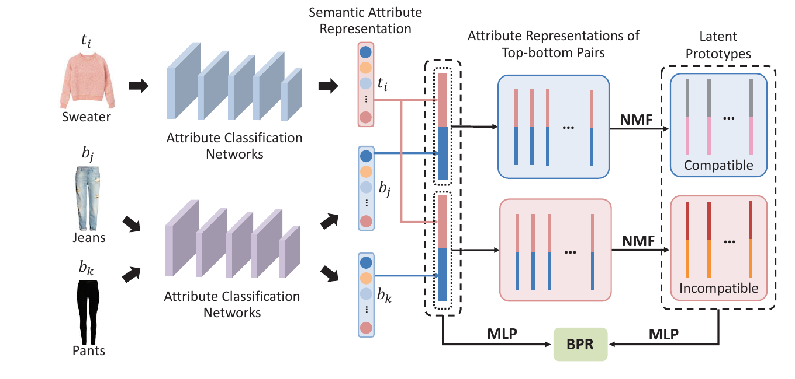

# 穿搭搭配：属性概率当特征，NMF 学出兼容/不兼容原型来约束打分，再对照最近的兼容原型找出并替换不协调的属性

关注我，每天为你精挑细选最优质、最新鲜的推荐算法paper，陪你一起保持进步、不断精进！

> [English version](sdu-paicm.full.en.md)

### 论文：Prototype-guided Attribute-wise Interpretable Scheme for Clothing Matching
### 网址：https://doi.org/10.1145/3331184.3331245
### 公司：山东大学、山东省计算中心（国家超级计算济南中心）
### 思想：
### 方向：i2i（互补推荐、穿搭搭配、可解释推荐）

## 解读：
给定一件上衣和一条下装，判断两者搭不搭；不搭时指出是哪个属性不协调（比如下装的颜色），并换一件只改了这个属性的单品。本文先用冻结的属性分类器把每件单品变成属性概率向量（每一维是「是牛仔裤」「是黑色」这类属性值的概率），上衣、下装各过一个 MLP 后做内积打分；同时用非负矩阵分解（NMF）从搭配对和不搭配对里各学出一组「属性组合模板」（原型），要求兼容原型的分数高于不兼容原型。推理时只用 MLP 内积打分；不搭的那对去和最相近的兼容原型逐个属性比，差得最大的属性换成原型里的取值，再找最接近的真实单品。

已有的搭配模型大多用深度网络学单品向量，向量的每一维没有明确含义，只能回答「搭不搭」，回答不了「哪里不搭」「换成什么」。按属性建模的做法只用了少数几个属性（如颜色、纹理），解释不全面。

### 方法
先把单品变成属性概率向量（（1）），再在这个向量上联合训练打分网络和原型（（2））。

#### （1）属性特征
* **视觉属性。** 在带属性标注的 DeepFashion 上（3.4 万件单品，18 个属性共 303 个属性值，如裤型、袖长、风格、面料）给每个属性单独训练一个分类网络（5 层卷积加 3 层全连接，类似 AlexNet），按属性值数量加权的平均 AUC 约 0.79 到 0.83。训好后冻结，对搭配数据集里每件单品的图片输出各属性值的概率。
* **类目和颜色。** 结构化类目直接编成 one-hot；DeepFashion 没有颜色标注，就在 HSV 空间统计颜色直方图，取主色编成 one-hot。
* **拼接。** 三部分拼成一个向量，每一维都对应一个能读懂的属性值。商品标题、描述这类文本不用，作者认为卖家写的文本噪声大。

按代码，属性分类器换成了一个 ResNet-101 加标签图卷积的多标签分类器，一次输出全部 303 个属性值，每个属性内部做 softmax；加上类目和颜色共 362 维，事先算好存盘，训练时不更新。

#### （2）联合训练：打分网络和原型
三部分一起训练，原型通过同一个打分网络和单品打分绑在一起。
* **打分网络。** 上衣、下装各用一个 MLP（参数不共享，1 层 256 维隐层，sigmoid 激活）把属性向量映射到一个「搭配空间」，两个输出做内积，得到兼容分。
* **单品级 BPR。** 时尚达人搭好的上衣-下装对是正样本；每个正样本对随机抽 3 条没和这件上衣搭过的下装当负样本，要求正样本对的内积高于负样本对，另加 L2 正则。
* **兼容原型。** 把每个正样本对的上衣、下装属性向量上下拼起来当一列，排成一个大矩阵，用 NMF 分解成「原型矩阵 × 系数矩阵」，两者都非负。原型矩阵的每一列是一个兼容原型，上半段可看作一件「原型上衣」，下半段是「原型下装」。比如作者展示的一个兼容原型主要由白、黑、学院风、蝴蝶结这几个属性值构成。
* **不兼容原型。** 对负样本对（上衣加随机下装）同样做一次 NMF，得到一组不兼容原型。NMF 用随机梯度下降和单品模型一起训，每步更新后把负数截成 0。
* **原型级 BPR。** 对每个训练三元组（上衣、正样本下装、负样本下装），按欧氏距离找离正样本对最近的兼容原型、离负样本对最近的不兼容原型。两个原型的上下半段分别送进上衣、下装的 MLP 算内积，作为原型自身的兼容分，要求兼容原型的分高于不兼容原型。梯度同时更新 MLP 和原型。

**损失。** 单品级 BPR 加原型级 BPR（权重 μ）加两个 NMF 的重构误差（权重 ν）。论文用 SGD 训 200 轮，μ、ν 网格搜索；按代码是 Adam 训 30 轮，μ=1、ν=0.1，两种原型各 60 个。

**为什么用 NMF。** 非负约束下每个原型只能由属性值「加」出来，不会正负抵消，原型向量可以直接按属性读成一组属性组合，后面才能拿来逐个属性对照。

**为什么加原型级 BPR。** 作者认为搭配的单品遵循若干种和谐的属性组合，不搭的也有常见的不良组合；让打分网络也能区分这两类典型组合，相当于给它加了一个正则，原型和打分网络互相促进。

### 推理
* **打分。** 只用 MLP 内积，原型不参与（论文检索实验按单品向量的内积排序，代码测试时也只算这一项）。上衣和下装各自编码，下装向量可以预先算好；论文的检索实验只在随机抽的候选上排序，没做全库检索。
* **定位不协调属性。** 对判为不搭的一对，找离它最近的兼容原型。把这一对和原型都按属性切成段（上衣的每个属性一段、下装的每个属性一段），逐段算欧氏距离并除以该属性的取值个数，距离最大的那一段就是最不协调的属性。判为不搭的分数门槛论文没写。
* **替换。** 把这一段换成原型里对应的那段，得到改过一个属性的上衣或下装向量，再按欧氏距离在训练集的上衣或下装里找最接近的真实单品作为替换建议。只换上衣或下装中的一件，另一件不动。

**代码和论文的出入。** 官方代码只有特征提取和训练打分，没有定位和替换这一步。另外数据按 8:1:1 切成训练、验证、测试（论文是 8:2，验证集从训练集里临时切）；NMF 的数据矩阵直接取训练三元组，每个正样本对随它的 3 个负样本重复 3 次。

### 数据与效果
FashionVC（时尚达人搭好的 20,726 套，14,871 件上衣、13,663 件下装，每件有图片、类目和标题），正样本对按 8:2 切分；每个正样本对配 3 个随机负样本下装，指标为 AUC。只有离线实验，外加一个小规模用户调研。
* **打分。** AUC 0.7130，最强基线 ExIBR（图像加类目特征投影后按距离打分）0.6366，BPR-DAE（图文自编码器加 BPR）0.6026，Bi-LSTM 0.5502；所有方法都用图像加类目。原型个数在 40 到 90 之间 AUC 基本稳定，70 个最好。
* **替换。** 以 PAICM 自己的打分为准，60 个兼容原型时 85.01% 的不搭对替换后分数变高；把 NMF 换成 K-means 聚类中心当原型，各原型个数下都更低。20 位时尚爱好者对 11 对做二选一，平均 79.32% 选替换后的那对（单对最低 53.85%）。
* **检索。** 每件测试上衣配 10 到 100 条随机下装（只有 1 条是正确答案）按 MRR 排序。训练集里见过的上衣上，10 个候选时 PAICM 约 0.45，ExIBR 约 0.40；测试集 1,954 件上衣里 64.59% 没在训练中出现过，这部分上约 0.42 对 0.39，候选超过 50 个后两者基本持平（数字从图上读出）。

代码开源。

## 心得：

## 愚见

## 可信度：离线

## 推荐等级：有时间看看

**请帮忙点赞、转发，谢谢。欢迎干货投稿 \ 论文宣传\ 合作交流**

### 【铁粉】请入微信群，群内我会给出更深入的解读，还可以共同讨论技术方案、发招聘广告、内推和交友等。
* 铁粉标准：关注公众号一个月以上，且在公众号上累计15次互动（评论、爱心、转发）、或投稿1次，只欢迎技术同学。
* 入群方法：请您加个人微信lmxhappy，我拉您入群，请备注【公司】（只我个人看，不公开）。

## 推荐您继续阅读：
