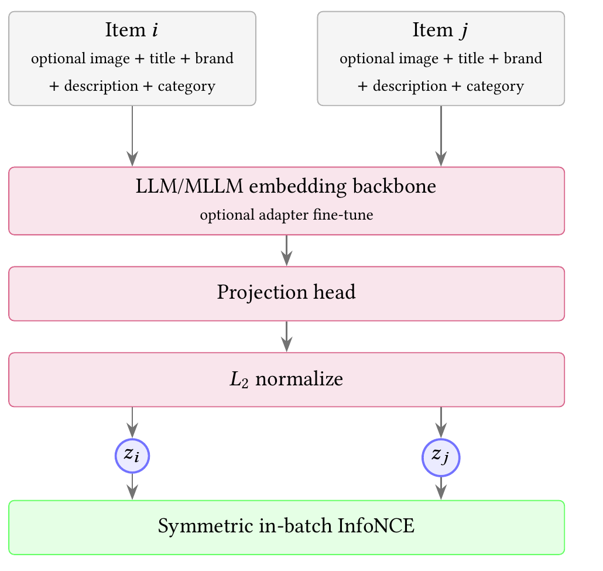

# Snap ads I2I retrieval: one multimodal LLM embedding replaces two encoders, CVR +1.9%

> [中文版](snap-camie.md)

### Paper: CAMIE: Co-Engagement-Aware Multimodal Item Embeddings for Snap Dynamic Product Ads Retrieval (under review, KDD'27 ADS Track)
### Link: https://arxiv.org/abs/2608.30255
### Company: Snap
### Idea: multimodal LLM embeddings, co-engagement contrastive learning, unifying modalities
### Area: i2i (retrieval for dynamic product ads: given a seed item, retrieve related items)

## Overview:
In Snap's Dynamic Product Ads (DPA: advertisers upload a product catalog and the system picks products to show as ads based on user behavior), I2I retrieval used to run several encoders: one multimodal, one text-only, one image-only, each with its own fine-tune, refresh pipeline and ANN index, and all supervised by item content. This paper takes item pairs that the same user engaged with along their journey and LoRA-fine-tunes Qwen3-VL-Embedding 2B on them; one model replaces the multimodal and the text-only encoders. The most valuable part of the paper is a set of controlled comparisons: supervision matters more than the backbone, data volume matters more than data purity, and one model can serve both multimodal and text-only retrieval.

### Data side: mining co-engagement pairs
**Positives.** Pairs come from 30 days of DPA user journeys: two items the same user viewed, clicked, added to cart or purchased form one positive pair, regardless of order. Each user's journey is first deduplicated by item, and at most 2 pairs are sampled per user.

**Time-decay weight.** The further apart the two engagements, the less reliable the pair: a weight between 0 and 1 with a 7-day half-life is computed and used to weight the sample in the loss.

**Filtering.** Only pairs that pass all of these are kept: exact-match attribution, non-empty title and image, same advertiser, weight at least 0.5 (i.e. the two engagements are at most 7 days apart), and the same top-level category. Offline experiments train on 10M pairs; the deployed version trains on 100M.

**Negatives.** There is no dedicated negative sampling: only the other items in the batch, gathered across GPUs into one large batch.

### Model side

#### Input: one record per modality
Each item is rendered into one input: the image plus a text template "Title: title Brand: brand Description: description Category: category". For text-only serving the image is dropped; for image-only serving the text is dropped; the model itself does not change. The image goes through the model's native visual input, with no separate vision tower or fusion module.

#### Encoder
The backbone is Qwen3-VL-Embedding 2B, frozen, with LoRA (r=32) only on the attention q, k, v and o projections. The hidden state of the last token goes through an MLP projection head, then L2 normalization; offline it is 512-dimensional.

#### Loss
Symmetric InfoNCE: each pair in the batch is a positive, and all other items in the batch are negatives. It is computed in both directions, finding j from i and i from j, and weighted by the time-decay weight. The temperature is learnable, initialized at 0.07. Training runs for 1 epoch.

### Controlled comparisons
**Images only help after fine-tuning.** The pretrained Qwen3-VL actually does better with text alone than with image plus text. After fine-tuning on co-engagement pairs this flips: image plus text beats text alone, multimodal Recall@10 rises 37.7% relative to the pretrained model, and it beats the Gemini Embedding 2 API by about 6% (512 dimensions vs. 3072).

**Supervision matters more than the backbone.** With the same data and the same training recipe, swapping the backbone for SigLIP2 or CLIP lowers multimodal Recall@10 by only 4–5pp relative to Qwen3-VL. SigLIP2 and CLIP also saturate at about 40% of the epoch, while Qwen3-VL keeps improving.

**Data volume matters more than purity.** Keeping only high-intent actions such as purchases and add-to-carts leaves 1/3 of the data. At equal data size, the high-intent data is only 1.6% better; but the full data with all actions beats high-intent-only by 7.2%.

**One model for two modalities.** The same model fed text alone is only 1.1pp behind a dedicated text-only model, so it can replace it directly. Image-only is the exception: image alone loses about a third relative to image plus text, and a dedicated SigLIP2 is far better on image-only retrieval (87.3% vs. 68.8%), so image-only retrieval keeps its dedicated vision encoder.

### Online deployment
At each catalog refresh, every active item is rendered for the matching modality, encoded once and written to the ANN index. At request time, if the seed item already has an embedding it is looked up, otherwise it is encoded on the fly, and a single ANN query returns the top-K. Online serving uses only the first 128 dimensions, matching the size of the existing index.

### A/B results
It replaces the existing multimodal I2I and text-only I2I paths with all other components unchanged, and has been fully launched. On overall DPA traffic: CVR +1.911%, CTR +0.211% (not significant). Per path: against the old multimodal I2I, CVR +10.832%, CTR +0.390% (not significant); against the old text-only I2I, CTR +18.958%, CVR +13.12%.

## Takeaways:
* For I2I embeddings, switching the supervision from item content to co-engagement pays off more than switching the backbone.
* The practical value of a multimodal LLM embedding is one model serving both multimodal and text-only retrieval, with one less model and index to maintain; image-only retrieval is still better served by a dedicated vision encoder.
* When mining co-engagement pairs, don't rush to keep only high-intent actions; the data you throw away is worth more than the purity you gain.

## My take
* The online evidence for "supervision matters more than the backbone" is not clean: the old multimodal I2I was a SigLIP2 trained on content labels, so the launch changed supervision and backbone at the same time, and there is no online arm with "SigLIP2 + co-engagement pairs". Offline, switching to Gemma 4 E2B costs nearly 30pp, so the backbone is far from irrelevant.
* All offline metrics are relative percentages, and the candidate pool is only the items that appear in the test pairs, far smaller than the real catalog. The test set itself is built from co-engagement pairs, which naturally favors models trained on that signal.
* The abstract lists the two non-significant CTR numbers alongside the significant ones. A/B duration and traffic are not given, and neither is the cost of truncating to 128 dimensions.
* The method itself is standard: no hard negatives, no popularity correction, and cold start is not evaluated.

## Credibility: production

## Recommendation level: practical value
