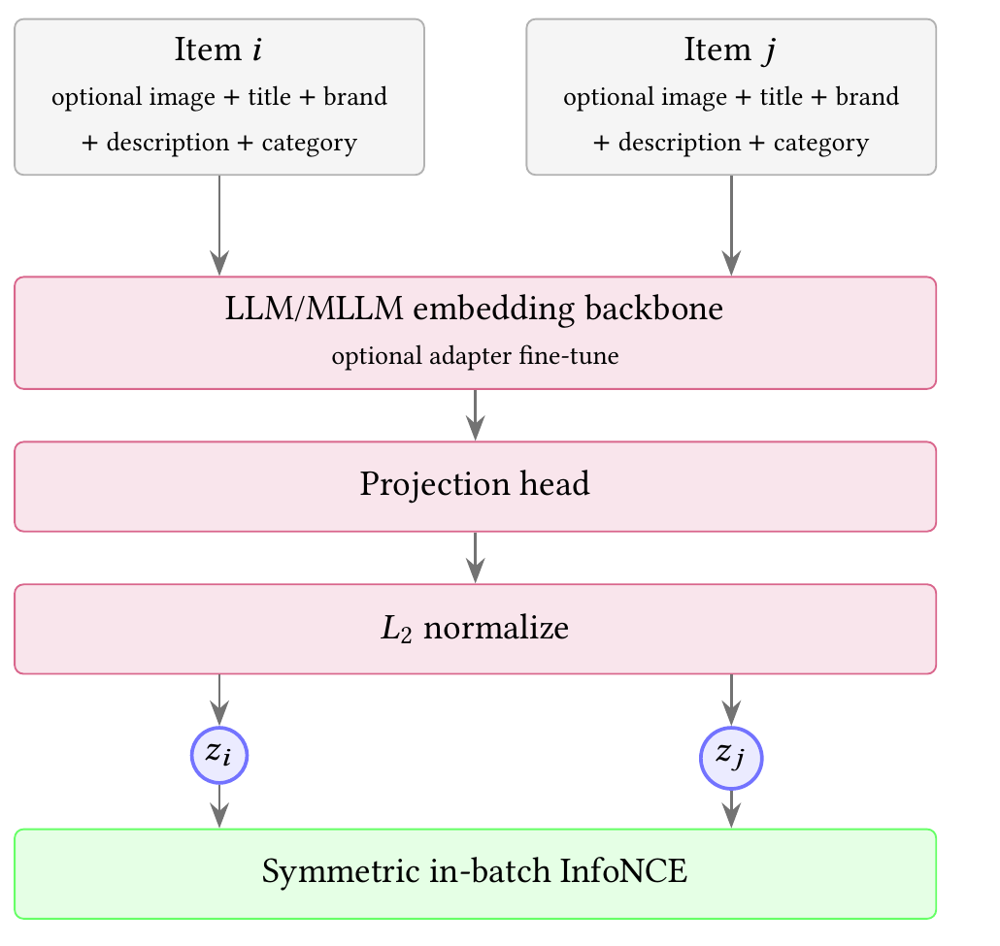

# Snap 广告 I2I 召回，一个多模态大模型 embedding 替换两套编码器，CVR+1.9%

关注我，每天为你精挑细选最优质、最新鲜的推荐算法paper，陪你一起保持进步、不断精进！

> [English version](snap-camie.full.en.md)

### 论文：CAMIE: Co-Engagement-Aware Multimodal Item Embeddings for Snap Dynamic Product Ads Retrieval（KDD'27 ADS Track 在审）
### 网址：https://arxiv.org/abs/2608.30255
### 公司：Snap
### 思想：多模态大模型 embedding、共同互动对比学习、多模态统一
### 方向：i2i

## 解读：
Snap 的动态商品广告（DPA，广告主上传商品目录，系统按用户行为自动挑商品出广告）里，I2I 召回原来有好几套编码器：多模态一套、纯文本一套、纯图片一套，各自微调、各自刷新、各自建 ANN 索引，而且都是用商品内容做监督。
本文用同一用户行为路径里共同互动过的商品对，对 Qwen3-VL-Embedding 2B 做 LoRA 微调，一个模型替换了多模态和纯文本两套编码器。论文最有价值的是几组对照实验：监督信号比模型骨干重要、数据量比数据纯度重要、一个模型能同时服务图文和纯文本。

### 数据侧：挖共同互动对
**正样本。** 从 30 天的 DPA 用户行为路径里取商品对：同一个用户先后浏览、点击、加购或购买过的两个商品，就是一对正样本，不分先后。每个用户的路径先按商品去重，最多采 2 对。

**时间衰减权重。** 两次互动隔得越久，这对样本越不可信：按 7 天半衰期算一个 0 到 1 的权重，在损失里给样本加权。

**过滤。** 只保留：归因精确匹配、标题和图片都不为空、同一个广告主、权重不低于 0.5（即两次互动相隔不超过 7 天）、一级类目一致的对。离线实验用 1000 万对训练，上线的版本用 1 亿对。

**负样本。** 没有专门采负样本，只用 batch 内其它商品，多卡之间汇总成一个大 batch。

### 模型侧

#### 输入：按模态拼成一条记录
每个商品渲染成一条输入：图片 + 文本模板「Title: 标题 Brand: 品牌 Description: 描述 Category: 类目」。纯文本场景去掉图片，纯图片场景去掉文本，模型本身不变。图片走模型原生的视觉输入，没有单独的视觉塔和融合模块。

#### 编码器
主干是 Qwen3-VL-Embedding 2B，冻住，只在 attention 的 q、k、v、o 投影上加 LoRA（r=32），取最后一个 token 的隐状态，过一个 MLP 投影头，再做 L2 归一化，离线用 512 维。

#### 损失
对称的 InfoNCE：batch 里每对商品互为正样本，batch 里其它商品都当负样本，从 i 找 j、从 j 找 i 两个方向各算一次，再按时间衰减权重加权。温度可学习，初始 0.07。只训 1 个 epoch。

### 几个对照结论
**微调后图片才有用。** 预训练的 Qwen3-VL 只喂文本反而比图文一起喂效果好；用共同互动对微调后反过来，图文一起比只喂文本好，多模态 Recall@10 相对预训练提升 37.7%，比 Gemini Embedding 2 的 API 还高约 6%（512 维对 3072 维）。

**监督信号比模型骨干重要。** 同样的数据、同样的训练流程，把骨干换成 SigLIP2、CLIP，多模态 Recall@10 只比 Qwen3-VL 低 4–5pp。而且 SigLIP2、CLIP 训到 40% 的 epoch 就饱和了，Qwen3-VL 一直在涨。

**数据量比纯度重要。** 只保留购买、加购这类高意向行为，数据量只剩 1/3。同样的数据量下，高意向数据只好 1.6%；但用全部行为的完整数据，比只用高意向的好 7.2%。

**一个模型服务两种模态。** 同一个模型只喂文本时，比专门训练的纯文本模型只差 1.1pp，可以直接替换。纯图片场景是例外：只喂图片时比图文一起差了约 1/3，而专门的 SigLIP2 在纯图片上远好于它（87.3% 对 68.8%），所以纯图片场景仍保留专用视觉编码器。

### 线上部署
商品目录每次刷新时，所有在投商品按对应模态渲染、编码一次，写进 ANN 索引。请求来时，种子商品已有 embedding 就直接查，没有就现场编码，然后一次 ANN 取 top-K。线上只用前 128 维，和原索引大小一致。

### A/B效果
替换原来的多模态 I2I 和纯文本 I2I 两路，其它模块不变，已全量上线。整体 DPA 流量：CVR +1.911%，CTR +0.211%（不显著）。分路看：相对原多模态 I2I，CVR +10.832%，CTR +0.390%（不显著）；相对原纯文本 I2I，CTR +18.958%，CVR +13.12%。

## 心得：
* I2I 的 embedding，把监督信号从商品内容换成共同互动，收益比换模型骨干大。
* 多模态大模型 embedding 的实际价值是一套模型服务图文和纯文本两种召回，少维护一套模型和索引；纯图片场景还是专用视觉编码器更好。
* 挖共同互动对时别急着只留高意向行为，丢掉的数据量比换来的纯度更值钱。

## 愚见
* 「监督比骨干重要」的线上证据不干净：原多模态 I2I 是用内容标签训练的 SigLIP2，上线时监督和骨干一起换了，缺一组「SigLIP2 + 共同互动对」的线上对照；离线换成 Gemma 4 E2B 还差了近 30pp，骨干并非不重要。
* 离线指标全是相对百分比，候选池只是测试对里出现过的商品，远小于真实商品库；测试集本身由共同互动对构成，天然偏向用这个信号训练的模型。
* 两个不显著的 CTR 数字在摘要里和显著的数字并列；A/B 的时长和流量没给，截到 128 维损失多少也没说。
* 方法本身是标准做法：没有难负样本、没有流行度纠偏，冷启动也没评估。

## 可信度：生产

## 推荐等级：有实践价值

**请帮忙点赞、转发，谢谢。欢迎干货投稿 \ 论文宣传\ 合作交流**

### 【铁粉】请入微信群，群内我会给出更深入的解读，还可以共同讨论技术方案、发招聘广告、内推和交友等。
* 铁粉标准：关注公众号一个月以上，且在公众号上累计15次互动（评论、爱心、转发）、或投稿1次，只欢迎技术同学。
* 入群方法：请您加个人微信lmxhappy，我拉您入群，请备注【公司】（只我个人看，不公开）。

## 推荐您继续阅读：
