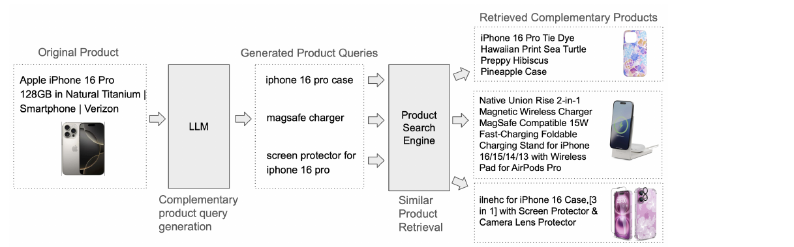

# Snap, complementary product ads: have an LLM write search queries for "what goes with this", then retrieve

> [中文版](snap-llm-complementary-query.md)

### Paper: Leveraging Large Language Models for Complementary Product Ads Recommendation (CIKM'25 short paper)
### Link: https://doi.org/10.1145/3746252.3760940
### Company: Snap
### Idea: generate-then-retrieve, in-context learning (ICL), LoRA fine-tuning
### Area: i2i (complementary product recommendation)

## Overview:
Dynamic product advertising (DPA) works like this: after a user views or buys a product (the trigger) on an advertiser's site, the platform shows them ads for related products. Today those are mostly similar products. Someone who just bought an iPhone is unlikely to buy another phone; a case or a screen protector is far more likely to convert.

Complements are hard for two reasons. First, an ad platform only knows which product the user viewed or bought, not the full shopping journey: users interact with ads for scattered products the platform chose to show, which don't add up to a shopping session, so it can't mine "bought together" from large numbers of orders the way an e-commerce site can. Second, complementarity needs product knowledge that isn't in the product description. The authors reproduced the BERT classifier from the ESCI paper (taking a query and product text as input and classifying them as exact, substitute, complement or irrelevant), which reaches F1 0.77 on the substitute class but only 0.04 on the complement class.

The paper's approach has two steps. First, an LLM reads the trigger's title and writes a few search queries describing its complements, e.g. iPhone 16 Pro → "iphone 16 pro case", "magsafe charger". Then those queries are run against a product index, and what comes back is the complementary recommendation. The paper focuses on evaluating the first step. Experiments use only a public dataset, not Snap's own data, and there is no online experiment.

### Data side: reversing ESCI into "product → complementary query"
Amazon ESCI is a search dataset where each (query, product) pair is labeled with one of four relations: exact, substitute, complement, irrelevant. The authors flip the English pairs labeled "complement": if the query is "iphone 15 case" and the product is an iPhone 15, then "iphone 15 case" is a complementary query for the iPhone 15.

- **Training set:** 27,531 pairs. When a product has several complementary queries, one is kept at random, since only 4.6% of products have more than one.
- **Test set:** 1,000 pairs sampled at random.
- **Product index:** all English products, 1.2M in total.
- **Complements used for evaluation:** for each test product, the products labeled "exact" for its complementary query count as its complements, 10.4 per product on average.

### Model side
#### (1) Generating queries
**The prompt has five parts:** task description; generation guidelines (what makes a good complementary query, e.g. matching brand, material, style, gender and age); demonstrations (product title + complementary query); output format (JSON); and a "domain-specific context" block used only in the third setting.

**Three in-context learning (ICL) settings:** In-context learning means writing examples directly into the prompt (a number of "product title → complementary query" pairs) and letting the LLM follow their pattern to answer for a new product, without updating the model's parameters. The three settings differ in how many examples there are and whether they're labeled.
- Few-shot: 5 hand-picked demonstrations covering different categories.
- Many-shot: 1,000 random demonstrations.
- Unsupervised ICL: 5 demonstrations plus a batch of product titles without queries. The authors' explanation is that these titles help the LLM locate the relevant knowledge it picked up in pre-training.

**Fine-tuning:** LoRA on Vertex AI for Gemini 2.0 Flash and Flash-Lite, each model trained once on 1,000 pairs (the same as the many-shot demonstrations) and once on all 27,531. Three input formats were compared: title only, title preceded by the task description, and the same plus the generation guidelines.

#### (2) Retrieval
The generated queries are run through BM25 and through vector search with Google's text-embedding-005, taking the top 100, and the results are checked against the complements defined above (hit@100, recall@100). With 5 queries per product, the paper doesn't say whether each query takes 100 and the results are merged, or 100 are taken in total.

### Results (offline only)
**With 5 queries per product**, many-shot generally beats few-shot, larger models beat smaller ones, and Gemini beats GPT. The best is gemini-1.5-pro many-shot, with vector-search hit@100 of 0.683 vs. 0.612 for few-shot; gpt-4.1 many-shot gets 0.675 and gpt-4.1-nano only 0.438.

**Unsupervised ICL:** adding 50 unlabeled product titles to the 5 demonstrations raises vector-search hit@100 from 0.612 to 0.620; going up to 1,000 actually dips slightly to 0.606. The exact-match rate improves more clearly, from 1.1% to 3.1%.

**ICL vs. fine-tuning (1 query per product):** for the same Gemini 2.0 Flash, fine-tuning on 27K pairs gives vector-search hit@100 of 0.505 vs. 0.462 for many-shot ICL. gemini-1.5-pro with many-shot ICL gets 0.508, about the same as the fine-tuned model. On exact-match rate (generated query identical to the label), ICL is higher: 3.0% for many-shot ICL vs. 2.4% after fine-tuning. Fine-tuning needs the task description in the input: with the title alone, BM25 hit@100 is only 0.271; adding the task description brings it to 0.486, and adding the guidelines as well drops it to 0.448.

## Takeaways:
* Complementary recommendation can be split into "an LLM decides what goes with it" and "ordinary search". The first step relies on the LLM's product knowledge and needs no behavior data; the second reuses an existing retrieval system.
* Putting 1,000 examples straight into the prompt comes close to fine-tuning on 27K, at a much lower labeling cost; the price is a long prompt and more expensive inference.
* When examples are scarce, adding a batch of unlabeled in-domain product titles is a nearly free supplement.

## My take
* The contributions say "a pre-trained Gemini-Flash model ... leading to 9.3% higher hit@100" than the same model fine-tuned on 27K examples, but in Table 3 the 9.3% goes the other way: the fine-tuned model's 0.505 is 9.3% higher than many-shot ICL's 0.462. On BM25 retrieval the fine-tuned model is also higher (0.486 vs. 0.459). "ICL beats fine-tuning" holds only on exact-match rate; on retrieval metrics ICL only ties when the larger gemini-1.5-pro is used.
* In Table 2, the "5 demonstrations, 0 unlabeled titles" row has an exact-match rate of 1.1%, while the same setting in Table 1 shows 2.6%. The text's "182% improvement in exact match rate" is computed from 1.1%; from 2.6% it would be about 19%.
* Each test product keeps only one complementary query, so it corresponds to only one type of complement. With 5 generated queries, a hit depends on guessing the one type the annotators used; other reasonable accessories count as misses. The paper doesn't say how the retrieval results of 5 queries are merged into a top 100.
* The motivation is Snap's ads setting, but all experiments are on Amazon ESCI, with no ads data and no online experiment.

## Credibility: offline

## Recommendation level: worth a look if you have time
