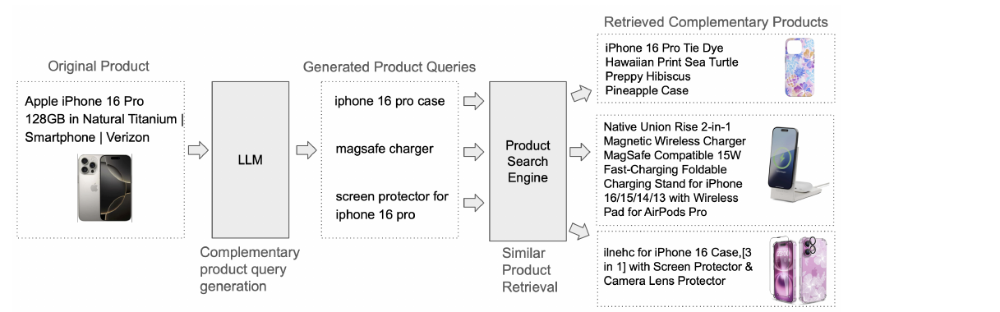

# Snap 广告互补品推荐：让 LLM 写出「该配什么」的搜索词，再去检索

关注我，每天为你精挑细选最优质、最新鲜的推荐算法paper，陪你一起保持进步、不断精进！

> [English version](snap-llm-complementary-query.full.en.md)

### 论文：Leveraging Large Language Models for Complementary Product Ads Recommendation
### 网址：https://doi.org/10.1145/3746252.3760940
### 公司：Snap
### 思想：先生成再检索、上下文学习（ICL）、LoRA 微调
### 方向：i2i（互补品推荐）

## 解读：
动态商品广告（DPA）的做法是：用户在广告主网站上看过或买过某件商品（trigger），平台就给他投相关商品的广告。现在投的基本是相似品，买了 iPhone 再推一台手机，用户多半不会买；手机壳、贴膜这类互补品更可能转化。

互补品难做有两个原因。一是广告平台只能知道用户看过或买过哪件商品，拿不到完整的购物过程：用户和广告的交互，是和平台挑出来投放的零散商品发生的，凑不成一次完整的购物，所以没法像电商那样从大量订单里挖「一起买」。二是互补关系需要商品知识，光看两件商品的文本判断不出来：作者复现了一个 BERT 分类器，判断相似品 F1 有 0.77，判断互补品只有 0.04。

本文的做法分两步：先让 LLM 根据 trigger 的标题，写出几条描述互补品的搜索词，比如 iPhone 16 Pro → 「iphone 16 pro case」「magsafe charger」；再拿这些搜索词去商品库里检索，检索到的就是互补品。论文重点评估第一步。实验只用公开数据集，没有 Snap 自己的数据，也没有线上实验。

### 数据侧：从 ESCI 反推「商品 → 互补搜索词」
Amazon ESCI 是一个搜索数据集，每个（搜索词，商品）对标了四类关系之一：完全匹配、替代、互补、不相关。作者把其中标为「互补」的英文对反过来用：比如搜索词是「iphone 15 case」，商品是 iPhone 15，那么「iphone 15 case」就是 iPhone 15 的一条互补搜索词。

- **训练集：** 27,531 对。一个商品有多条互补搜索词时只随机留一条，因为只有 4.6% 的商品有多条。
- **测试集：** 随机抽 1,000 对。
- **商品库：** 所有英文商品，共 120 万。
- **评测用的互补品：** 对测试集里的每个商品，把它那条互补搜索词下标为「完全匹配」的商品当作它的互补品，平均每个商品 10.4 个。

### 模型侧
#### （1）生成搜索词
**prompt 分五部分：** 任务描述；生成要求（什么算好的互补搜索词，比如品牌、材质、风格、性别、年龄要对上）；示例（商品标题 + 互补搜索词）；输出格式（JSON）；以及只在第三种设置里才有的「领域上下文」。

**三种上下文学习（ICL）设置：**
- few-shot：5 个人工挑选、覆盖不同类目的示例。
- many-shot：随机 1,000 个示例。
- 无监督 ICL：5 个示例，再加一批不带搜索词的商品标题。作者的解释是，这些标题能帮 LLM 定位到预训练时学过的、和这个领域相关的知识。

**微调：** 在 Vertex AI 上用 LoRA 微调 Gemini 2.0 Flash 和 Flash-Lite，训练数据分别用 1,000 对和全部 27,531 对。输入格式对比了三种：只给标题、标题前加任务描述、再加上生成要求。

#### （2）检索
每个生成的搜索词分别用 BM25 和 Google 的 text-embedding-005 向量检索，各取 top-100，看召回的商品里有没有命中上面定义的互补品（hit@100、recall@100）。

### 效果（只有离线）
**每个商品生成 5 条搜索词时**，many-shot 普遍好于 few-shot，大模型好于小模型，Gemini 好于 GPT。最好的是 gemini-1.5-pro many-shot，向量检索 hit@100 为 0.683，few-shot 是 0.612；gpt-4.1 many-shot 是 0.675，gpt-4.1-nano 只有 0.438。

**无监督 ICL：** 在 5 个示例之外加 50 个不带标注的商品标题，向量检索 hit@100 从 0.612 升到 0.620；再加到 1,000 个，基本不再提升。

**ICL 对比微调（每个商品生成 1 条搜索词）：** 同一个 Gemini 2.0 Flash，用 2.7 万条微调后，向量检索 hit@100 是 0.505，many-shot ICL 是 0.462。gemini-1.5-pro many-shot ICL 是 0.508，和微调版几乎一样。完全匹配率（生成的搜索词和标注一字不差）上，ICL 更高：many-shot ICL 3.0%，微调后 2.4%。微调时输入里必须带任务描述：只给标题，BM25 hit@100 只有 0.271，加上任务描述到 0.486，再加生成要求反而降到 0.448。

## 心得：
* 互补品推荐可以拆成「LLM 判断该配什么」和「普通搜索」两步。第一步靠 LLM 的商品常识，没有行为数据也能做；第二步直接复用现成的检索系统。
* 1,000 个示例直接放进 prompt，效果就接近 2.7 万条数据微调，标注成本低得多；代价是 prompt 长，每次推理更贵。
* 示例不够时，加一批不带标注的同领域商品标题，是一个几乎零成本的补充办法。

## 愚见
* 贡献点写「Gemini-Flash 预训练模型比同一模型用 27K 条微调后，hit@100 高 9.3%」，但表 3 里 9.3% 是反过来的：微调版 0.505 比 many-shot ICL 的 0.462 高 9.3%。BM25 检索上也是微调版更高（0.486 对 0.459）。「ICL 胜过微调」只在完全匹配率上成立，检索指标上要和更大的 gemini-1.5-pro 比才持平。
* 表 2 里「5 个示例、0 个无标注标题」那一行的完全匹配率是 1.1%，表 1 里同样设置是 2.6%。正文「完全匹配率提升 182%」是按 1.1% 算的，按 2.6% 算只有约 19%。
* 每个测试商品只保留了一条互补搜索词，也就只对应一类互补品。生成 5 条搜索词时，命中与否取决于有没有猜中标注的那一类，生成了别的合理配件也算错。5 条搜索词的检索结果怎么合并成 top-100，论文没说。
* 动机是 Snap 的广告场景，但实验全在 Amazon ESCI 上，没有用广告数据，也没有线上实验。

## 可信度：离线

## 推荐等级：有时间看看

**请帮忙点赞、转发，谢谢。欢迎干货投稿 \ 论文宣传\ 合作交流**

### 【铁粉】请入微信群，群内我会给出更深入的解读，还可以共同讨论技术方案、发招聘广告、内推和交友等。
* 铁粉标准：关注公众号一个月以上，且在公众号上累计15次互动（评论、爱心、转发）、或投稿1次，只欢迎技术同学。
* 入群方法：请您加个人微信lmxhappy，我拉您入群，请备注【公司】（只我个人看，不公开）。

## 推荐您继续阅读：
