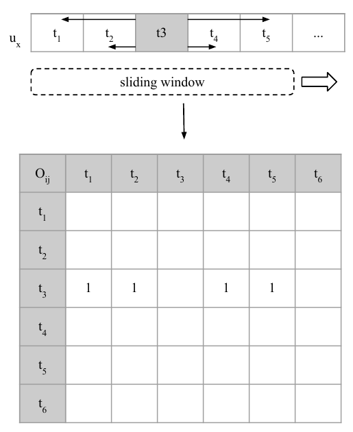

# Track-to-track music recommendation: count tracks played close together with a sliding window, learn vectors with a factorization machine, and add creator information along the way

> [中文版](soundcloud-item-item-fm.md)

### Paper: Item-Item Music Recommendations With Side Information (arXiv 2017)
### Link: https://arxiv.org/abs/1706.00218
### Institution: SoundCloud
### Ideas: user interaction model, sliding-window co-occurrence, factorization machines, negative sampling, side information, long tail
### Area: i2i (music)

## Breakdown:
Recommend tracks similar to the one currently playing, usable even for new and anonymous users. Instead of factorizing the user-track matrix directly, the paper slides a window over each user's time-ordered listening sequence to count which tracks are often played next to each other, then learns a vector per track with a factorization machine and finds similar tracks by cosine; the factorization machine also makes it easy to add side information such as the creator, helping tracks with few interactions.

The authors argue that listening has a particular pattern: tracks played within a short period are similar in style, but taste drifts over longer periods. So looking only at tracks played close together reflects similarity better than putting all of a user's tracks together.

### Method
First filter trustworthy positive interactions from the logs, then form track pairs with a sliding window, and finally learn vectors with a factorization machine.

#### (1) Filtering positive interactions
* **What counts as positive.** Adding to a playlist, sharing, liking, or fully listening to the same track more than once. A single listen might be unintentional and doesn't count.
* **Skips are not negatives.** The authors found that skips correlate strongly with positive interactions, e.g., users often skip straight to a refrain they like.
* **Filtering.** Users with fewer than 5 tracks and tracks with fewer than 5 users are removed; at most 10,000 interactions are randomly kept per track, so a few popular tracks don't dominate training.

#### (2) Forming track pairs with a sliding window
Each user's positive interactions are ordered by time; each track in turn serves as the center and is paired with every one of the 5 tracks before and after it, and the counts accumulate into a track co-occurrence matrix. Each time the center moves forward one track, the window slides forward one step. For illustration, the figure draws the window as 2 tracks on each side: if a user listened to t1 through t5 in order, centering on t3 gives the four pairs (t3, t1), (t3, t2), (t3, t4) and (t3, t5). In the experiments the window is 5 tracks on each side, so each center track yields up to 10 pairs.

Pairs from all users and all windows are first accumulated into the co-occurrence matrix, so a pair that recurs only increases its count; in training, each nonzero entry of the matrix (each distinct track pair) is one positive sample, and the number of occurrences may enter through a per-sample weight in the loss, which the paper doesn't spell out. Direction is kept separate: (t3, t1) and (t1, t3), produced when t1 is the center, are two samples.

#### (3) Learning vectors with a factorization machine
* **Input.** Each training sample is a sparse vector of three concatenated one-hot parts: the center track, the context track, and side information (in the experiments, the center track's creator). The context side carries no creator, so each creator has only one vector, appearing only when one of its tracks is the center track (as in the paper's Figure 2; the text doesn't state it).
* **Scoring.** A factorization machine treats every dimension of the input vector as a feature, and each feature has a bias (a single number) and a vector (150 dimensions, the same for all features, so any two can be dotted). Multiplying a one-hot vector by these vectors amounts to looking up one row by ID, the same principle as an embedding layer. In this sample only three dimensions equal 1, namely "center track is t3", "context track is t1" and "creator is c3" (center track, context track and creator are three fields, and t3, t1 and c3 are their values), and only they take part in scoring; the same track uses two separate parameter sets as center track and as context track. A sample's score is the sum of the three biases plus the sum of pairwise inner products of the three vectors:
  * ŷ = w_t3 + w'_t1 + w_c3 + v_t3·v'_t1 + v_t3·v_c3 + v'_t1·v_c3;
  * the main part is (v_t3 + v_c3)·v'_t1, i.e., the center track's own vector plus the creator's vector, dotted with the context track's vector; v_t3·v_c3 depends only on the center track and acts like a bias;
  * without the creator, only v_t3·v'_t1 plus two biases remains, which is the form of word2vec negative sampling.
* **Loss.** Co-occurring track pairs are positives; each positive gets 5 negatives sampled by smoothed track frequency, trained with logistic loss, the same as word2vec's negative sampling. Each track has 150 dimensions.

#### Inference
* **Each track's final vector.** The paper only says it is "the sum of all of the track's latent vectors", without the biases. It includes at least the center-side vector and the creator's vector (e.g., v_t3 + v_c3); whether the track's context-side vector is also added isn't made clear (GloVe adds the two sets together).
* **How to recommend.** Given the track currently playing, compute the cosine similarity between its final vector and those of other tracks, and take the top ones.
* **Why the biases are dropped.** During training the biases absorb popularity (popular tracks co-occur with everything), so the vectors only learn whether styles are alike; when recommending similar tracks popularity is a distraction, so only vector direction is used. GloVe in word embeddings likewise uses biases in training and discards them afterward.
* **Difference from training.** Training takes the inner product of the center side with the context track's vector plus biases; inference takes the cosine between two tracks' final vectors. Two tracks that often co-occur with the same context tracks end up with nearby center vectors, so this works.

### Data and results
SoundCloud logs with about 40M users and 1.5B interactions, split by time into training and test; the test set has 5M users and 25M interactions. The metric is mean percentile rank (MPR: how high the tracks played together in the test set rank among all tracks; lower is better). Offline only.
* **Overall.** The model using only track pairs has MPR 0.0449, vs. 0.0901 for the baseline that factorizes the user-track matrix directly; adding the creator gives 0.0422.
* **Long tail.** On tracks appearing only about 5 times in training, the three are 0.0970, 0.1680 and 0.0865; the creator helps more on tracks with few interactions.

The code is open source.

## Takeaways
* Music similarity is short-term; forming samples only from tracks played next to each other with a sliding window is more accurate than lumping a user's whole history together.
* Using a factorization machine instead of a plain inner product makes it natural to add side information such as creators or audio features, supplementing tracks with few interactions.
* Positive interactions must be defined per domain: in music, a skip is not a negative signal.

## Caveats
* The only comparison is with factorizing the user-track matrix, not with sliding-window word2vec-style methods (such as item2vec). Without side information, the model is nearly identical to word2vec with negative sampling, so the gain mainly comes from forming samples with a sliding window, not from the factorization machine.
* Tracks with fewer than 5 users are filtered out before training, so truly new tracks with no interactions are never evaluated; "side information helps cold start" is only verified on long-tail tracks with at least 5 interactions.
* The paper says a track's final vector is the sum of "all of the track's latent vectors" but doesn't make clear whether this includes its vector as a context track. The experiments also add only one kind of side information, the creator.

## Credibility: offline

## Recommendation level: worth a look if you have time
