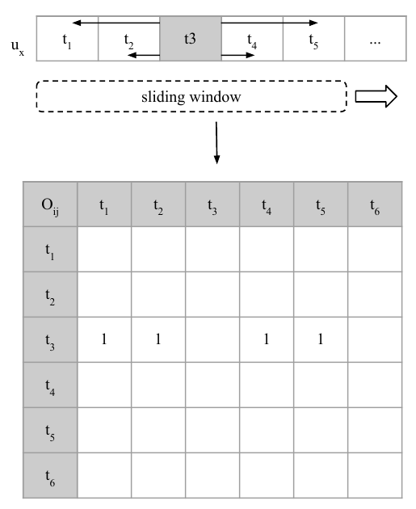

# 音乐的单曲相似推荐：滑动窗口统计前后听过的歌，用因子分解机学向量，顺带加入创作者信息

关注我，每天为你精挑细选最优质、最新鲜的推荐算法paper，陪你一起保持进步、不断精进！

> [English version](soundcloud-item-item-fm.full.en.md)

### 论文：Item-Item Music Recommendations With Side Information
### 网址：https://arxiv.org/abs/1706.00218
### 公司：SoundCloud
### 思想：
### 方向：i2i（音乐）

## 解读：
给正在播放的歌推荐相似的歌，新用户、匿名用户也能用。本文不直接分解「用户-歌曲」矩阵，而是在每个用户按时间排好的收听序列上滑动窗口，统计哪两首歌经常前后挨着听，再用因子分解机学出每首歌的向量，按余弦找相似歌；因子分解机还能顺带加入创作者这类附加信息，帮互动少的歌。

作者认为，听歌有个特点：同一段时间里听的歌风格接近，但时间拉长后口味会慢慢转变。所以只看短时间内前后听的歌，比把用户听过的所有歌放在一起更能反映相似性。

### 方法
先从日志里筛出可信的正向互动，再用滑动窗口造歌曲对，最后用因子分解机学向量。

#### （1）筛出正向互动
* **什么算正向。** 加歌单、分享、点赞，或者完整听过同一首歌两次以上。只听一次可能是挂着没注意，不算。
* **跳过不当负向。** 作者发现跳过和正向互动高度相关，比如用户经常直接跳到喜欢的副歌。
* **过滤。** 去掉互动不到 5 首的用户和不到 5 个用户互动过的歌；每首歌最多随机保留 1 万条互动，免得少数热门歌主导训练。

#### （2）滑动窗口造歌曲对
把每个用户的正向互动按时间排好，让每首歌依次当中心，和它前后各 5 首里的每一首组成一对，累加到歌曲共现矩阵里。中心每往后移一首，窗口就跟着往后滑一格。上图为了示意，把窗口画成左右各 2 首：用户依次听了 t1 到 t5，以 t3 为中心时，得到 (t3, t1)、(t3, t2)、(t3, t4)、(t3, t5) 四对。实验里窗口是左右各 5 首，每个中心歌最多配出 10 对。

所有用户、所有窗口的歌曲对先累加到共现矩阵里，同一对歌反复出现只是计数变大；训练时矩阵里每个非零项（每个不同的歌曲对）是一个正样本，出现次数可能通过损失里的样本权重体现，论文没说清。方向是分开的：(t3, t1) 和 t1 当中心时的 (t1, t3) 是两个样本。

#### （3）因子分解机学向量
* **输入。** 每个训练样本是一个稀疏向量，由三段 one-hot 拼成：一首中心歌、一首上下文歌、附加信息（实验里是中心歌的创作者）。上下文歌一侧不带创作者，所以每位创作者只有一个向量，只在它的歌当中心歌时出现（论文图 2 如此，正文没写明）。

* **打分。** 因子分解机把输入向量的每一维都当作一个特征，每个特征有一个偏置（一个数）和一个向量（150 维，所有特征相同，才能两两做内积）。one-hot 向量乘这些向量，等于按 ID 查表取出一行，和 embedding 层是同一个原理。这个样本里只有三维取值为 1，即「中心歌是 t3」「上下文歌是 t1」「创作者是 c3」（中心歌、上下文歌、创作者是三个字段，t3、t1、c3 是各自的取值），只有它们参与打分；同一首歌当中心歌和当上下文歌时用的是两套参数。样本的分数是三个偏置之和，加上三个向量两两内积之和：
  * ŷ = w_t3 + w'_t1 + w_c3 + v_t3·v'_t1 + v_t3·v_c3 + v'_t1·v_c3；
  * 主要部分是 (v_t3 + v_c3)·v'_t1，即中心歌自己的向量加上创作者的向量，再和上下文歌的向量做内积；v_t3·v_c3 只和中心歌有关，相当于偏置；
  * 没有创作者时只剩 v_t3·v'_t1 加两个偏置，就是 word2vec 负采样的形式。
  
* **损失。** 共现过的歌曲对为正样本，每个正样本按平滑后的歌曲频率采 5 个负样本，用逻辑损失训练，做法和 word2vec 的负采样一样。每首歌 150 维。

#### 推理
* **每首歌的最终向量。** 论文只说是这首歌「所有隐向量之和」，不用偏置。至少包括中心歌那一侧的向量和创作者的向量（如 v_t3 + v_c3）；是否也加上它当上下文歌时的向量，论文没说清（GloVe 的做法是两套相加）。
* **怎么推荐。** 给定正在播放的歌，和其他歌的最终向量算余弦相似度，取最高的若干首。
* **为什么丢掉偏置。** 偏置在训练时吸收的是热度（热门歌和谁都容易一起出现），让向量只学风格像不像；推相似歌时热度是干扰，所以只看向量方向。词向量里 GloVe 也是训练用偏置、用时丢掉。
* **和训练的区别。** 训练时是中心歌一侧和上下文歌向量做内积再加偏置，推理时是两首歌的最终向量之间算余弦。和同一批上下文歌都常一起出现的两首歌，中心歌向量会靠近，所以这样用说得通。

### 数据与效果
SoundCloud 的日志，约 4,000 万用户、15 亿条互动，按时间切分训练和测试，测试集有 500 万用户、2,500 万条互动。指标是平均百分位排名（MPR，测试时前后一起听过的歌在所有歌里排在多靠前，越低越好）。只有离线实验。
* **整体。** 只用歌曲对的模型 MPR 为 0.0449，直接分解用户-歌曲矩阵的基线是 0.0901；再加创作者为 0.0422。
* **长尾。** 在训练集里只出现约 5 次的歌上，三者分别是 0.0970、0.1680、0.0865，加创作者在互动少的歌上帮助更大。

代码已开源。

## 心得：

## 愚见

## 可信度：离线

## 推荐等级：有时间看看

**请帮忙点赞、转发，谢谢。欢迎干货投稿 \ 论文宣传\ 合作交流**

### 【铁粉】请入微信群，群内我会给出更深入的解读，还可以共同讨论技术方案、发招聘广告、内推和交友等。
* 铁粉标准：关注公众号一个月以上，且在公众号上累计15次互动（评论、爱心、转发）、或投稿1次，只欢迎技术同学。
* 入群方法：请您加个人微信lmxhappy，我拉您入群，请备注【公司】（只我个人看，不公开）。

## 推荐您继续阅读：
