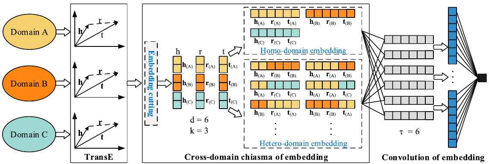

# i2i on a multi-domain knowledge graph: cut entity vectors into one segment per domain, cross-splice segments across domains, score triples with a convolution, then recommend by link prediction

> [中文版](swjtu-cdkg-ce.md)

### Paper: Cross-Domain Knowledge Graph Chiasmal Embedding for Multi-Domain Item-Item Recommendation (TKDE 2023)
### Link: https://doi.org/10.1109/TKDE.2022.3151986
### Institution: Southwest Jiaotong University, Tencent, JD iCity
### Ideas: cross-domain knowledge graph embedding, vector segmentation, cross-domain splicing, convolutional triple scoring (ConvKB-style), link-prediction recommendation
### Area: i2i (multi-domain recommendation)

## Breakdown:
Given an item, recommend related items from several domains at once, e.g., from a movie recommend similar movies, its soundtrack, and the novel it's adapted from. The paper uses only a knowledge graph, with no user behavior at all: it first learns entity and relation vectors on the combined knowledge graphs of several domains, cutting each vector into one segment per domain and splicing segments across domains, then scores (head entity, relation, tail entity) triples with a convolution; at recommendation time, the query item is taken as the head (or tail) entity, and the method checks which candidate items can form a high-scoring triple with it.

The authors argue that single-domain recommendation can't handle cross-domain cold start (e.g., recommending novels from music-listening records), while existing multi-domain recommendation mostly just extends single-domain methods without distinguishing the differences and links between domains. In a knowledge graph, entities from different domains are already linked (a movie adapted from a novel, a movie using a piece of music), which can be used to connect the domains.

### Method
Three stages: first pretrain initial vectors with TransE, then train the cross-domain knowledge graph embedding (CDKG-CE) starting from those vectors, and finally use the trained vectors and scoring function for link-prediction-style recommendation (MD-I2IR). The first two stages are trained separately, not end to end. Of the three steps from left to right in the figure, the first is pretraining and the other two are training.

#### (1) Pretraining: TransE initialization
* **How it learns.** Each entity and each relation has a 60-dimensional vector. For true triples it requires "head + relation ≈ tail", i.e., a relation is a translation from head to tail, measured by ‖head + relation − tail‖, where a smaller distance means more plausible. Negatives are made by randomly replacing the head or tail of true triples, and true triples must have a smaller distance than negatives. Trained with SGD for 3,000 epochs.
* **Once per domain.** The three domains' knowledge graphs are trained separately, each giving its own set of vectors. Every entity in the graph (not just items) and every relation gets a vector.
* **Merging.** When an entity or relation appears in several domains, its vectors are summed and divided by the number of domains k to give one vector.

The paper says this initialization converges faster and performs better than random initialization.

#### (2) Training: cross-domain knowledge graph embedding (CDKG-CE)
Training continues from the pretrained vectors: the vectors keep being updated, and convolution kernels and a weight vector are added, finally giving a vector for each entity and relation plus a triple scoring function. Trained with Adagrad for 300 epochs.
* **Cutting.** Entity and relation vectors are split by position into k equal segments (k = 3 in the experiments, 20 dimensions each), and the authors assign each segment to one domain, called the A, B and C segments.
* **Crossing.** For each triple, one segment each is picked from the head, relation and tail and spliced into a row, giving 15 rows. The authors liken this cross-splicing to chromosome crossover, hence "chiasmal" embedding. Below, three letters give the segments taken by the head, relation and tail in order; e.g., ABB means the head takes segment A and the relation and tail take segment B.
  * 3 same-domain rows. AAA, BBB, CCC.
  * 12 cross-domain rows. Only two domains cross at a time (A, B and C never appear together), and two binding rules give 6 rows each.
    * Relation goes with the tail. ABB, ACC, BAA, BCC, CAA, CBB.
    * Relation goes with the head. AAB, AAC, BBA, BBC, CCA, CCB.
* **Convolutional scoring.** These 15 rows are stacked into a matrix and convolved row by row with 256 kernels of size 1 × d; the resulting feature maps are concatenated into one long vector and dotted with a weight vector to give the triple's score, following ConvKB.
* **Loss.** Negatives are made by randomly replacing the head or tail entity of true triples; true triples must score higher than negatives, plus regularization on the weight vector.

#### Inference: link-prediction-style recommendation (MD-I2IR)
It uses the vectors and convolutional scoring function from the training stage. Every score below means cutting the three vectors into segments, cross-splicing them into the 15-row matrix, passing it through the 256 kernels, and taking the dot product with the weight vector. Given a query item, check which candidate items "should have an edge" with it:
* **Query item as head entity.** One round for each relation r the query item already has in the graph.
  * Threshold. The query item already has some triples (query item, r, e) in the graph, where e is an existing tail entity, either an item or a non-item entity. All of them are scored with the convolutional scoring function, and the highest score (not the average) becomes this relation's threshold.
  * Scoring candidates. Every item in the catalog is used as the tail entity (not filtered by domain or type; only items, not non-item entities such as directors or singers) to form (query item, r, candidate), which is scored. Each candidate's score is compared with the threshold on its own, and those above it go into the recommendation set; nothing is aggregated across candidates.
  * Example. The query item is movie X, and the graph has (X, soundtrack, song Y1) and (X, soundtrack, song Y2), scoring 0.80 and 0.70, so the threshold for the "soundtrack" relation is the highest score, 0.80. Candidate song Z forms (X, soundtrack, Z) with score 0.85, above the threshold, so it is recommended; song W scores 0.75, higher than 0.70 but below 0.80, so it is not. In other words, if the triple a candidate forms with the query item is more plausible than the existing true facts, the two are taken to "deserve an edge".
* **Query item as tail entity.** The same procedure is repeated.
* **Ranking.** The recommendation set is sorted by score and the top m are taken. The same item may pass the threshold under several relations or in both directions and so get several scores; the paper doesn't say which score is used for sorting in that case.

The authors stress that this differs from the usual "inner product of two item vectors": two items' vectors may not be alike, yet they can be connected through some relation. To test this, the paper also runs a variant, MD-I2IR(ip), which uses the same vectors but takes the inner product of the query item's and candidate's vectors directly, without the convolution (results below).

The cost is that the number of scores is roughly "number of relations × catalog size × 2", each requiring a pass through the convolutional network, so inference gets expensive as the catalog grows, and it can't use an ANN index for full-catalog retrieval the way an inner product can. The paper doesn't discuss inference cost, and in the experiments each query item has only 101 candidates (see below), so this cost never shows up.

### Data and results
Two knowledge graphs: FB15K-237 (a Freebase subset, used only to evaluate the embedding) and KG3Domain, built by the authors. KG3Domain was retrieved through the Fudan Knowledge Works API starting from manually chosen seed entities in three domains, with 78K triples, 9,282 entities and 445 relations; the paper doesn't say what the three domains are. Offline only.
* **Embedding (link prediction).** On KG3Domain, MRR 0.206 and Hits@10 0.431 vs. 0.196 and 0.378 for ConvKB; on FB15K-237, MRR 0.464 vs. 0.396 for ConvKB.
* **Recommendation.** On KG3Domain, each query item is paired with one truly related item and 100 random items; HR@10 is 0.604, vs. 0.580 for the same embedding with vector inner product instead, 0.565 for SPE and 0.368 for NeuMF.
* **Cross-domain distribution.** With 10 recommendations, the baselines' items all come from a single domain while this method's come from two; with 40, this method is the most evenly spread across the three domains.

## Takeaways
* Cross-domain relations in a knowledge graph (adaptation, soundtrack) can directly connect items in different domains, useful for new items and cross-domain recommendation.
* Cutting vectors into per-domain segments and cross-splicing them is a simple way to keep domain information separate while letting domains interact.
* Recommending by "whether a candidate can form a high-scoring triple with the query item" adds a layer of relation types beyond plain vector similarity.

## Caveats
* There is no user data at all; the "ground truth" for recommendation is entities related to the query item in the knowledge graph, so HR@10 really measures whether graph relations can be completed, not whether users would like the items. The paper also doesn't explain exactly how the ground truth is chosen.
* NeuMF and DeepICF are collaborative filtering methods; with no users here, the authors apply them by treating the query entity as a user and its neighbors within two hops as interactions, so these baselines say little in this setting.
* In the link-prediction table, ConvKB's FB15K-237 numbers are taken directly from its original paper (the authors note their own reproduction was lower) and compared with results the authors ran themselves. On MR, this method is worse than both ConvE and ConvKB on FB15K-237.
* "Recommendations spread more evenly across domains" is presented as an advantage, but an even spread doesn't by itself mean better recommendations, and the paper doesn't check whether these cross-domain recommendations are relevant; it also doesn't say what the three domains are. The recommendation experiment uses only one self-built dataset, without significance testing.

## Credibility: offline

## Recommendation level: worth a look if you have time
