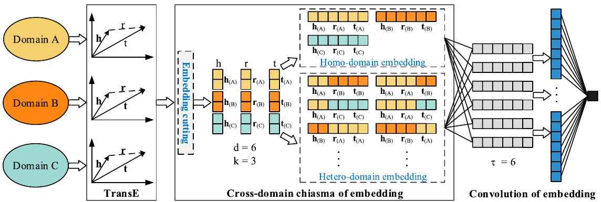

# 多领域知识图谱上的 i2i：把实体向量切成每个领域一段，跨领域交叉拼接后用卷积给三元组打分，再按链接预测推荐

关注我，每天为你精挑细选最优质、最新鲜的推荐算法paper，陪你一起保持进步、不断精进！

> [English version](swjtu-cdkg-ce.full.en.md)

### 论文：Cross-Domain Knowledge Graph Chiasmal Embedding for Multi-Domain Item-Item Recommendation
### 网址：https://doi.org/10.1109/TKDE.2022.3151986
### 公司：西南交通大学、腾讯、京东城市
### 思想：
### 方向：i2i（多领域推荐）

## 解读：
给定一件商品，同时从多个领域里推荐相关商品，比如由一部电影推荐同类电影、它用的配乐、它改编自的小说。本文只用知识图谱，不用任何用户行为。即先把多个领域的知识图谱合在一起学实体和关系的向量，每个向量切成每个领域一段，让不同领域的段交叉拼接，再用卷积给（头实体，关系，尾实体）三元组打分。推荐时把查询商品当头实体（或尾实体），看哪些候选商品能和它组成分数够高的三元组。

作者认为单领域推荐解决不了跨领域冷启动（比如没法根据听歌记录推小说），现有多领域推荐又大多是单领域方法的简单扩展，没区分领域之间的差异和联系。知识图谱里不同领域的实体本来就有联系（电影改编自小说、电影用了某首配乐），可以拿来连接各个领域。

### 方法
分三个阶段：先用 TransE 预训练出初始向量，再从这些向量出发训练跨领域知识图谱嵌入（CDKG-CE），最后用训练好的向量和打分函数做链接预测式的推荐（MD-I2IR）。前两个阶段分开训练，不是端到端。上图从左到右三步，第一步是预训练，后两步是训练。

#### （1）预训练：TransE 初始化
* **怎么学。** 每个实体、每个关系各有一个 60 维向量。对真实三元组要求「头 + 关系 ≈ 尾」，也就是把关系看成从头实体到尾实体的平移，用 ‖头 + 关系 − 尾‖ 衡量，距离越小越可信。把真实三元组的头或尾随机换掉造负样本，要求真实三元组的距离比负样本小。SGD 训练 3000 轮。
* **每个领域各跑一遍。** 三个领域的知识图谱分开训练，各得一套向量。图里所有实体（不只是商品）和所有关系都有向量。
* **合并。** 同一个实体或关系出现在多个领域时，有几份向量，相加后除以领域数 k，合成一份。

论文说，用它初始化比随机初始化收敛更快、效果更好。

#### （2）训练：跨领域知识图谱嵌入（CDKG-CE）
从预训练的向量出发接着训练，向量继续更新，另外新增卷积核和权重向量，最终得到每个实体、每个关系的向量和一个三元组打分函数。Adagrad 训练 300 轮。
* **切段。** 实体向量和关系向量都按位置等分成 k 段（实验里 k = 3，每段 20 维），作者让每段对应一个领域，记作 A、B、C 段。
* **交叉。** 对每个三元组，从头、关系、尾的段里各挑一段拼成一行，共拼出 15 行。作者把这种交叉拼接比作染色体交叉，所以叫 chiasmal（交叉）嵌入。下面用三个字母依次表示头、关系、尾取的段，如 ABB 表示头取 A 段，关系和尾取 B 段。
  * 同领域 3 行。AAA、BBB、CCC。
  * 跨领域 12 行。一次只让两个领域交叉，不允许 A、B、C 同时出现，按两条绑定规则各拼 6 行。
    * 关系跟着尾实体走。ABB、ACC、BAA、BCC、CAA、CBB。
    * 关系跟着头实体走。AAB、AAC、BBA、BBC、CCA、CCB。
* **卷积打分。** 这 15 行排成一个矩阵，用 256 个 1 × d 的卷积核逐行卷积，得到的特征图拼成一个长向量，和一个权重向量做内积，得到三元组的分数，做法沿用 ConvKB。
* **损失。** 把真实三元组的头实体或尾实体随机换掉，造出负样本，要求真实三元组的分数高于负样本，加上对权重向量的正则。

#### 推理：链接预测式的推荐（MD-I2IR）
用训练阶段得到的向量和卷积打分函数。下面每一次打分，都是把三个向量切段、交叉拼成 15 行的矩阵，过 256 个卷积核，再和权重向量做内积。给定查询商品，看它和哪些候选商品之间「应该有一条边」：
* **以查询商品为头实体。** 对它在图里已有的每种关系 r 各做一轮。
  * 算门槛。查询商品在图里已有若干条（查询商品，r，e），e 是图里已有的尾实体，可以是商品，也可以是非商品实体。把这几条都用卷积打分函数打一遍分，取最高分（不是平均）作为这种关系的门槛。
  * 给候选打分。拿物料库里的每个商品当尾实体（不按领域或类型筛，只含商品，不含导演、歌手这类非商品实体），组成（查询商品，r，候选）打分。每个候选的分数各自和门槛比，超过的放进推荐集，候选之间不做汇总。
  * 举个例子。查询商品是电影 X，图里已有（X，配乐，歌曲 Y1）和（X，配乐，歌曲 Y2），分别得分 0.80 和 0.70，「配乐」这种关系的门槛取最高分 0.80。候选歌曲 Z 组成的（X，配乐，Z）得分 0.85，超过门槛，被推荐；歌曲 W 得分 0.75，虽然比 0.70 高，但没过 0.80，不推荐。也就是说，候选和查询商品组成的三元组比已有的真实事实还可信，就认为两者之间应该有一条边。
* **以查询商品为尾实体。** 同样的方法再做一遍。
* **排序。** 推荐集按分数从高到低排，取前 m 个。同一个商品可能在几种关系或两个方向下都超过门槛，得到好几个分数，论文没说这时用哪个分数排序。

作者强调，这和常见的「两个商品向量算内积」不同：两件商品的向量可能并不像，但通过某种关系可以连起来。为了验证这一点，论文还做了一个对照版本 MD-I2IR(ip)：用同样的向量，但直接算查询商品和候选商品向量的内积，不过卷积（结果见下文）。

代价是，打分次数约为「关系数 × 物料库商品数 × 2」，每次都要过一遍卷积网络，物料库一大推理开销就大，也没法像向量内积那样用 ANN 索引做全库检索。论文没讨论推理开销，实验里每个查询商品也只有 101 个候选（见下文），这个开销没有体现出来。

### 数据与效果
两个知识图谱：FB15K-237（Freebase 子集，只用来评测嵌入）和作者构建的 KG3Domain。KG3Domain 用复旦知识工场的接口，从人工给定的种子实体出发检索三个领域的实体和三元组，共 7.8 万个三元组、9,282 个实体、445 种关系，论文没说三个领域分别是什么。只有离线实验。
* **嵌入（链接预测）。** KG3Domain 上 MRR 0.206、Hits@10 0.431，ConvKB 是 0.196、0.378；FB15K-237 上 MRR 0.464，ConvKB 是 0.396。
* **推荐。** KG3Domain 上，给每个查询商品配一件真实相关商品和 100 件随机商品，HR@10 为 0.604，用同样的嵌入改成向量内积是 0.580，SPE 0.565，NeuMF 0.368。
* **跨领域分布。** 推荐 10 件时，几个基线推出来的都来自同一个领域，本文来自两个领域；推荐 40 件时本文在三个领域里分布最均匀。

## 心得：

## 愚见

## 可信度：离线

## 推荐等级：有时间看看

**请帮忙点赞、转发，谢谢。欢迎干货投稿 \ 论文宣传\ 合作交流**

### 【铁粉】请入微信群，群内我会给出更深入的解读，还可以共同讨论技术方案、发招聘广告、内推和交友等。
* 铁粉标准：关注公众号一个月以上，且在公众号上累计15次互动（评论、爱心、转发）、或投稿1次，只欢迎技术同学。
* 入群方法：请您加个人微信lmxhappy，我拉您入群，请备注【公司】（只我个人看，不公开）。

## 推荐您继续阅读：
