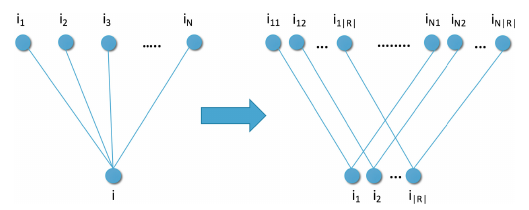

# i2i for rare items: describe an item by its distances to a set of popular "anchor" items, and compute similarity from those distances

> [中文版](sztaki-fisher-i2i.md)

### Paper: Infrequent Item-to-Item Recommendation via Invariant Random Fields (MICAI 2018)
### Link: https://doi.org/10.1007/978-3-030-04491-6_20
### Institution: Institute for Computer Science and Control, Hungarian Academy of Sciences (MTA SZTAKI), Eötvös Loránd University
### Ideas: anchor items, Markov random fields, Fisher score, Fisher distance, multimodal fusion
### Area: i2i (rare items)

## Breakdown:
Rare items co-occur with other items too seldom, so similarity computed directly from co-occurrence is unreliable. The paper describes items another way: pick a set of popular items as "anchors" and represent each item by a vector of its distances to these anchors; even if two rare items never appeared together, they're considered similar as long as their patterns of distances to the anchors are alike. This vector is derived from the Fisher score of a Markov random field, and this step needs no training (if the base distance comes from latent vectors, that part is trained separately).

The scenario is session-based i2i: users browse anonymously with no profile history, so the next item can only be recommended from the one just viewed. "People who viewed this also viewed" works well for popular items, but for rare and newly listed items co-occurrences are too few and recommendations unreliable. This is a MICAI 2018 paper; the authors had earlier posted a preprint on arXiv.

### Method
Three steps: first choose a base item distance and a set of anchor items, then represent each item as a "distance-to-anchors vector", and finally score candidates with this vector.

#### (1) Base distance and anchors
* **Base distance.** Any distance between items works, e.g., Jaccard, cosine or conditional probability from co-occurrence counts (co-occurrence means both items were consumed by the same user; Jaccard = users who consumed both ÷ users who consumed either, so it comes from user behavior), distances between latent vectors, or Jaccard over content (e.g., a movie's director, actors and genres in DBpedia).
* **Anchors.** The N most popular items in the training set. Performance stops improving beyond N = 50 in the experiments, and the main experiments use 20. Popular items have plenty of data, so distances to them are reliable.

#### (2) Representing an item as a "distance-to-anchors vector"
The authors treat "an item and N anchors" as a Markov random field (left of the figure) and, following the standard derivation for random fields, obtain the item's Fisher score, which has a very simple form: dimension k = the average distance of all items to the k-th anchor − this item's distance to the k-th anchor. That is, "how much closer this item is to the k-th anchor than a typical item". A rare item has few co-occurrences of its own, but its distance to each popular anchor can still be computed, so the vector is meaningful for rare items too.

The authors also prove that the resulting kernel is unchanged under a reparametrization, and argue from this that the random field's parameters need not be learned.

#### (3) Two ways to score
* **Fisher distance (FD).** Each dimension of the vector above is divided by that dimension's standard deviation (corresponding to the diagonal of the Fisher information matrix), giving a standardized vector; the sum of squared differences between two items' vectors is the Fisher distance, and the smallest is recommended. In effect, the more alike two items' "patterns of closeness to the anchors" are, the more similar they are.
* **Fisher conditional score (FC).** The previous item i is also put into the random field (three nodes pairwise connected), giving "the Fisher score of candidate j given i": dimension k = the average of (j's distance to the k-th anchor + the distance from i to j) − the actual value. The shorter this vector, the better j fits the model, and the smallest is recommended. Expected values are replaced directly by averages over the training set. Unlike the Fisher distance, this still uses the direct distance between i and j.

**Using several distances together.** With several base distances (e.g., co-occurrence and content), a vector is computed for each and concatenated; the Fisher distance is the sum of the Fisher distances under each. No weights need to be set and no fusion needs to be trained.

### Data and results
Four public datasets: Netflix, MovieLens, Books (Ziegler's Book-Crossing) and Yahoo! Music. There are no real sessions; the authors pair up the items each user consumed (e.g., a, b, c give (a, b), (b, c), (c, a)). Because the focus is on rare items, only item pairs with co-occurrence counts up to the 75th percentile are kept (2 for Books, 23 for Yahoo! Music, 300 for MovieLens, 1,241 for Netflix). Training and test are split by user. At evaluation, given the current item i and an item j that truly co-occurs with it, j is ranked among 200 random items to see whether it comes out on top; the metrics are Recall@20 and DCG@20. Offline only.
* **The rarest 25% on MovieLens.** Jaccard alone gives Recall@20 of 0.099; Fisher distance with Jaccard 0.187, Fisher conditional score with Jaccard 0.177; the latent-vector method EIR used for comparison gets 0.129. Jaccard is the best of the base distances.
* **Adding content.** On MovieLens, using co-occurrence and DBpedia content together (with 10 anchors in this experiment) raises Recall@20 from 0.139 for the baseline to 0.275.
* **Across the four datasets.** On MovieLens and Yahoo! Music, the Fisher distance with Jaccard is best; on Netflix and Books, a linear sum of the two Fisher scores, each standardized, is best.
* **No advantage on popular items.** Plotted against item support (Netflix), the Fisher methods do better on items with support below about 100 and the original methods do better above it; the authors suggest switching by support.

## Takeaways
* When a rare item's co-occurrences are unreliable, it can be described by its distances to a set of popular anchor items instead, bypassing direct co-occurrence.
* Several distances (co-occurrence, content) can each produce a vector and be concatenated, fusing them without tuning weights.
* Rare and popular items suit different methods, and one can switch by support.

## Caveats
* There are no real sessions: item pairs are formed from users' entire consumption records, which isn't the same as "the next item in a session", and the authors acknowledge the lack of session data. Evaluation ranks the true answer among only 200 random items, which are easy to separate, so the metrics are optimistic.
* Item pairs with high co-occurrence are filtered out before evaluation, while the authors' own curve shows the Fisher methods are worse on popular items. The switch-by-support hybrid isn't evaluated as a whole.
* The theorem shows the kernel is unchanged under a reparametrization, which isn't the same as the kernel being independent of the parameter values. The implementation also replaces expectations with training-set averages and approximates the Fisher matrix by its diagonal, so the Fisher distance ends up being the Euclidean distance between standardized "distance-to-anchors vectors", and how much the random-field and Fisher-information derivation contributes to the results is unclear.
* The paper claims "significant improvement" without significance testing; in the summary table, the best baseline and best method differ across datasets.

## Credibility: offline

## Recommendation level: worth a look if you have time
