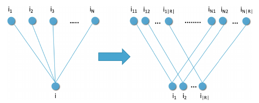

# 冷门商品的 i2i：用它和一组热门「锚点」商品的距离描述它，再按这组距离算相似度

关注我，每天为你精挑细选最优质、最新鲜的推荐算法paper，陪你一起保持进步、不断精进！

> [English version](sztaki-fisher-i2i.full.en.md)

### 论文：Infrequent Item-to-Item Recommendation via Invariant Random Fields
### 网址：https://doi.org/10.1007/978-3-030-04491-6_20
### 公司：匈牙利科学院计算机与自动化研究所（MTA SZTAKI）、罗兰大学
### 思想：锚点商品、马尔可夫随机场、Fisher 分数、Fisher 距离、多模态融合
### 方向：i2i（冷门商品）

## 解读：
冷门商品和其他商品共同出现的次数太少，直接按共现算相似度很不可靠。本文换一种方式描述商品：挑出一组热门商品当「锚点」，每件商品用它和这些锚点的距离组成一个向量；两件冷门商品哪怕从没一起出现过，只要它们和锚点的距离模式相像，就认为相似。这个向量是从马尔可夫随机场的 Fisher 分数推出来的，这一步不需要训练（基础距离如果用隐向量，那部分要另外训练）。

场景是基于会话的 i2i：用户匿名浏览，没有历史画像，只能根据刚看的那件商品推下一件。「看了这个的人还看了」对热门商品效果很好，但对冷门商品、新上架商品，共现太少，推荐不可靠。

### 方法
分三步：先选一个基础的商品距离和一组锚点商品，再把每件商品表示成「到锚点的距离向量」，最后用这个向量给候选打分。

#### （1）基础距离和锚点
* **基础距离。** 任何一种商品之间的距离都可以，比如按共现次数算的 Jaccard、余弦、条件概率（共现是指两件商品被同一个用户消费过，Jaccard = 同时消费过两件的用户数 ÷ 消费过任一件的用户数，来自用户行为），也可以是隐向量的距离，或者内容（如电影在 DBpedia 里的导演、演员、类型）的 Jaccard。
* **锚点。** 训练集里最热门的 N 件商品。实验发现 N 超过 50 后效果不再提升，正文实验取 20。热门商品数据充足，和它们的距离比较可靠。

#### （2）把商品表示成「到锚点的距离向量」
作者把「一件商品和 N 个锚点」看成一个马尔可夫随机场（上图左），按随机场的标准推导，得到这件商品的 Fisher 分数，形式很简单：第 k 维 = 所有商品到第 k 个锚点的平均距离 − 这件商品到第 k 个锚点的距离。也就是「这件商品比一般商品离第 k 个锚点近多少」。冷门商品自己的共现很少，但它和每个热门锚点的距离仍然能算，所以这个向量对冷门商品也有意义。

作者还证明了换一种参数化方式，由此得到的核不变，并据此说明不需要学随机场的参数。

#### （3）两种打分方式
* **Fisher 距离（FD）。** 把上面的向量每一维再除以这一维的标准差（对应 Fisher 信息矩阵的对角线），得到标准化后的向量，两件商品的向量之差的平方和就是 Fisher 距离，取最小的推荐。实际效果相当于：两件商品「到各个锚点的远近模式」越像，就越相似。
* **Fisher 条件分数（FC）。** 把上一件商品 i 也放进随机场（三个节点两两相连），推出「给定 i，候选 j 的 Fisher 分数」：第 k 维 = 平均的（j 到第 k 个锚点的距离 + i 到 j 的距离）− 实际的这个值。这个向量的长度越小，说明 j 越符合模型，取最小的推荐。期望值直接用训练集里的平均值代替。和 Fisher 距离不同，这里仍然用到 i 和 j 之间的直接距离。

**多种距离一起用。** 有几种基础距离（比如共现和内容），就各算一个向量，拼起来；Fisher 距离就是各种距离下的 Fisher 距离相加。不需要设权重，也不用训练融合方式。

### 数据与效果
四个公开数据集：Netflix、MovieLens、图书（Ziegler 的 Book-Crossing）、Yahoo! Music。没有真实的会话，作者把每个用户消费过的商品两两配成商品对（比如 a、b、c 配成 (a, b)、(b, c)、(c, a)）。因为关注冷门商品，只保留共现次数在 75% 分位数以下的商品对（图书 2 次、Yahoo! Music 23 次、MovieLens 300 次、Netflix 1,241 次）。按用户划分训练、测试。评测时给当前商品 i 和一件真实与它共现的商品 j，再配 200 个随机商品，看 j 能不能排到前面，指标是 Recall@20 和 DCG@20。只有离线实验。
* **MovieLens 最冷门的 25%。** 只用 Jaccard 的 Recall@20 是 0.099，Fisher 距离加 Jaccard 是 0.187，Fisher 条件分数加 Jaccard 是 0.177；对比的隐向量方法 EIR 是 0.129。各种基础距离里 Jaccard 最好。
* **加入内容。** MovieLens 上同时用共现和 DBpedia 内容（这组实验锚点取 10 件），Recall@20 从基线的 0.139 提到 0.275。
* **四个数据集汇总。** MovieLens 和 Yahoo! Music 上 Fisher 距离加 Jaccard 最好；Netflix 和图书上，把两种 Fisher 打分各自标准化后线性相加最好。
* **热门商品不占优。** 按商品支持度画曲线（Netflix），Fisher 方法在支持度低于约 100 的商品上更好，高于这个数时原来的方法更好，作者建议按支持度切换。

## 心得：

## 愚见

## 可信度：离线

## 推荐等级：有时间看看

**请帮忙点赞、转发，谢谢。欢迎干货投稿 \ 论文宣传\ 合作交流**

### 【铁粉】请入微信群，群内我会给出更深入的解读，还可以共同讨论技术方案、发招聘广告、内推和交友等。
* 铁粉标准：关注公众号一个月以上，且在公众号上累计15次互动（评论、爱心、转发）、或投稿1次，只欢迎技术同学。
* 入群方法：请您加个人微信lmxhappy，我拉您入群，请备注【公司】（只我个人看，不公开）。

## 推荐您继续阅读：
