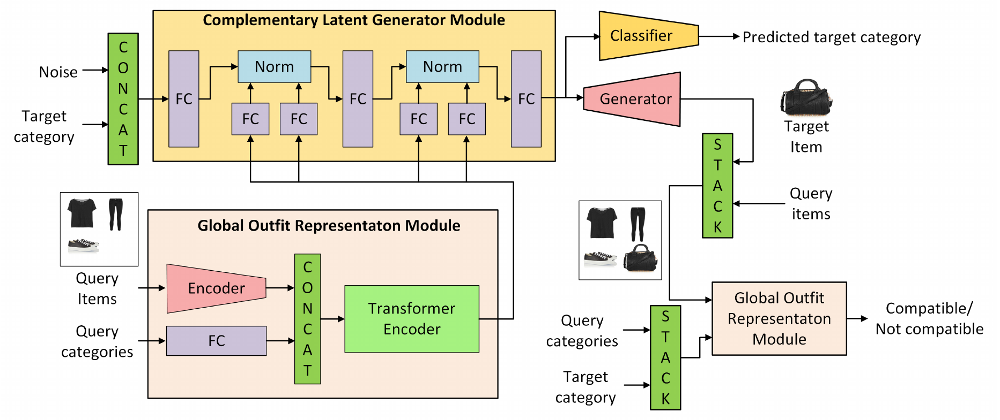

# Generate, then retrieve: generate a complementary item for an incomplete outfit, then find the closest product in the catalog

> [中文版](tcs-recommendation-by-generation.md)

### Paper: Recommendation By Generation: Generation Augmented Complementary Fashion Item Retrieval Using Incomplete Outfit (ICCV 2025 Workshops, RetailVision)
### Link: https://doi.org/10.1109/ICCVW69036.2025.00246
### Company: TCS Research (Tata Consultancy Services, India)
### Idea: generative recommendation, StyleGAN2 latent space, classifier guidance, retrieval from generated items
### Area: i2i (complementary recommendation for a partial outfit)

## Overview:
A user has picked a top, trousers and shoes and needs a bag; the trigger is this incomplete outfit plus the target category (bag). The usual approach trains a compatibility scoring model on annotated positives and negatives and then scores and ranks the catalog's bags one by one. The authors argue that compatibility has no single right answer (one outfit can go with several kinds of bags), so training on annotations only learns the annotators' preferences, and the same input always yields the same result. This paper therefore takes another route: it first generates, in StyleGAN2's latent space, a few bags that go with the outfit, then uses the generated latent codes to find the most similar real bags in the catalog. The generator is trained without any ground-truth target item; it only has to produce a bag that the compatibility judge accepts as matching the outfit, and random noise in its input lets the same outfit yield different candidates each time. It is an ICCV 2025 RetailVision workshop paper with offline experiments only.

### Model side

Below, the figure is walked through following the data flow of one request; module names match the boxes in the figure. How each module is trained comes at the end.

#### (1) Encoding the picked items into an outfit vector (bottom left of the figure)
The images of the picked items (Query Items in the figure) first go through the Encoder (pink trapezoid), each becoming a 512-dimensional latent code; their category labels (Query categories) go through an FC layer to become category embeddings. The two are concatenated item by item and passed together through a 6-layer Transformer Encoder, producing one outfit vector. This whole block is the Global Outfit Representation Module; the outfit vector goes up into (2) as the generation condition.

#### (2) Generating the target item's latent code (yellow box at the top)
Random noise and the target category's one-hot are concatenated and fed into the Complementary Latent Generator Module. The target category tells it which category to fill this time, and the noise lets the same outfit yield different candidates each time. Inside are three fully connected layers (the three tall FC boxes); between every two sits a Norm block that normalizes the intermediate result and then multiplies and adds two quantities computed from the outfit vector (the two small FC boxes under each Norm, one for the scale and one for the shift), which is how the outfit information is injected. The output is the target item's 512-dimensional latent code.

#### (3) Checking the result during training (right side of the figure)
When training the generator, the generated latent code passes two checks, corresponding to two cross-entropy losses.

**Is the category right?** The latent code goes into the Classifier at the top right, whose Predicted target category must equal the target category. The compatibility judgment reads the category from the label and cannot tell whether the generated item really is a bag, so this is checked separately.

**Does it go with the outfit?** The latent code is first drawn into an image by the Generator (pink trapezoid at the top right, StyleGAN2's generator), stacked with the Query Items, while the target category is stacked with the Query categories (the two STACK blocks at the bottom right); the whole outfit goes into the Global Outfit Representation Module at the bottom right. A two-node fully connected layer on top of its outfit vector (not drawn separately) outputs Compatible / Not compatible, and the outfit must be judged compatible.

Only the Complementary Latent Generator Module is updated in this step; all other modules are frozen, and gradients merely pass through them. No ground-truth target item is used, and there is no adversarial discriminator.

#### (4) Retrieval at inference
At inference only (1) and (2) run; the generated latent code retrieves its nearest neighbors among the catalog's latent codes, returning the top k. Every catalog item's latent code is precomputed with the Encoder. Retrieval uses only latent codes; the Generator is needed only to display the generated image.

#### Training order of the modules
Three stages; modules trained in an earlier stage are frozen for later ones.

**Stage 1, Generator and Encoder.** StyleGAN2 is first trained the usual way on ~127K item images (its generator against its own discriminator), giving the Generator. StyleGAN2 has no encoder of its own, so the authors change the last layer of its discriminator to output a 512-dimensional latent code and use it as the Encoder; with the Generator frozen, the Encoder encodes an image into a latent code, the Generator decodes it back, and the Encoder is trained with the MSE between the reconstruction and the original. Together they provide a latent space where images and latent codes convert into each other.

**Stage 2, the two judges.** The Classifier, a 5-layer MLP, is trained on real items' latent codes and category labels. The Global Outfit Representation Module, together with its compatibility head, is trained on 40K outfits (half compatible, half not).

**Stage 3, the generator.** This is the process in (3), training only the Complementary Latent Generator Module, which is the paper's own new design and not part of StyleGAN2.

### Data side
The disjoint and non-disjoint subsets of Polyvore Outfits, keeping only outfits with at least 3 items as queries and only categories with at least 1,000 samples. The generation training sets are 13K outfits (non-disjoint) and 3,868 (disjoint); the Global Outfit Representation Module is trained on a separate 40K outfits, half compatible and half not. StyleGAN2 is trained on all ~127K item images.

### Results (offline only)
Evaluation uses three pretrained compatibility models (Outfit Transformer, a relational network, LPAE), with image quality (IS) and compatibility rate (CP, the share of outfits judged compatible after adding the generated item) as metrics. On the disjoint subset with Outfit Transformer as the judge, IS is 4.93 vs. 2.85 for the strongest baseline, and CP is 0.86 vs. 0.78. Retrieval top-10 accuracy is 0.673 vs. 0.644. All baselines are generative methods (c+GAN, OutfitGAN, COutfitGAN, etc.). In the ablation, removing the compatibility classifier drops CP from 0.85 to 0.63.

## Takeaways:
* Splitting complementary retrieval into "conditional generation + similarity retrieval" lets the second step reuse an existing visual-search index directly.
* The image generator is trained separately and frozen, so only three fully connected layers in latent space need training, which is cheap.
* Random noise as input lets one outfit yield several different candidate templates, giving built-in diversity.

## My take
* The training objective and the evaluation metric are the same thing: the generator is trained to make a pretrained compatibility classifier say "compatible", and CP is the share judged compatible by pretrained compatibility models, one of which, Outfit Transformer, has the same architecture as the compatibility classifier in (2). Whether the three judge models were trained independently of (2) is not stated.
* In the ablation, sampling StyleGAN2 at random with no conditioning still reaches a CP of 0.651, higher than 4 of the 7 baselines (0.45–0.61 under the same setting), which raises questions about how well the baselines were reproduced.
* The retrieval metric is not clearly defined: Table 3 is grouped by compatibility prediction model, and Top-10, 30 and 50 barely change (0.673, 0.674, 0.675), which does not look like a ground-truth hit rate (that should rise noticeably with k) and looks more like "the share of retrieved items judged compatible". The paper never evaluates against ground-truth items, so it cannot be compared directly with discriminative methods such as Outfit Transformer on FITB or recall.
* The paper says one of the generated items is chosen by user preference for retrieval, but there are no users in the experiments, and which generated item is used for retrieval is not stated.
* The generator's three fully connected layers are listed as 32, 64 and 32 units, yet the output must be a 512-dimensional latent code; how this is connected is not described.

## Credibility: offline

## Recommendation level: worth a look if you have time
