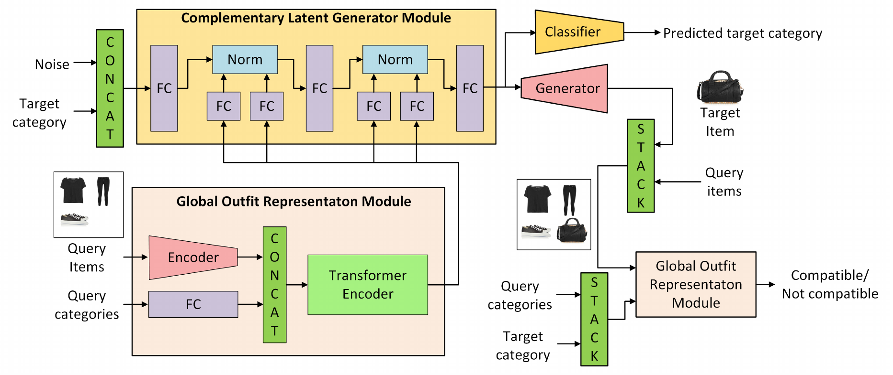

# 先生成、再检索：给不完整 outfit 生成一件互补单品，再去商品库找最像的

关注我，每天为你精挑细选最优质、最新鲜的推荐算法paper，陪你一起保持进步、不断精进！

> [English version](tcs-recommendation-by-generation.full.en.md)

### 论文：Recommendation By Generation: Generation Augmented Complementary Fashion Item Retrieval Using Incomplete Outfit
### 网址：https://doi.org/10.1109/ICCVW69036.2025.00246
### 公司：TCS Research（塔塔咨询服务公司研究院，印度）
### 思想：生成式推荐、StyleGAN2 潜空间、分类器引导、以生成结果做检索
### 方向：i2i

## 解读：
用户已经选了上衣、裤子、鞋，要补一个包，trigger 就是这套不完整的 outfit 加上目标品类（包）。常规做法是用标注好的正负样本训练一个兼容打分模型，再给商品库里的包逐个打分排序。作者认为兼容本来没有唯一答案，同一套衣服可以配好几种包，按标注训练只会学到标注者的偏好，而且同样的输入永远给出同样的结果。所以本文换了一个思路，先在 StyleGAN2 的潜空间里「生成」几个和这套 outfit 搭的包，再用生成结果的潜码去商品库里找最像的真包。生成器训练时完全不用目标单品的真值，只要求生成的东西是包、并且被兼容判别模型判为能和这套搭；输入里加随机噪声，同一套 outfit 每次能生成不同的候选。

### 模型侧

下面按一次请求的数据流把图走一遍，模块名都对应图里的方框。各模块怎么训出来的放在最后。

#### （1）编码已选单品，得到 outfit 向量（图左下）
已选单品（图中 Query Items）的图片先过 Encoder（粉色梯形），每件变成一个 512 维潜码；它们的品类标签（Query categories）过一个 FC，变成品类 embedding。两者逐件拼接，一起过 6 层 Transformer Encoder，得到一个 outfit 向量。这整块就是 Global Outfit Representation Module，outfit 向量往上送进（2），作为生成的条件。

#### （2）生成目标单品的潜码（图上方黄框）
随机噪声和目标品类的 one-hot 拼在一起，送进 Complementary Latent Generator Module。目标品类告诉它这次补哪一类，噪声让同一套 outfit 每次能生成不同的候选。模块内部是三层全连接（图中竖着的三个 FC），每两层之间夹一个 Norm，把中间结果先归一化，再乘上、加上两个由 outfit 向量算出的量（图中每个 Norm 下面的两个小 FC，一个算缩放、一个算平移），outfit 信息就这样注入进来。输出是目标单品的 512 维潜码。

#### （3）训练时检查生成结果（图右侧）
训练生成器时，生成的潜码要过两道检查，对应两项交叉熵损失。

**品类对不对。** 潜码送进右上角的 Classifier，输出的 Predicted target category 要等于目标品类。兼容判别读的品类来自标签，查不出生成的东西到底是不是包，所以要单独查。

**搭不搭。** 潜码先经 Generator（右上方粉色梯形，StyleGAN2 的生成器）画成一张图，和 Query Items 拼成一套，目标品类也和 Query categories 拼在一起（图右下两个 STACK），整套送进右下角的 Global Outfit Representation Module。它在 outfit 向量后面接了一个两节点的全连接层（图里没单独画），输出 Compatible / Not compatible，要判成兼容。

这一步只更新 Complementary Latent Generator Module，其他模块都冻住，梯度只是穿过它们。全程不用目标单品的真值，也没有对抗判别器。

#### （4）推理时检索
推理时只走（1）（2），得到生成的潜码后，在商品库的潜码里找最近邻，返回 top-k。商品库每件商品的潜码都是用 Encoder 预先算好的。检索只用潜码，Generator 只在需要展示生成的图时才用。

#### 各模块的训练顺序
分三个阶段，前一阶段训好的模块冻住给后一阶段用。

**第一阶段，Generator 和 Encoder。** 先用约 12.7 万张单品图按 StyleGAN2 原本的方式训练（生成器和 StyleGAN2 自己的判别器做对抗训练），得到 Generator。StyleGAN2 本身没有编码器，作者把它的判别器最后一层改成输出 512 维潜码，作为 Encoder；冻住 Generator，让 Encoder 把图编成潜码、Generator 还原回图，用还原图和原图的 MSE 训练 Encoder。两者合起来提供一个「图 ↔ 潜码」互转的潜空间。

**第二阶段，两个裁判。** Classifier 是 5 层 MLP，用真实单品的潜码和品类标签训练。Global Outfit Representation Module 连同它的兼容分类层，用 4 万套 outfit（兼容、不兼容各半）训练。

**第三阶段，生成器。** 就是（3）的过程，只训 Complementary Latent Generator Module。它是本文新设计的，不属于 StyleGAN2。

### 数据侧
Polyvore Outfits 的 disjoint 和 non-disjoint 两个子集，只保留至少 3 件单品的 outfit 作 query，只保留样本数 ≥1000 的品类。生成用的训练集是 non-disjoint 1.3 万套、disjoint 3868 套；Global Outfit Representation Module 另用 4 万套训练，兼容和不兼容各半。StyleGAN2 用全部约 12.7 万张单品图训练。

## 心得：
* 互补检索拆成「条件生成 + 相似检索」两步，后一步可以直接复用现成的以图搜图索引。
* 图像生成器（Generator）单独训好后冻住，要训练的只是潜空间里的三层全连接，成本很低。
* 输入加随机噪声，同一套 outfit 能生成多个不同的候选模板，推荐结果自带多样性。

## 愚见

## 可信度：离线

## 推荐等级：有时间看看

**请帮忙点赞、转发，谢谢。欢迎干货投稿 \ 论文宣传\ 合作交流**

### 【铁粉】请入微信群，群内我会给出更深入的解读，还可以共同讨论技术方案、发招聘广告、内推和交友等。
* 铁粉标准：关注公众号一个月以上，且在公众号上累计15次互动（评论、爱心、转发）、或投稿1次，只欢迎技术同学。
* 入群方法：请您加个人微信lmxhappy，我拉您入群，请备注【公司】（只我个人看，不公开）。

## 推荐您继续阅读：
