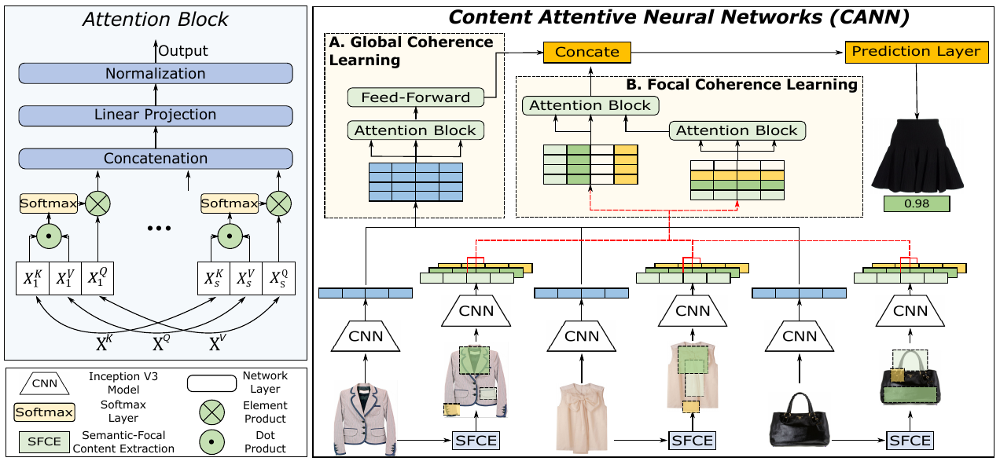

# Outfit completion: run attention over the chosen items' whole images and over local regions grouped by color and texture, concatenate into a vector for "the missing item", and score candidates by inner product

> [中文版](ustc-cann.md)

### Paper: Learning the Compositional Visual Coherence for Complementary Recommendations (IJCAI 2020)
### Link: https://arxiv.org/abs/2006.04380
### Institution: University of Science and Technology of China, Columbia University, Tianjin University, JD AI Research
### Ideas: set-level multi-head attention, color/texture region grouping, Selective Search, hierarchical attention, fill-in-the-blank training, in-batch softmax, content-based complementary recommendation
### Area: i2i (complementary recommendation, outfit completion)

## Breakdown:
Given the items already chosen for an outfit (e.g., a jacket, a top and a bag), pick the best-matching item from a few candidates. The paper runs one set of attention over the whole-image vectors of the chosen items and another over local-region vectors cut out by color and texture, to learn whether the items look coherent together. The two outputs are concatenated and passed through a fully connected layer to get a predicted vector for "what the missing item should look like", which is then scored against each candidate's vector by inner product and softmax. Only images are used; no purchase or click data. During training, one item per outfit is masked at random as the target, and the other items in the same batch serve as negatives.

Most existing approaches model the relation between two items (often bought together, pairwise compatible) rather than whether a whole set looks coherent, and they look only at the overall impression of the whole image, ignoring local details such as matching colors and compatible textures. The paper's example: the chosen mini skirt and shoulder bag are both blue; co-purchase relations would suggest a white shirt, pairwise compatibility would suggest black booties, while taking the whole outfit's color echo into account, blue pumps are the best match.

### Method
A global module and a local module encode the chosen items in parallel; their outputs are concatenated to predict the missing item, which is scored against candidates for training. All three parts are trained end to end.

#### Global coherence: multi-head attention over whole images
Each chosen item's image goes through an ImageNet-pretrained Inception-V3, then two fully connected layers reduce it to 512 dimensions (these two layers are trained). An outfit has at most 8 items; shorter ones are left-padded with a placeholder item.
* **Multi-head attention.** The 512 dimensions are split into 4 subspaces of 128 dimensions (4 heads). In each subspace, the two items' vectors are each multiplied by a matrix, then their inner product is divided by the square root of the dimension and passed through softmax, giving a score for "how coherent item i is with item j"; item i's new vector is the score-weighted sum of the items' vectors. The 4 heads are concatenated back to 512 dimensions.
* **Stacking.** Each attention block is followed by a two-layer feed-forward network, a residual addition and BatchNorm; 4 blocks are stacked, producing for each chosen item a vector that has absorbed information from the whole outfit.

#### Local coherence: hierarchical attention over color and texture regions
First cut each item's image into meaningful local regions, then use two levels of attention to learn coherence between regions and between items.
* **Cutting regions.** A classic graph-based segmentation (Felzenszwalb) first splits the image into many small patches, then, following Selective Search, the most similar neighboring patches are merged repeatedly. Merging is done three times independently: looking only at the color histogram (25 bins per color channel, 75 dimensions), only at the texture histogram (gradient statistics in 8 orientations per color channel, 240 dimensions), and at both. Each grouping contributes 3 regions, so each item has 9 regions; the paper doesn't say how these 3 are picked from the merge results.
* **Region vectors.** Each region is cropped and passed through a pretrained Inception-V3 to get a vector.
* **Hierarchical attention.** Attention is first applied across regions of different groupings, then across the chosen items, using the same attention computation as the global module. Two levels instead of attending over all 8 items × 9 regions at once is meant to save computation. The paper is unclear about how the tensor is reshaped into the inputs of these two levels.

**Why merge by color and by texture separately.** Selective Search originally merges regions using a combined similarity over color, texture and more; the paper merges separately so that the model can learn "color echo" and "texture compatibility" as two distinct kinds of local coherence.

#### Scoring and training
* **Predicted vector.** The outputs of the two modules are concatenated and passed through a fully connected layer to get the predicted vector for the missing item. Both modules output one vector per chosen item; the paper doesn't say how these are combined into one vector (flattening or pooling).
* **Scoring.** The predicted vector takes an inner product with each candidate item's vector, followed by softmax over the candidate set; scoring is a fixed inner product with no extra scoring network. The paper doesn't spell out how candidate vectors are obtained: the notation suggests a candidate image vector, but it doesn't say whether candidates share the Inception-V3 plus two fully connected layers used for the chosen items.
* **Training samples.** Each batch randomly takes 9 outfits; in each, one item is masked at random as the target and the rest are the chosen items.
* **Negatives and loss.** The candidate set is the items in this batch's outfits; the masked target is the positive and all others are negatives (in-batch negatives). The loss is the average softmax negative log-likelihood of the target, optimized with SGD. Read literally, the paper's Algorithm 1 puts only the chosen items into the candidate set and doesn't make clear how the targets get in. Following the Bi-LSTM outfit paper (Han et al. 2017), a "visual-semantic embedding" regularizer is also added, with no details given.

### Inference
* The chosen items are encoded into a predicted vector, which takes an inner product with each candidate; the highest-scoring candidate wins. In the experiments this is a 4-way choice (1 correct answer plus 3 negative candidates).
* The authors note that on small datasets all items could serve as candidates, but on large ones this is impractical because of the high-dimensional vectors; the experiments only cover multiple choice among 4 to 10 candidates, not full-catalog retrieval.

### Data and results
Polyvore outfits (complete outfits uploaded by fashion enthusiasts), merging the Han et al. 2017 and Vasileva et al. 2018 versions into 90,634 outfits; after dropping outfits with more than 8 items, 59,212 outfits (222k items) for training, 3,000 for validation and 10,218 for testing. Evaluation is outfit fill-in-the-blank: mask one item per outfit and pick it from 4 candidates. Of the two test sets, FITB Random draws negative candidates at random from the test set, and FITB Category replaces them with items in the same category as the correct answer (e.g., all shoes), which is harder. Metrics are accuracy and MRR (the mean of the reciprocal rank of the correct answer). Offline experiments only.
* **Overall.** Accuracy on FITB Random is 90.7%, versus 87.3% for the strongest baseline NGNN (a graph neural network over the whole outfit) and 83.6% for Bi-LSTM; on FITB Category it is 66.5%, versus 58.2% for the strongest baseline Bi-LSTM.
* **The two modules.** The global module alone gets 88.8% / 62.4%, the local module alone 71.9% / 56.7%. The global module provides most of the performance; the local module adds more on same-category candidates (+4.1 points, versus +1.9 on random candidates).
* **Region groupings.** With a single grouping, merging by color and texture together works best, color alone is second, and texture alone is worst; using all three is best, for every candidate count from 4 to 10.

## Takeaways
* Grouping image regions by color and by texture gives the model an explicit channel for local cues such as matching colors, on top of whole-image features.
* The training recipe is the standard fill-in-the-blank setup: mask one item, predict its vector from the rest, and score candidates by inner product with an in-batch softmax.
* Set-level attention over whole-image features carries most of the gain; the region branch alone is much weaker and adds a few points on top.

## Caveats
* The paper doesn't specify how candidate vectors are produced or how the per-item outputs are combined into a single prediction vector, and the project page it cites for code and data was unreachable (expired certificate) at the time of writing, so neither can be checked against code.
* Evaluation is a 4-way multiple choice (up to 10 in the ablation) on a split the authors built by merging two Polyvore versions, so baseline numbers are not directly comparable to those reported in the original papers, and there is no full-catalog retrieval test.
* The method is described as image-only, yet the loss adds a visual-semantic embedding regularizer that in Han et al. 2017 aligns images with text descriptions; the paper gives no details on what this term uses here.
* Algorithm 1 builds the candidate set from the masked seed collections, which literally excludes the targets; results are single numbers without variance or significance tests.

## Credibility: offline

## Recommendation level: worth a look if you have time
