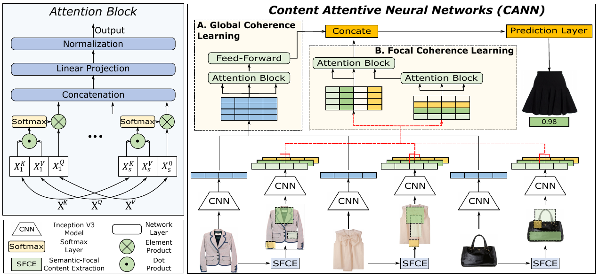

# 穿搭补全：已选几件的整图和按颜色、纹理切出的局部区域各过一组注意力，拼成「缺的那件」的向量，和候选内积打分

关注我，每天为你精挑细选最优质、最新鲜的推荐算法paper，陪你一起保持进步、不断精进！

> [English version](ustc-cann.full.en.md)

### 论文：Learning the Compositional Visual Coherence for Complementary Recommendations
### 网址：https://arxiv.org/abs/2006.04380
### 公司：中国科学技术大学、哥伦比亚大学、天津大学、京东 AI 研究院
### 思想：
### 方向：i2i（互补推荐、穿搭补全）

## 解读：
给定一套穿搭里已选好的几件（比如外套、上衣、包），从几个候选里挑出最搭的那件。本文把已选几件的整张图片向量，和按颜色、纹理切出的局部区域向量，各过一组注意力，学它们放在一起是否协调；两路输出拼起来过全连接层，得到「缺的那件应该是什么样」的预测向量，再和每个候选的向量做内积、softmax 打分。全程只用图片，不用购买、点击数据。训练时每套随机遮掉一件当目标，同一批里的其他商品当负样本。

已有做法多是建模两件商品之间的关系（常被一起买、两两是否搭配），没看一整套放在一起是否协调，而且只看整图的大致印象，忽略颜色呼应、纹理搭配这类局部细节。论文的例子是，已选的短裙和挎包都是蓝色，按共同购买会推白衬衫，按两两搭配会推黑短靴，而顾及整套的颜色呼应，蓝色高跟鞋最合适。

### 方法
全局、局部两个模块并行编码已选的几件，输出拼起来预测缺的那件，再和候选打分训练，三部分端到端一起训。

#### 全局一致性：整图之间的多头注意力
每件已选商品的图片过 ImageNet 预训练的 Inception-V3 抽特征，再过两层全连接降到 512 维（这两层参与训练）。一套最多 8 件，不足的在左边补占位商品。
* **多头注意力。** 512 维切成 4 个 128 维的子空间（4 个头）。每个子空间里，两件商品的向量各乘一个矩阵后做内积、除以根号维度、再 softmax，得到「商品 i 和商品 j 有多协调」的分数；商品 i 的新向量是各商品向量按这个分数加权求和。4 个头的结果拼回 512 维。
* **堆叠。** 每个注意力块后接两层前馈网络、残差相加和 BatchNorm，共堆 4 块，输出每件已选商品融合了整套信息的向量。

#### 局部一致性：颜色、纹理区域上的分层注意力
先把每件商品的图片切成有语义的局部区域，再用两层注意力学区域之间、商品之间的协调。
* **切区域。** 先用经典的图分割算法（Felzenszwalb）把图片切成许多小块，再仿照 Selective Search 反复合并最相似的相邻块。合并分三次独立做，分别只看颜色直方图（每个颜色通道 25 格，共 75 维）、只看纹理直方图（每个颜色通道 8 个方向的梯度统计，共 240 维）、两者都看。每种分组取 3 个区域，每件商品共 9 个区域；怎么从合并结果里挑出这 3 个，论文没说。
* **区域向量。** 每个区域裁出来，过预训练的 Inception-V3 得到向量。
* **分层注意力。** 先在不同分组的区域之间做注意力，再在已选商品之间做注意力，注意力的算法和全局模块相同。分两层而不是把 8 件 × 9 个区域放在一起算，是为了省计算。张量怎么重排成这两层的输入，论文写得不清楚。

**为什么把颜色和纹理分开合并。** Selective Search 原本把颜色、纹理等相似度加在一起合并区域；本文分开合并，是想分别学「颜色呼应」和「纹理搭配」两种局部协调。

#### 打分与训练
* **预测向量。** 两个模块的输出拼起来，过一层全连接，得到缺的那件的预测向量。两个模块输出的都是每件已选商品一个向量，怎么汇成一个（拼平还是池化），论文没写。
* **打分。** 预测向量和每个候选商品的向量做内积，在候选集合上做 softmax，打分是固定的内积，没有额外的打分网络。候选向量怎么来论文没写清，公式符号上看像是候选图片的向量，但没说是否和已选商品共用 Inception-V3 加两层全连接这套编码。
* **训练样本。** 每批随机取 9 套穿搭，每套随机遮掉一件当目标，剩下的当已选商品。
* **负样本与损失。** 候选集合取这一批穿搭里的商品，被遮掉的目标是正样本，其余都是负样本（批内负样本）；损失是目标的 softmax 负对数似然取平均，用 SGD 训练。论文的算法 1 按字面只把已选商品放进候选集合，没说清目标怎么进去。另沿用 Bi-LSTM 穿搭论文（Han 等 2017）的做法，加了一项「视觉–语义嵌入」正则，论文没给细节。

### 推理
* 已选几件编码出预测向量，和每个候选逐一内积，取分数最高的。实验里是 4 选 1（1 个正确答案加 3 个负候选）。
* 作者提到小数据集可以把全部商品当候选，大数据集因向量维度高不现实；实验只做了 4 到 10 个候选的选择题，没做全库召回。

### 数据与效果
Polyvore 穿搭（时尚达人上传的整套搭配），合并 Han 等 2017 和 Vasileva 等 2018 两个版本，共 90,634 套；去掉超过 8 件的，训练 59,212 套（22.2 万件商品）、验证 3,000 套、测试 10,218 套。评测是穿搭填空，每套遮一件，从 4 个候选里挑。两个测试集中，FITB Random 的负候选从测试集里随机抽，FITB Category 的负候选换成和正确答案同类目的商品（比如都是鞋），更难。指标是准确率和 MRR（正确答案排名倒数的平均）。只有离线实验。
* **整体。** FITB Random 上准确率 90.7%，最强基线 NGNN（用图神经网络建模整套搭配）87.3%、Bi-LSTM 83.6%；FITB Category 上 66.5%，最强基线 Bi-LSTM 58.2%。
* **两个模块。** 只用全局模块为 88.8% / 62.4%，只用局部模块为 71.9% / 56.7%；全局模块贡献大部分效果，局部模块在同类目候选上补得更多（+4.1 个点，随机候选上 +1.9 个点）。
* **区域分组。** 只用一种分组时，颜色、纹理一起合并的最好，只看颜色次之，只看纹理最差；三种都用最好，候选数从 4 加到 10 都如此。

## 心得：

## 愚见

## 可信度：离线

## 推荐等级：有时间看看

**请帮忙点赞、转发，谢谢。欢迎干货投稿 \ 论文宣传\ 合作交流**

### 【铁粉】请入微信群，群内我会给出更深入的解读，还可以共同讨论技术方案、发招聘广告、内推和交友等。
* 铁粉标准：关注公众号一个月以上，且在公众号上累计15次互动（评论、爱心、转发）、或投稿1次，只欢迎技术同学。
* 入群方法：请您加个人微信lmxhappy，我拉您入群，请备注【公司】（只我个人看，不公开）。

## 推荐您继续阅读：
