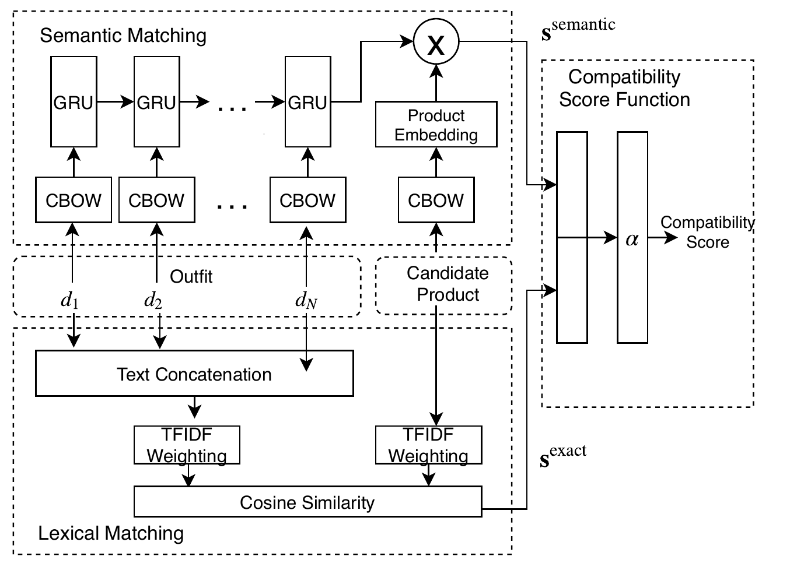

# Outfit completion: encode the existing outfit with a GRU and the candidate with an MLP, combine element-wise semantic matching with TF-IDF term matching, and weight both with one learned vector

> [中文版](walmart-ncr.md)

### Paper: Neural Compatibility Ranking for Text-based Fashion Matching (SIGIR 2019, short paper)
### Link: https://doi.org/10.1145/3331184.3331365
### Institution: Santa Clara University, Walmart Labs
### Ideas: text-only fashion compatibility, GRU outfit encoder, asymmetric two-tower, Hadamard interaction, TF-IDF lexical matching, learned weighted scoring, point-wise ranking
### Area: i2i (complementary recommendation, outfit matching)

## Breakdown:
The user provides an existing outfit (a few pieces of clothing, shoes, a bag), and the system ranks candidate products by how well each goes with it. The paper uses only the products' text descriptions and scores along two paths. Semantic matching reads the outfit's items one by one into a GRU to get an outfit vector, passes the candidate through a separate feed-forward network, and multiplies the two vectors element-wise. Lexical matching concatenates the outfit's text into one passage and computes the TF-IDF cosine against the candidate's title. The two are concatenated, weighted and summed by one learnable weight vector, and passed through a sigmoid to give the compatibility score.

Most existing outfit-matching models rely mainly on images and don't make full use of text descriptions, yet rare words in the text such as brand, material or designer often directly indicate that two products belong together. Semantic matching alone also favors frequent co-occurrences (jacket with jeans) and misses strong signals from rare words like "both are Zara". In addition, an outfit has a variable number of items, so ordinary text-retrieval models can't directly use the whole outfit as a query.

### Method
Semantic matching and lexical matching run in parallel, each producing an interaction signal, and the compatibility scorer combines them into one score.

#### Semantic matching
* **Product vector.** Each word of a product's description is looked up in pre-trained GloVe word vectors (300 dimensions), and all word vectors are averaged (i.e., CBOW). The word vectors are not fine-tuned.
* **Outfit encoding.** The product vectors of the outfit's items are randomly shuffled and fed one by one into a 1-layer GRU (a recurrent network that updates its hidden state after reading each item; 32-dim hidden state), and the final hidden state is the outfit vector. The authors say shuffling the order doesn't affect performance.
* **Candidate encoding.** The candidate's product vector goes through a separate 3-layer feed-forward network (300→128→32, ReLU) into the same 32-dim space as the outfit vector. The outfit side and the candidate side don't share an encoder.
* **Interaction.** The outfit vector and the candidate vector are multiplied element-wise (Hadamard product) to get a 32-dim semantic interaction vector. It is not summed; the scoring layer weights it.

**Why the candidate gets its own network.** The authors argue that a whole outfit and a single product have different statistical properties, so one shared mapping function is not flexible enough; they partly attribute the low HR@1 of DSSM and BiLSTM+VSE to "both sides sharing one mapping".

#### Lexical matching
The descriptions of all products in the outfit are concatenated into one passage as the query, and the candidate's title is the document. Both are turned into TF-IDF vectors (term frequency times inverse document frequency, so rarer words get larger weights), and their cosine similarity gives a scalar. This path has no learnable parameters; the authors say it could be swapped for BM25 or query likelihood.

**Why this path is needed.** Rare words such as brand, material or designer tend to get averaged away in semantic vectors, while TF-IDF cosine directly rewards "the outfit and the candidate share the same rare word", e.g., several outfit items are Zara and the candidate is also Zara.

#### Compatibility scoring
The 32-dim semantic interaction vector and the 1-dim lexical score are concatenated into 33 dimensions, dotted with a learnable weight vector, and passed through a sigmoid to get the compatibility score. The semantic part is equivalent to a per-dimension weighted inner product between the outfit vector and the candidate vector, with learned weights, so the scoring is neither a fixed dot product nor a multi-layer scoring network.

**Loss.** Point-wise training on (outfit, candidate, compatible or not) triplets with binary cross-entropy; there are 5 times as many negatives as positives. The paper doesn't say how training positives are cut from outfits or where negatives are sampled from.

**Why one shared weight vector.** Because both paths are scored by the same weight vector, the lexical score also takes part in the gradients and in turn influences how the semantic part is learned; the authors use this to distinguish the model from an ensemble of two separately trained models. Per-dimension weighting also lets useless semantic dimensions be down-weighted.

### Inference
Compute the compatibility score for each candidate one by one and sort by score. In evaluation, one item is randomly removed from each test outfit as the correct answer, and 100 items randomly drawn from other test outfits serve as negatives; the 101 items are ranked. The paper doesn't discuss how to retrieve from the full catalog.

### Data and results
Polyvore outfits (complete outfits curated by fashion bloggers): 21,889 outfits, with 17,316, 1,497 and 3,076 for training, validation and test. Outfits with fewer than 3 items and products whose descriptions have fewer than 3 words are removed, and training and test share no products. Metrics are MRR (the average reciprocal rank of the correct answer) and HR@k (the share of cases where the correct answer is in the top k). Offline experiments only.
* **Against text-only baselines.** NCR reaches MRR 0.2678 and HR@1 0.1547; among text-only baselines (query likelihood, BM25, DSSM, K-NRM), the highest MRR is query likelihood's 0.1762.
* **Against image+text baselines.** SiameseNet, which uses images, gets MRR 0.2559 and HR@1 0.1320, both below NCR; but on HR@5 and HR@10 NCR (0.3626, 0.5137) is slightly below SiameseNet's 0.3667 and BiLSTM+VSE's 0.5224.
* **Splitting the two paths.** Semantic matching alone gets MRR 0.1708 with HR@1 of only 0.0603 but HR@10 of 0.4296; lexical matching alone gets MRR 0.1794 and HR@1 0.1212 but HR@10 of only 0.2610. Combined, all three are clearly higher: the former gives coverage, the latter puts the right item first.

## Takeaways
* For text-only complementary matching, an exact-match TF-IDF feature on rare words (brand, material) complements dense semantic vectors: adding it lifts HR@1 from 0.0603 (semantic matching alone) to 0.1547.
* An asymmetric two-tower (GRU over a variable-size outfit, MLP for a single candidate) handles "set as query" without concatenating all text into one document.
* A learned weight vector over the Hadamard product plus one lexical scalar is still just a weighted inner product plus one scalar term, so the scorer stays cheap.

## Caveats
* The "state-of-the-art" claim holds for MRR and HR@1; on HR@5 and HR@10 NCR trails the image+text baselines, and significance over those baselines is marked only for HR@1.
* The 100 negatives are random items from other test outfits, not matched by category, so the task is easier than ranking same-category alternatives, and a shared brand word is a strong cue in this setup; retrieval from the full catalog is not evaluated.
* How training positives are built and where the 5x negatives come from is not described, and no code is released. The semantic side is described as using product descriptions while the lexical side uses candidate titles (a footnote says titles average about 5 words), so it is unclear whether these are different text fields.
* The lexical-only HR@10 in the ablation (0.2610) is identical to query likelihood's HR@10 in the main table, and the paper doesn't explain the relation.

## Credibility: offline

## Recommendation level: worth a look if you have time
