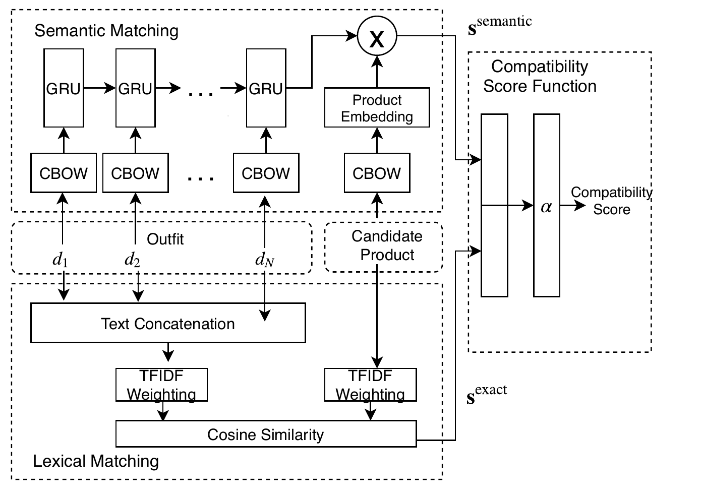

# 穿搭补全：已搭的几件用 GRU 编码、候选走前馈网络，逐维相乘做语义匹配，再加一路 TF-IDF 词匹配，一层线性层合成兼容分

关注我，每天为你精挑细选最优质、最新鲜的推荐算法paper，陪你一起保持进步、不断精进！

> [English version](walmart-ncr.full.en.md)

### 论文：Neural Compatibility Ranking for Text-based Fashion Matching
### 网址：https://doi.org/10.1145/3331184.3331365
### 公司：圣克拉拉大学、沃尔玛
### 思想：
### 方向：i2i（互补推荐、穿搭搭配）

## 解读：
给定已搭好的几件（衣服、鞋、包），从候选里排出最搭的一件，只用商品文字。语义匹配把已搭几件过 GRU、候选过前馈网络，两个向量逐维相乘；词匹配算整套文字和候选标题的 TF-IDF 余弦。两路拼起来，过一层线性层得到一个分数，再过 sigmoid 就是兼容分。

已有的穿搭搭配模型大多以图片为主，文字描述没用足；而文字里的品牌、材质、设计师这类少见词往往直接说明两件商品是一路的。只做语义匹配又会偏向高频共现（夹克配牛仔裤），抓不住「同是 Zara」这种少见词带来的强信号；另外一套穿搭件数不定，普通的文本检索模型没法直接拿整套当查询。

### 方法
语义匹配和词匹配两路并行，各自给出一个交互信号，再由兼容打分合成一个分数。

#### 语义匹配
已搭几件和候选各编码成一个 32 维向量，逐维相乘，得到 32 维语义交互向量，交给兼容打分。
* **商品向量（两侧共用）。** 每件商品的描述切成词，每个词查预训练 GloVe 词向量（300 维），所有词向量取平均（论文叫 CBOW，指词袋取平均，不是 word2vec 的训练目标）。词向量固定不微调（作者怕过拟合）。
* **整套编码。** 已搭几件的商品向量随机打乱顺序，依次送进一层 GRU（循环网络，每读一件更新一次隐状态，隐层 32 维），最后一步的隐状态作为整套向量。
* **候选编码。** 候选的商品向量另走一个 3 层前馈网络（300→128→32，ReLU），映射到和整套向量同一个 32 维空间。两侧不共享编码器。
* **交互。** 整套向量和候选向量逐维相乘（Hadamard 积），不求和，留给打分层加权。

**为什么打乱顺序。** 一套穿搭本是集合，没有先后。作者在脚注里说件的顺序不影响效果（没给数字），所以不用按上衣、下装、鞋的固定顺序排。

**为什么候选单独一个网络。** 作者认为一整套和单件商品的统计性质不同，共用一个映射不够灵活。

#### 词匹配
整套和候选各转成一个 TF-IDF 向量（词频乘逆文档频率，越少见的词权重越大），算余弦相似度（两个向量各自 L2 归一化后做内积），得到一个标量，交给兼容打分。这一路没有可学参数。
* **整套（当查询）。** 已搭几件的描述拼成一段文字，转成 TF-IDF 向量。
* **候选（当文档）。** 候选的标题转成 TF-IDF 向量。论文这里写的是标题，语义匹配那边写的是描述，没说两者是否同一个字段。

**为什么要这一路。** 品牌、材质、设计师这类少见词在语义向量里容易被平均掉，TF-IDF 余弦能直接奖励「整套和候选共享同一个少见词」，例如整套里多件是 Zara，候选也是 Zara。

#### 兼容打分
32 维语义交互向量和 1 维词匹配分拼成 33 维，过一层线性层（33 维变成 1 个分数），再过 sigmoid 得到兼容分。语义部分相当于整套向量和候选向量按维加权的内积，权重是学出来的，所以打分既不是固定的点积，也不是多层打分网络。

**损失。** 逐点训练，样本是（整套、候选、是否搭配），用二分类交叉熵，负样本数是正样本的 5 倍。正样本怎么从整套里切出来、负样本从哪里采，论文没写。

**为什么两路共用一层线性层。** 两路由同一层线性层打分，词匹配分也参与梯度，会反过来影响语义部分的学习，作者以此区别于两个模型分开训练再加权的集成；按维加权还能让没用的语义维度被压低。

### 推理
对每个候选算兼容分，按分数排序。论文只在 101 个候选里排序，没讨论全库召回。

按公式推（论文没做），可以做 ANN，而且不损失精度。记整套向量为 o、候选向量为 c（都是 32 维），线性层的 33 个权重里前 32 个为 w、最后一个为 w₃₃（偏置是常数，不影响排序），整套和候选的 TF-IDF 向量做 L2 归一化后为 u、v（余弦就是 u·v），则

兼容分 = sigmoid( Σ_d w_d·o_d·c_d + w₃₃·(u·v) )

sigmoid 单调，不改变排序，只看括号里。第一项等于 (w⊙o)·c，第二项等于 (w₃₃·u)·v，两项合起来就是一次内积

[w⊙o ; w₃₃·u] · [c ; v]

分号表示把两段向量首尾拼成一个长向量，两个长向量做内积，等于对应段各自内积再相加。左边只依赖整套，查询时现算；右边只依赖候选（IDF 在语料上统计好就固定），可以离线算好建索引。所以整个打分就是最大内积检索，向量是 32 维稠密部分加词表长度的稀疏部分，用支持稠密加稀疏混合检索的索引即可。没有这种索引时，也可以语义、词匹配两路各召回一批（前者走稠密 ANN，后者走倒排索引），合并后按完整兼容分重排。

### 数据与效果
Polyvore 穿搭数据（时尚博主搭配的整套），21,889 套，训练、验证、测试分别 17,316、1,497、3,076 套；去掉少于 3 件的套装和描述少于 3 个词的商品，训练和测试没有共同商品。评测时每套测试穿搭随机拿掉一件当正确答案，再从其他测试穿搭里随机抽 100 件当负样本，在这 101 件里排序，指标是 MRR（正确答案排名倒数的平均）和 HR@k（正确答案排进前 k 的比例）。只有离线实验。
* **整体。** NCR 的 MRR 为 0.2678，纯文本基线里最高的是 0.1762；比用了图片的基线 MRR、HR@1 更高，HR@5、HR@10 略低。
* **拆两路。** 只用语义匹配 HR@1 只有 0.0603、HR@10 有 0.4296；只用词匹配 HR@1 0.1212、HR@10 只有 0.2610。合起来都明显更高（HR@1 0.1547），前者负责召得全，后者负责排第一。

## 心得：

## 愚见

## 可信度：离线

## 推荐等级：有时间看看

**请帮忙点赞、转发，谢谢。欢迎干货投稿 \ 论文宣传\ 合作交流**

### 【铁粉】请入微信群，群内我会给出更深入的解读，还可以共同讨论技术方案、发招聘广告、内推和交友等。
* 铁粉标准：关注公众号一个月以上，且在公众号上累计15次互动（评论、爱心、转发）、或投稿1次，只欢迎技术同学。
* 入群方法：请您加个人微信lmxhappy，我拉您入群，请备注【公司】（只我个人看，不公开）。

## 推荐您继续阅读：
