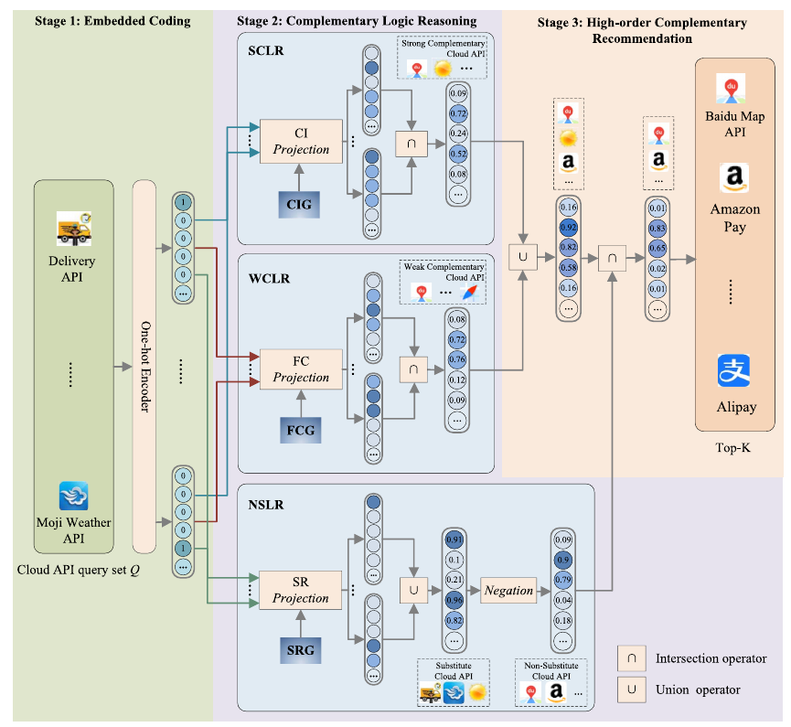

# Recommending complementary APIs for a set of APIs: project each trigger on a graph, then combine with intersection, union and negation

> [中文版](ysu-lrn4hcar.md)

### Paper: A Logical Reasoning Network for High-Order Complementary Cloud API Recommendation (IEEE TSC 2025)
### Link: https://doi.org/10.1109/TSC.2025.3579133
### Company: Yanshan University, Xidian University
### Idea: graph neural networks, link prediction, fuzzy-logic composition, long tail
### Area: i2i (complementary recommendation with a set of triggers)

## Overview:
A developer's app already uses several cloud APIs (say, a delivery-tracking API), and the system should recommend which APIs to add next (say, maps or weather). The trigger is a set of APIs (the query set): each recommendation must complement every API in the set and must not be a substitute for any of them. With a single API in the set, this is ordinary single-trigger complementary recommendation.

The model, LRN4HCAR, builds three API relation graphs, runs link prediction once per API in the set on each graph to get a probability for every candidate, and then combines these probabilities into a final score with intersection, union and negation. Published in IEEE TSC 2025, with open-source code; offline experiments only.

### Data side: three relation graphs
The data comes from two API ecosystems: ProgrammableWeb (6,452 mashups, 23K APIs, 13K invocations) and Huawei AppGallery (11K apps, 1,946 APIs, 99K invocations), with one functional category per API. The long tail is heavy: APIs invoked fewer than 5 times make up 80% and 68% of the APIs, respectively.

**Co-invocation graph (strong complementarity).** Two APIs are connected if the same app has invoked both.

**Function co-occurrence graph (weak complementarity).** Co-occurrence is first counted at the category level: 86.9% of apps that call a "Weather" API also call a "Mapping" API. Two APIs whose categories often co-occur are connected, even if the two APIs have never been called together (the paper gives no threshold for "often"). Long-tail APIs have few calls and almost no edges on the co-invocation graph; this graph connects them through their categories.

**Substitute relation graph.** Functionally similar APIs are connected, so that substitutes can be pushed down. The paper does not give the exact edge rule.

**Samples.** For each app, every n of its APIs form a query set and the remaining APIs are the answers; n is 1, 2 or 3, and the three are also merged into a hybrid dataset. The data is split 7:2:1 into train, validation and test.

### Model side

Three steps: first, for each API in the set and on each graph, compute "the probability that each candidate has this relation with it"; then combine the per-API results into a probability for the whole set; finally, combine the results from the three graphs into the final score.

#### (1) Graph projection for a single API
Given one query API and one relation, the model propagates for T rounds on the corresponding graph starting from that API, producing link probabilities for all candidates at once.

**Initialization.** Only the query API's node is initialized to the relation's vector; all other nodes start at zero. So the same candidate gets a different representation under a different query, encoding the paths from that query to it.

**Propagation.** In each round, every node receives messages from its neighbors: the neighbor's previous representation multiplied element-wise by a vector transformed from the relation vector; the messages are then combined with several aggregators (mean, max, min, standard deviation). This scheme comes from NBFNet, a knowledge-graph link prediction model.

**Output.** After T rounds, each node's representation goes through an MLP and a sigmoid, giving the probability that the candidate has this relation with the query.

#### (2) Combining into a probability for the whole set
The operations are element-wise on probabilities, one per logical operator: intersection = product, union = p₁ + p₂ − p₁p₂, negation = 1 − p.

**Strong complementarity.** The co-invocation probabilities of all APIs in the set are intersected, i.e., multiplied: a candidate scores high only if it complements every one of them.

**Weak complementarity.** The same intersection on the function co-occurrence graph.

**Non-substitute.** On the substitute graph, take the union first (a substitute of any one counts as a substitute), then the negation.

#### (3) Combining into the final score
Final score = (strong ∪ weak) ∩ non-substitute, i.e., (p_strong + p_weak − p_strong·p_weak) × p_non-substitute, and the top K are returned. The paper only gives a BCE loss on this final score: positives are the app's remaining APIs and negatives are APIs not complementary to the set; the projections on the three graphs have no supervision of their own.

### Results (offline only)
At K=20 on the hybrid datasets, HR is 0.918 on ProgrammableWeb and 0.844 on Huawei, versus 0.874 and 0.837 for the strongest baseline, BSARec. The share of recommendations that substitute a query API (SD) drops from about 0.15–0.18 to 0.06–0.08, and the share of long-tail APIs (LTP) is also higher than the strongest baseline. Baselines include the FM family and several sequential recommenders (fed the query set as a sequence). In the ablation, the substitute graph mainly lowers SD, roughly halving it; the function co-occurrence graph mainly raises the long-tail share and the category hit rate.

## Takeaways:
* Multi-trigger requirements can be written directly as probability operations: "complements every one" = compute a probability per trigger and multiply; "is not a substitute for any one" = multiply by (1 − the union of substitute probabilities). The rules are clear and explainable, and carry over to multi-trigger settings such as carts and outfits.
* Long-tail items have no edges on the behavior graph; category-level co-occurrence (weather APIs often pair with map APIs) can add edges for them as an extra retrieval signal.
* The projection propagates over the whole graph starting from the query, so item vectors cannot be precomputed and ANN cannot be used; each request runs several full-graph propagations, one per API in the set.

## My take
* The overall framework follows complex logical queries on knowledge graphs (GNN-QE, ICML'22): NBFNet for projection and product-style fuzzy logic for intersection, union and negation. The paper's contribution lies in the design of the three graphs and how they are combined.
* The abstract claims LRN4HCAR beats the other methods in all experimental settings, but in Table IV's Huawei 1-order scenario its HR of 0.806 is below MC-RGN (0.876), FEARec and BSARec, and its MRR of 0.170 is below MC-RGN (0.293); MRR is also below MC-RGN in the ProgrammableWeb 1-order and Huawei hybrid scenarios. The "improvement" row only compares against BSARec, which is not always the strongest baseline, and the whole LRN4HCAR row is bolded, including cells that are not the best.
* In the ablation, adding only the function co-occurrence graph or only the substitute graph changes HR little and sometimes lowers it (Huawei 1-order with the co-occurrence graph: 0.751 → 0.712); adding both raises 1-order HR markedly (ProgrammableWeb 0.782 → 0.877, Huawei 0.751 → 0.806). The paper calls this a synergistic effect without explaining it. In the 2- and 3-order scenarios, the full model's HR is lower than the co-invocation-only version (e.g., ProgrammableWeb 2-order 0.937 → 0.935, Huawei 2-order 0.886 → 0.875).
* One app yields several (query, answer) groups. The paper only says the data is split 7:2:1, not whether the split is by app; if it is by group, combinations from the same app appear in both train and test. Nor does it say whether the co-invocation graph is built from training invocations only; if it uses all records, test answers are direct neighbors of the query on the graph.
* The paper does not say where the substitute relations in SD or the target functions in the category hit rate (HRF) come from; if they share sources with the substitute graph and the functional categories, part of the advantage on these two metrics is built in by construction. Results come without variance or significance.

## Credibility: offline

## Recommendation level: worth a look if you have time
