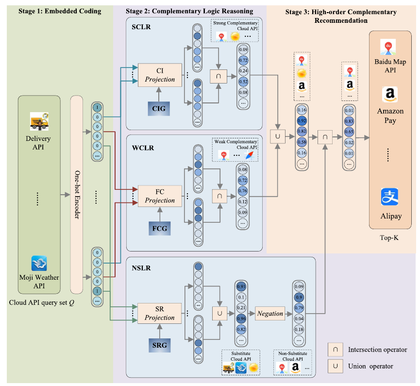

# 给一组 API 推荐互补 API：逐个 trigger 图上投影，再用交、并、非组合

关注我，每天为你精挑细选最优质、最新鲜的推荐算法paper，陪你一起保持进步、不断精进！

> [English version](ysu-lrn4hcar.full.en.md)

### 论文：A Logical Reasoning Network for High-Order Complementary Cloud API Recommendation
### 网址：https://doi.org/10.1109/TSC.2025.3579133
### 公司：燕山大学、西安电子科技大学
### 思想：图神经网络、链接预测、模糊逻辑组合、长尾
### 方向：i2i

## 解读：
开发者的 App 已经接了几个云 API（比如快递查询），系统要推荐还该接哪些 API（比如地图、天气）。trigger 是一组 API（query 集合），要求推荐结果和集合里每一个都互补，且不能是其中任何一个的替代品。集合只有 1 个 API 时，就是普通的单 trigger 互补推荐。

本文建三张 API 关系图，对集合里每个 API 在每张图上各做一次链接预测，得到所有候选的概率，再用交、并、非把这些概率组合成最终分数。

### 数据侧：三张关系图
数据来自两个 API 生态：ProgrammableWeb（6452 个 Mashup、2.3 万个 API、1.3 万条调用）和华为应用市场（1.1 万个 App、1946 个 API、9.9 万条调用），每个 API 带一个功能类目。长尾很重：调用少于 5 次的 API 分别占 80% 和 68%。

**共调用图（强互补）。** 两个 API 被同一个 App 调用过，就连一条边。

**功能共现图（弱互补）。** 先在功能类目层面统计共现：调用了「天气」类 API 的 App，有 86.9% 也调用了「地图」类。两个 API 的功能类目经常共现，就连一条边，即使这两个 API 从没被一起调用过（论文没给「经常」的阈值）。长尾 API 调用少，在共调用图上几乎没有边，在这张图上可以借类目连进来。

**替代关系图。** 功能相似的 API 之间连边，用来压低替代品的分数。论文没给具体的建边规则。

**样本。** 对每个 App，从它调用的 API 里任取 n 个作为 query 集合，其余的作为答案；n 取 1、2、3，另把三者合成一个混合数据集。按 7:2:1 切分训练、验证、测试。

### 模型侧

分三步：先对集合里每个 API、在每张图上各算一次「所有候选和它有这种关系的概率」；再把集合里各个 API 的结果合成对整个集合的概率；最后把三张图的结果合成最终分数。

#### （1）单个 API 的图上投影
给定一个 query API 和一种关系，从这个 API 出发在对应的图上传播 T 轮，一次算出所有候选的链接概率。

**初始化。** 只有 query API 这个节点初始化为该关系的向量，其他节点全为 0。所以同一个候选，换一个 query 就有不同的表示，表示里编码的是「从这个 query 走到我」的路径信息。

**传播。** 每轮每个节点从邻居收消息：邻居上一轮的表示逐元素乘上一个由关系向量变换来的向量；再用多种聚合方式（均值、最大、最小、标准差）组合邻居消息。这套做法来自知识图谱链接预测的 NBFNet。

**输出。** T 轮后每个节点的表示过 MLP + sigmoid，就是这个候选和 query 有该关系的概率。

#### （2）合成对整个集合的概率
概率逐元素做运算，三种运算对应三种逻辑：交 = 相乘，并 = p₁ + p₂ − p₁p₂，非 = 1 − p。

**强互补。** 集合里每个 API 在共调用图上的概率取交，即相乘：候选要和每一个都互补，分数才高。

**弱互补。** 在功能共现图上同样取交。

**非替代。** 在替代关系图上先取并（和任何一个是替代就算替代），再取非。

#### （3）合成最终分数
最终分数 = （强互补 ∪ 弱互补）∩ 非替代，即 (p强 + p弱 − p强·p弱) × p非替代，按分数取 top-K。论文只给了这一个最终分数上的 BCE：正样本是该 App 的其余 API，负样本是不和集合互补的 API；三张图上的投影没有各自的监督。

## 心得：
* 

## 愚见
* 

## 可信度：离线

## 推荐等级：有时间看看

**请帮忙点赞、转发，谢谢。欢迎干货投稿 \ 论文宣传\ 合作交流**

### 【铁粉】请入微信群，群内我会给出更深入的解读，还可以共同讨论技术方案、发招聘广告、内推和交友等。
* 铁粉标准：关注公众号一个月以上，且在公众号上累计15次互动（评论、爱心、转发）、或投稿1次，只欢迎技术同学。
* 入群方法：请您加个人微信lmxhappy，我拉您入群，请备注【公司】（只我个人看，不公开）。

## 推荐您继续阅读：
