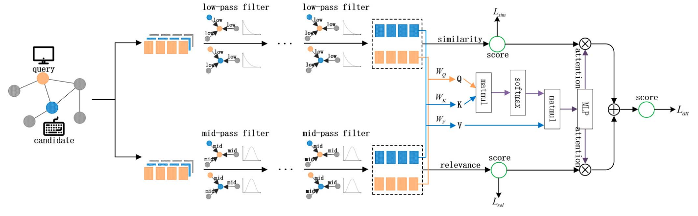

# Complementary item recommendation: low-pass and mid-pass graph filters learn "similar" and "related" separately, each gives a score, and the two are weighted per item pair

> [中文版](zjut-sr-rec.md)

### Paper: Similar or Related: Spectral-Based Item Relationship Mining With Graph Convolutional Network for Complementary Recommendation (IEEE TAI 2025)
### Link: https://doi.org/10.1109/TAI.2025.3543820
### Institution: Zhejiang University of Technology
### Ideas: spectral graph convolution, low-pass/mid-pass filtering, bilinear scoring, pairwise attention
### Area: i2i (complementary item recommendation)

## Breakdown:
**On the same co-purchase graph, a low-pass filter learns similarity and a mid-pass filter learns relevance; the two scores are summed with per-pair weights.**

The paper proposes SR-Rec. On the co-purchase graph, two graph filters produce a "similarity vector" and a "relevance vector" for each item. The similarity vectors give a similarity score via inner product, the relevance vectors give a relevance score via a bilinear function, and pairwise attention weights the two scores; the weighted sum is the final complementarity score.

The task: given an item, recommend items that complement it. The authors split item relations into two kinds. One is similarity (similar function, e.g., a desktop and a laptop), which corresponds to substitution; the other is relevance (different functions but often bought together, e.g., a desktop with a keyboard and mouse), which corresponds to complementarity. The co-purchase graph mixes both, and earlier methods merge them into one vector, so they can't be separated, and it's unclear which kind of relation drove a given recommendation.

Note that separating similarity from relevance here is not meant to exclude substitutes. Both scores are trained with co-purchase edges as positives and are added together at the end, so a high similarity score also raises the complementarity score; the aim is only to learn the two signals separately and decide, per item pair, how much each contributes.

### Model architecture
Four steps. (1) corresponds to the two filter branches in the figure, low-pass on top and mid-pass below; (2) corresponds to the two scores on the right and the pairwise attention in the middle; (3) is the three losses (L_sim, L_rel, L_att in the figure); (4) is inference. In the figure, orange marks query items and blue marks candidate items.

### (1) Two graph filters: low-pass learns similarity, mid-pass learns relevance
The graph is Amazon's co-purchase graph (undirected); node features are vectors extracted from item text descriptions with a pretrained model.

**What frequency means here.** Treat item vectors on the graph as a signal. A low-frequency signal is smooth over the graph, with connected items having nearly the same vector; a mid-frequency signal means connected items differ somewhat; a high-frequency signal means neighbors differ a lot, which the authors treat as mostly noise and don't use. Following the observation in SComGNN (AAAI 2024), low frequency corresponds to similarity and mid frequency to relevance.

* **Low-pass filter.** The convolution kernel is [(I + Â)/2]^k, where  is the normalized adjacency matrix. Each multiplication averages every item with its neighbors, so k multiplications smooth k times; connected items' vectors become increasingly alike, giving the similarity vector.
* **Mid-pass filter.** The convolution kernel is [I − ²]^k. I − ² is "self minus the average of two-hop neighbors", which keeps the part that differs from the neighbors, giving the relevance vector.
* **The role of k.** The larger k, the narrower the band the filter keeps, so the two signals separate more cleanly, but more information is lost. k is searched over 1 to 10, and set to 5, 5 and 4 on the three datasets.

Each branch is an ordinary graph convolution layer (kernel × previous-layer vectors × weight matrix, then ReLU), and layers can be stacked.

### (2) Two scores plus pairwise attention
* **Similarity score.** Inner product of the two items' similarity vectors.
* **Relevance score.** A bilinear function of the two items' relevance vectors (vector i × matrix W × vector j). Inner product isn't used because two complementary items (a computer and a keyboard) aren't necessarily close in vector space. The authors view it as a knowledge-graph triple (item i, related, item j) with a single relation, "related", represented by W.
* **Pairwise attention.** Each item has two tokens (similarity vector, relevance vector), projected into Q, K and V with shared W_Q, W_K, W_V. For the pair (i, j), j's two Qs attend over i's two Ks to weight i's two Vs; the result goes through a small two-layer network that outputs two weights, one for the similarity score and one for the relevance score. The same is computed for (j, i), and the two sets of weights are averaged.
* **Final score.** The two weights multiply the similarity and relevance scores, which are then summed; this ranks the candidates.

**Why this design.** Different item pairs depend on similarity and relevance to different degrees. Scoring the two relations separately and then weighting them interferes less than merging the two kinds of vectors, and the weights can indicate which relation a recommendation mainly relies on.

### (3) Training
All three losses are InfoNCE-style contrastive losses with the same formula, differing only in which score is plugged in, and they are summed with equal weights.
* **Similarity loss L_sim.** Acts on the similarity score and constrains the low-pass branch on its own.
* **Relevance loss L_rel.** Acts on the relevance score and constrains the mid-pass branch on its own.
* **Attention loss L_att.** Acts on the final score and constrains the two branches and the pairwise attention jointly.

Each co-purchase edge is a positive; for each positive, 2 unconnected items are sampled at random as negatives. Scores go through a sigmoid and are divided by a temperature, and positives must score higher than negatives.

### (4) Inference
The paper doesn't describe inference separately; following the model structure, it works like this. Both filter branches run once over the whole graph, so every item's similarity and relevance vectors can be computed offline; for a query item, each candidate gets a similarity score, a relevance score and pairwise attention weights, and the top K by final score are returned. Because pairwise attention looks at both items at once, items can't be compressed into single vectors for ANN retrieval, so the model suits ranking a retrieved candidate set; new items with no co-purchase edges also get no graph representation.

### Data and results
Three Amazon subsets (Appliances with 804 items, Grocery 39K, Home 76K). For each item, one edge is held out at random for test and one for validation, with the rest for training; items with fewer than 3 edges go entirely into training. 16-dim vectors, averaged over 10 random seeds. Offline experiments only. Against SComGNN, HR@5 is 8.54% higher on average, HR@10 5.34% higher and NDCG 6.10% higher; Appliances gains the most (HR@5 from 0.49 to 0.57) and Home the least (0.79 to 0.82). The ablation is done only on Appliances: removing the low-pass branch drops HR@5 from 0.5655 to 0.0436, removing the mid-pass branch to 0.5366, and removing attention to 0.5455.

## Takeaways:
* Co-purchase relations mix two signals, similarity and relevance, which can be learned separately with graph filters on different frequency bands and scored separately.
* The relevance score uses a bilinear function rather than an inner product, because complementary items aren't necessarily close in vector space.
* The two scores' weights are computed per item pair, so a recommendation can be explained as relying on similarity or on relevance.

## Caveats
* The model doesn't exclude substitutes. Negatives are randomly sampled unconnected items, which almost never hit substitutes, and substitutes are never used as negatives (the also_view field already in the data goes unused); substitutes mixed into the co-purchase edges are actually positives. The final score is a weighted sum of the two scores, so a higher similarity score means a higher final score. The weights aren't normalized and could in principle be negative, but the paper doesn't report the learned values, nor does it check whether the low-pass branch actually learns substitution.
* With the low-pass (similarity) branch removed, Appliances HR@5 falls to 0.0436, below the 0.2040 of popularity-only recommendation; removing the mid-pass (relevance) branch only drops it to 0.5366. So the similarity signal does most of the work for complementary recommendation, which sits uneasily with the paper's premise that complementarity is not similarity. The paper also doesn't explain the result falling below the popularity baseline. The ablation is done only on the smallest dataset, Appliances (804 items).
* The two weights aren't normalized (the last layer is a linear output, not a softmax), so they can take any size and sign, which weakens their use for "quantifying the impact of the two relations".
* The paper doesn't say how many candidates each test positive is ranked against.
* A few details don't match. The mid-pass filter function is written as (λ²−2λ)^k, but the eigenvalues of the corresponding kernel [I − ²]^k are actually (2λ−λ²)^k, which differ by a sign when k is odd (k=5 on Appliances and Grocery); the "Model Implement" section calls the mid frequency "high frequency"; the relevance score is called a symmetric bilinear function, but W isn't constrained to be symmetric.

## Credibility: offline

## Recommendation level: worth a look if you have time
