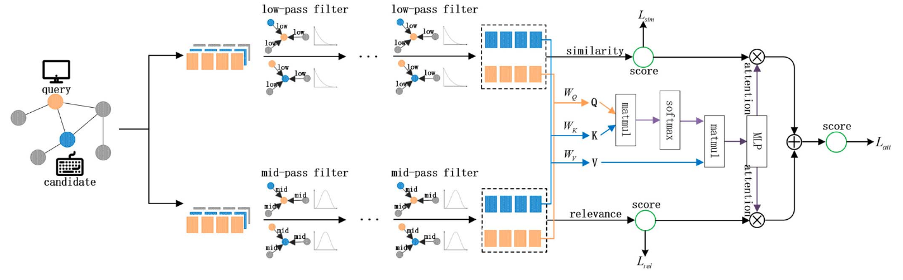

# 互补品推荐：低通、中通两个图滤波器分别学「相似」和「相关」，各打一个分，再按商品对加权

关注我，每天为你精挑细选最优质、最新鲜的推荐算法paper，陪你一起保持进步、不断精进！

> [English version](zjut-sr-rec.full.en.md)

### 论文：Similar or Related: Spectral-Based Item Relationship Mining With Graph Convolutional Network for Complementary Recommendation
### 网址：https://doi.org/10.1109/TAI.2025.3543820
### 公司：浙江工业大学
### 思想：频谱图卷积、低通/中通滤波、双线性打分、成对注意力
### 方向：i2i（互补品推荐）

## 解读：
**同一张共购图，低通滤波学相似、中通滤波学相关，两个分按商品对加权求和。**

本文提出，在共购图上用两个图滤波器分别得到每个商品的「相似向量」和「相关向量」，相似向量用内积打相似分，相关向量用双线性函数打相关分，再用成对注意力给两个分加权，加权和作为最终的互补分。

场景是给定一个商品，推荐和它互补的商品。作者把商品间的关系分成两种。一种是相似（功能相近，台式机和笔记本），对应替代；另一种是相关（功能不同但常一起买，台式机和键盘、鼠标），对应互补。共购图里两种关系混在一起，以往方法把它们揉进同一个向量，分不开，也说不清一次推荐是靠哪种关系推出来的。

要注意，本文分开相似和相关，不是为了把替代品排除掉。两个分都用共购边当正样本训练，最后加在一起，相似分高也会让互补分变高；目的只是把两种信号分开学，再按商品对决定各占多少。

### 模型结构
分四步。（1）对应图中上下两路滤波器，上路低通、下路中通；（2）对应右侧的两个分和中间的成对注意力；（3）是三个损失（图中 L_sim、L_rel、L_att）；（4）是推理。图中橙色是查询商品，蓝色是候选商品。

### （1）两个图滤波器：低通学相似，中通学相关
图是 Amazon 的共购图（无向），节点特征是用预训练模型从商品文本描述里抽的向量。

**频率是什么意思。** 把图上的商品向量看成信号。低频信号在图上很平滑，相连的商品向量差不多；中频信号是相连的商品有一定差别；高频信号是相邻商品差别很大，作者认为主要是噪声，不用。沿用 SComGNN（AAAI 2024）的观察，低频对应相似，中频对应相关。

* **低通滤波。** 卷积核是 [(I + Â)/2]^k，Â 是归一化邻接矩阵。乘一次相当于每个商品和邻居取平均，乘 k 次就是平滑 k 遍，相连商品的向量越来越像，得到相似向量。
* **中通滤波。** 卷积核是 [I − ²]^k。I − ² 是「自己减去两跳邻居的平均」，保留和邻居有差别的部分，得到相关向量。
* **k 的作用。** k 越大，滤波器截取的频段越窄，两种信号分得越开，但丢的信息也越多。k 在 1 到 10 之间搜，三个数据集取 5、5、4。

每一路都是普通的图卷积层（卷积核 × 上一层向量 × 权重矩阵，过 ReLU），可以堆多层。

### （2）两个分，加成对注意力
* **相似分。** 两个商品相似向量的内积。
* **相关分。** 两个商品相关向量的双线性函数（向量 i × 矩阵 W × 向量 j）。不用内积，是因为互补的两个商品（电脑和键盘）在向量空间里不一定挨得近。作者把它看成知识图谱里的三元组（商品 i，相关，商品 j），关系只有「相关」这一种，用 W 表示。
* **成对注意力。** 每个商品有两个 token（相似向量、相关向量），用共享的 W_Q、W_K、W_V 投影成 Q、K、V。对商品对 (i, j)，j 的两个 Q 去和 i 的两个 K 做注意力，加权 i 的两个 V，过两层小网络，输出两个权重，分别给相似分和相关分。反过来再算一遍 (j, i)，两组权重取平均。
* **最终分。** 两个权重分别乘相似分和相关分再相加，用来给候选排序。

**为什么这样做。** 不同商品对依赖相似和相关的程度不一样。两种关系分开打分再加权，比把两种向量揉在一起更不容易互相干扰，权重也能说明这次推荐主要靠哪种关系。

### （3）训练
三个损失都是类似 InfoNCE 的对比损失，公式相同，只是代入的分数不同，等权相加。
* **相似损失 L_sim。** 作用在相似分上，单独约束低通分支。
* **相关损失 L_rel。** 作用在相关分上，单独约束中通分支。
* **注意力损失 L_att。** 作用在最终分上，把两个分支和成对注意力一起约束。

每条共购边是正样本，每个正样本随机采 2 个不相连的商品当负样本；分数先过 sigmoid、再除以温度，要求正样本的分高于负样本。

### （4）推理
论文没单独写推理流程，按模型结构是这样。两路滤波在整张图上跑一遍，所有商品的相似向量和相关向量可以离线算好；对查询商品，逐个候选算相似分、相关分和成对注意力权重，按最终分取前 K。成对注意力要同时看两个商品，没法把每个商品压成一个向量做 ANN 检索，更适合在召回出的候选集上排序；新商品没有共购边，也拿不到图上的表示。

### 数据与效果
Amazon 三个子集（Appliances 804 个商品，Grocery 3.9 万，Home 7.6 万）。每个商品随机留一条边做测试、一条做验证，其余训练；边数少于 3 的商品全部放进训练。向量 16 维，10 个随机种子取平均。只有离线实验。对比 SComGNN，HR@5 平均高 8.54%，HR@10 高 5.34%，NDCG 高 6.10%；Appliances 提升最大（HR@5 从 0.49 到 0.57），Home 最小（0.79 到 0.82）。消融只在 Appliances 上做，去掉低通分支 HR@5 从 0.5655 降到 0.0436，去掉中通分支降到 0.5366，去掉注意力降到 0.5455。

## 心得：
* 共购关系里混着相似和相关两种信号，可以用不同频段的图滤波器分开学，再分别打分。
* 相关分用双线性函数而不是内积，因为互补品在向量空间里不一定挨得近。
* 两个分的权重按商品对计算，推荐结果能解释是靠相似还是靠相关。

## 愚见
* 模型没有把替代品排除掉。负样本是随机采的不相连商品，几乎碰不到替代品，也没有用替代品当负样本（数据里现成的 also_view 字段没用上）；共购边里混着的替代品反而是正样本。最终分是两个分的加权和，相似分越高最终分越高。权重没有归一化、理论上可以为负，但论文没报告学出来的取值，也没检查低通分支学到的是不是替代关系。
* 去掉低通（相似）分支后，Appliances 的 HR@5 降到 0.0436，比只按流行度推荐的 0.2040 还低；去掉中通（相关）分支只降到 0.5366。对互补推荐起主要作用的反而是相似信号，和文章「互补不等于相似」的出发点不太一致。低于流行度基线的结果论文也没解释。消融只在最小的 Appliances（804 个商品）上做。
* 两个权重没有归一化（最后一层是线性输出，不是 softmax），可以是任意大小和正负，用它「量化两种关系的影响」要打折扣。
* 评测时每个测试正样本和多少个候选比较，论文没说。
* 几处细节对不上。中通滤波函数写作 (λ²−2λ)^k，对应卷积核 [I − ²]^k 的特征值其实是 (2λ−λ²)^k，k 为奇数时（Appliances、Grocery 取 k=5）差一个负号；「Model Implement」一节把中频写成了高频；相关分称为对称双线性函数，但 W 没有约束成对称矩阵。

## 可信度：离线

## 推荐等级：有时间看看

**请帮忙点赞、转发，谢谢。欢迎干货投稿 \ 论文宣传\ 合作交流**

### 【铁粉】请入微信群，群内我会给出更深入的解读，还可以共同讨论技术方案、发招聘广告、内推和交友等。
* 铁粉标准：关注公众号一个月以上，且在公众号上累计15次互动（评论、爱心、转发）、或投稿1次，只欢迎技术同学。
* 入群方法：请您加个人微信lmxhappy，我拉您入群，请备注【公司】（只我个人看，不公开）。

## 推荐您继续阅读：
