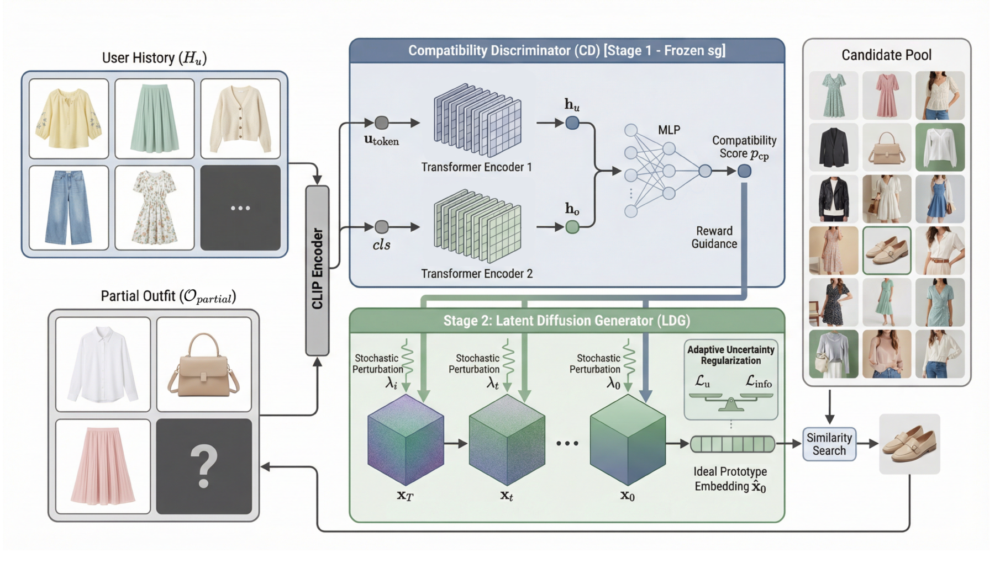

# Personalized outfit completion with a diffusion model: generate the vector of an "ideal item", then retrieve the closest product

> [中文版](zstu-pdor.md)

### Paper: Personalized Diffusion-based Outfit Recommendation with Diffusion-Aware Stochastic Perturbation (IJCNN 2026)
### Link: https://doi.org/10.1109/IJCNN69854.2026.11729495
### Company: Zhejiang Sci-Tech University
### Idea: diffusion models, generate-then-retrieve, a compatibility discriminator as the reward, personalized outfits
### Area: i2i (complementary recommendation for a partial outfit)

## Overview:
The paper addresses personalized outfit completion: a user has put together a few items and one is still missing, and the system has to add an item that goes with the existing ones and also suits this user's taste. The trigger is the items already in the outfit, together with the user's historical items. The authors argue that the same context usually admits several reasonable completions (the same pair of jeans works with a white T-shirt or a plaid shirt), and a model that outputs a single point cannot express this "one-to-many" relationship.

The paper proposes PDOR (published at IJCNN 2026). It uses a diffusion model in the CLIP item-embedding space to generate the vector of the missing item, then retrieves the most similar products from the candidate pool by cosine similarity. Training has two stages: first a compatibility discriminator is trained; it is then frozen and plugged into the diffusion generator's loss as a reward. Offline experiments only.

### Model side

Four steps overall. First, every item is encoded into a vector; in stage 1 these vectors are used to train the compatibility discriminator; in stage 2 the diffusion generator is trained, with the frozen discriminator scoring its output; at inference, a vector is generated and used to retrieve from the candidate pool.

#### (1) Item encoding
A frozen CLIP extracts an image vector and a text vector for each item, which are concatenated and passed through a projection layer to get a d-dimensional vector, shared by the discriminator and the generator (the diffusion target, the picked items, the user history and the retrieval candidates later on are all this vector).

#### (2) Compatibility discriminator (stage 1)
This is the blue box at the top of the figure (the figure feeds it the partial outfit, which does not match the text; the text is followed here). This step trains a scorer that takes a user and a complete outfit and outputs the probability p_cp that the outfit is compatible (the paper intends it to measure both whether the items go together and whether the style suits this user, hence the user vector in the input, but the training labels are only whether the whole outfit is compatible or not). Stage 2 uses it as the reward (what goes in then is the picked items plus the generated one).

**Structure.** A learnable user token is prepended to the vectors of the user's historical items, the sequence goes through a Transformer, and the output at the user-token position is the user vector h_u. The outfit's items get a cls token and go through another Transformer, and the output at the cls position is the outfit vector h_o. h_u and h_o are concatenated and passed through an MLP, which outputs p_cp.

**Loss.** Labels are per whole outfit (compatible or not), not per pair of items. The main loss is focal loss (larger weights for hard samples, to ease the imbalance between positives and negatives). Two auxiliary terms are added. One is an outfit-level supervised contrastive loss (compatible outfits in the same batch are positives for each other, incompatible ones are negatives). The other is an item-diversity constraint (after L2-normalizing the item vectors within an outfit, a penalty applies if their variance falls below a threshold, to keep the Transformer from smoothing the items of one outfit into near-identical vectors). Negatives include both random items and hard items from the same category (neither the ratio nor how an incompatible outfit is assembled is stated).

#### (3) Diffusion generator (stage 2)
This is the green box at the bottom of the figure. This step learns what the missing item's vector looks like given the user and the items already picked, and outputs the vector x̂_0.

* Build the partial outfit. During training, one item is removed from a complete outfit as the target and the rest serve as the picked items.

* Rewrite the items. The removed item's vector x_0 is noised step by step with Gaussian noise on a cosine schedule, giving the noisy vector x_t at step t. Each picked item's vector e_i is not fed in directly; it becomes e_i + λ_i × (x_t + the step-t time embedding), where λ_i is freshly sampled from a small-variance Gaussian each time; this is the only path by which x_t enters the denoising network.

* Encode the picked items. The modified picked items then go through a Transformer to give the context vector h_o^mod (the paper does not say whether it takes the cls position or pools some other way, nor whether this Transformer is shared with the discriminator).

* Generate the missing item with the denoising network. A U-Net-like encoder-decoder takes h_o^mod, the user vector h_u and the time embedding, and directly predicts the clean target vector x̂_0.

**Why add this term to the picked items.** The authors call this diffusion-aware stochastic perturbation. Their explanation: since λ_i and t are re-sampled every time, the same set of picked items has different vectors at each training step, which acts as data augmentation; the model cannot memorize "these exact vectors map to that answer" and has to learn more stable compatibility relations.

**Loss.** Three terms.
- **Reconstruction:** x̂_0 should be close both to the true vector x_0 and to an augmented version of x_0 (standardized within the batch, randomly scaled and shifted, then normalized again); the two MSE terms are averaged, giving L_u.
- **Contrastive:** x̂_0 and x_0 form a positive pair and the other items in the batch are negatives, trained with InfoNCE, to keep the generated vectors from collapsing toward the average. The weight γ between L_u and InfoNCE is adjusted dynamically from an exponential moving average of their ratio.
- **Compatibility reward:** x̂_0 is fed together with the picked items into the frozen discriminator to get p_cp; the loss is −log p_cp, and the gradient flows back through the discriminator into the generator. Total loss = generation loss + 0.2 × reward loss; above a weight of 0.5, the generator drifts away from the true item to please the discriminator, and retrieval gets worse.

#### (4) Inference: generate, then retrieve
Starting from pure noise, T denoising steps produce the "ideal item" vector, which is ranked against every item in the candidate pool by cosine similarity (Candidate Pool and Similarity Search on the right of the figure). T = 50 works best, T = 5 is already close, and more steps make results fluctuate.

### Data side
**Datasets.** iFashion (Alibaba's POG data: 3.57M users, 1.01M outfits, 583K items) and Polyvore-630 (630 users, 150K outfits, 205K items; the outfits a user created are treated as that user's history). Split 8:1:1 into training, validation and test sets.

### Results (offline only)
On iFashion, compatibility prediction AUC is 0.9074 and fill-in-the-blank accuracy is 0.7117 (the strongest baseline, OutfitTransformer, gets 0.8864 and 0.6924). On personalized retrieval, HR@10 is 0.3264, 15.2% above HFGN's 0.2833. In the ablation, removing the stochastic perturbation causes the largest drop (fill-in-the-blank accuracy 0.7117 → 0.6623).

## Takeaways:
* A generative model does not have to output item IDs directly: generating a target vector in the item-embedding space and then doing nearest-neighbor search plugs straight into existing ANN retrieval.
* A compatibility discriminator can be trained first, frozen, and attached to the generator's loss as a differentiable reward; keep its weight small (0.2 here), or reconstruction suffers.
* Regressing the target vector with MSE alone tends to collapse to the average; adding an in-batch InfoNCE preserves discriminability.

## My take
* The retrieval metrics are questionable. If each sample has a single target item, NDCG@10 cannot exceed HR@10, yet in Table III LightGCN (0.2882 vs. 0.2632), Hg-PDC (0.3532 vs. 0.1402) and PDOR (0.3356 vs. 0.3264) all have NDCG above HR. The paper does not state the candidate-pool size or the metric definitions, nor the number of candidates in the fill-in-the-blank task.
* Per Eq. (5), the denoising network's inputs are only h_o^mod, h_u and the time embedding, so the noisy vector x_t enters only through the perturbation term. If that is the case, removing the perturbation also removes x_t from the network, and the "without stochastic perturbation" ablation, which shows the largest drop, measures something closer to "with or without diffusion" than the effect of the perturbation alone.
* The baselines include no diffusion-based outfit methods (DiFashion and FashionDPO, both mentioned in the related work, are not compared); the strongest baseline is OutfitTransformer, and the fill-in-the-blank gain over it is 1.93 percentage points (written as 1.93% in the paper).
* Several details are missing: the exact update rule for γ, the parameters of λ's distribution, whether the perturbation is also applied at inference, and the latency of 50 denoising steps. No variance over multiple runs is reported.

## Credibility: offline

## Recommendation level: worth a look if you have time
