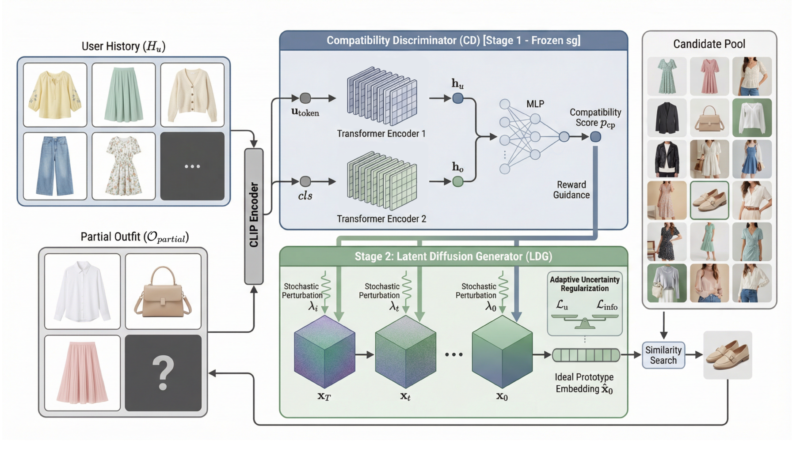

# 用扩散模型做个性化搭配补全：先生成一件「理想单品」的向量，再去商品库检索最像的

关注我，每天为你精挑细选最优质、最新鲜的推荐算法paper，陪你一起保持进步、不断精进！

> [English version](zstu-pdor.full.en.md)

### 论文：Personalized Diffusion-based Outfit Recommendation with Diffusion-Aware Stochastic Perturbation
### 网址：https://doi.org/10.1109/IJCNN69854.2026.11729495
### 公司：浙江理工大学
### 思想：扩散模型、生成后检索、兼容性判别器当奖励
### 方向：i2i

## 解读：
本文做的是个性化搭配补全。一套 outfit 是一整套穿搭（比如上衣、裤子、鞋、包），用户已经搭了几件、还缺一件，系统要补一件既和已有单品搭、又合这个用户口味的。trigger 是已经搭好的那几件单品，另外带上用户的历史单品。

作者认为同一个上下文往往有好几种合理的补法（同一条牛仔裤配白 T 或格子衬衫都行），只输出一个点的模型表达不了这种「一对多」。本文提出，在 CLIP 单品向量空间里用扩散模型生成缺的那件单品的向量，再按余弦相似度从候选池里检索最像的商品。训练分两阶段，先训一个兼容性判别器，冻结后作为奖励接到扩散生成器的损失上。

### 模型侧

整体分四步。先把每件单品编码成向量；阶段一用这些向量训兼容性判别器；阶段二训扩散生成器，冻结的判别器给它打分；推理时生成一个向量，再去候选池检索。

#### （1）单品编码
冻结的 CLIP 分别抽每件单品的图像向量和文本向量，拼起来过一个投影层，得到一个 d 维向量，判别器和生成器共用（后面扩散生成的目标、已搭单品、用户历史、检索时的候选都是这个向量）。

#### （2）兼容性判别器（阶段一）
这一步训出一个打分器，输入用户和一套完整的 outfit，输出这套搭不搭的概率（论文的意图是同时衡量单品之间搭不搭、风格合不合这个用户，所以把用户向量也拼进来，但训练标签只有整套搭 / 不搭）。对应图中上方蓝框（图里接进来的是不完整的 outfit，和正文不一致，以正文为准）。

**结构。** 用户历史单品的向量前面加一个可学习的 user token，过 Transformer，取 user token 位置的输出当用户向量 h_u；outfit 里的单品加一个 cls token，过另一个 Transformer，取 cls 位置的输出当整套向量 h_o。h_u 和 h_o 拼起来过 MLP，输出 p_cp。

标签以整套为单位（这套搭 / 不搭），不拆成单品两两配对。
- **正样本：** 一整套真实的 outfit，标签是「搭」。
- **负样本：** 一整套不搭的 outfit。论文只说负样本里混合了随机单品和同类目的难样本。

**损失。** 主损失是 focal loss（给难分的样本更大权重，缓解正负样本不均衡）。另加两个辅助项，一是 outfit 级的有监督对比损失（同一批里搭的 outfit 互为正样本，不搭的当负样本）；二是单品多样性约束（outfit 内单品向量 L2 归一化后的方差低于阈值就罚，防止 Transformer 把同一套里的单品向量抹得太像）。

#### （3）扩散生成器（阶段二）
对应图中下方绿框。这一步学的是「给定用户和已搭单品，缺的那件单品向量长什么样」，产出向量 x̂_0。

* 造样本。训练时，从一套完整的 outfit 里拿掉一件当目标，其余当已搭单品；

* 改写item。被拿掉那件的向量 x_0 按余弦调度逐步加高斯噪声，得到第 t 步的带噪向量 x_t。已搭的每件单品向量 e_i 不直接输入，而是改成 e_i + λ_i ×（x_t + 第 t 步的时间步编码），λ_i 每次从一个小方差的高斯分布里随机抽；x_t 只经这条路进入去噪网络。

* 序列encode。改过的已搭单品再过一个 Transformer，得到上下文向量 h_o^mod（论文没说是取 cls 位置还是怎么汇聚，也没说和判别器是否共用这个 Transformer）。

* 去噪网络生成缺失item。一个类 U-Net 的编码器-解码器，输入 h_o^mod、用户向量 h_u、时间步编码，直接预测干净的目标向量 x̂_0。

**为什么给已搭单品加这一项。** 作者称之为扩散感知的随机扰动，解释是 λ_i 和 t 每次都重新随机，同一组已搭单品每次训练时的向量都不一样，相当于数据增强，模型没法死记「这几个向量对应哪个答案」，只能学更稳定的搭配关系。

**训练-损失** 三项。
- **重构：** x̂_0 既要接近真实向量 x_0，又要接近 x_0 的增强版（批内标准化后随机缩放、平移、再归一化），两个 MSE 取平均，记为 L_u。
- **对比：** x̂_0 和 x_0 是正样本对，批内其他单品是负样本，做 InfoNCE，防止生成的向量都塌到平均值附近。L_u 和 InfoNCE 的权重 γ 按两者比值的指数滑动平均动态调整。
- **兼容性奖励：** 把 x̂_0 和已搭单品一起送进冻结的判别器，得到 p_cp，损失为 −log p_cp，梯度穿过判别器回传给生成器。总损失 = 生成损失 + 0.2 × 奖励损失；权重超过 0.5 后，生成器为了讨好判别器偏离真实单品，检索反而变差。

#### 推理：生成后检索
从纯噪声出发去噪 T 步得到「理想单品」向量，和候选池里所有单品算余弦相似度排序（图中右侧 Candidate Pool 和 Similarity Search）。T = 50 最好，T = 5 也接近，再多反而波动。

### 数据侧
**数据集。** iFashion（阿里 POG 数据，357 万用户、101 万套 outfit、58 万件单品）；Polyvore-630（630 个用户、15 万套 outfit、21 万件单品，同一个用户创建的 outfit 当作他的历史）。按 8:1:1 划分训练、验证、测试集。

### 效果（仅离线）
iFashion 上兼容性预测 AUC 0.9074、填空准确率 0.7117（最强基线 OutfitTransformer 为 0.8864、0.6924）；个性化检索 HR@10 0.3264，比 HFGN 的 0.2833 高 15.2%。消融里去掉随机扰动掉得最多（填空准确率 0.7117 → 0.6623）。

## 心得：

## 愚见

## 可信度：离线

## 推荐等级：有时间看看

**请帮忙点赞、转发，谢谢。欢迎干货投稿 \ 论文宣传\ 合作交流**

### 【铁粉】请入微信群，群内我会给出更深入的解读，还可以共同讨论技术方案、发招聘广告、内推和交友等。
* 铁粉标准：关注公众号一个月以上，且在公众号上累计15次互动（评论、爱心、转发）、或投稿1次，只欢迎技术同学。
* 入群方法：请您加个人微信lmxhappy，我拉您入群，请备注【公司】（只我个人看，不公开）。

## 推荐您继续阅读：
