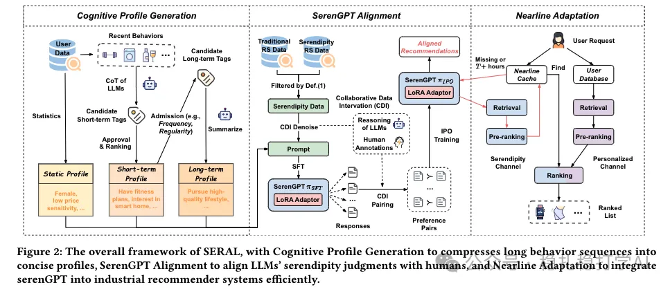

# Quick read on recommendation papers! Taobao's new breakthrough on diversity

> [中文版](2025-02-20-taobao-serendipity.md)

1 Bursting Filter Bubble: Enhancing Serendipity Recommendations with Aligned Large Language Models

Link: https://arxiv.org/pdf/2502.13539

Company: Alibaba Taobao

Area: Matthew effect (Bursting Filter Bubble) + LLM

Overview:

Two innovations: compressing the user behavior sequence into interest tags, and fine-tuning an LLM for serendipity recommendation. Specifically:

(1) Long- and short-term user profile generation: mimicking human cognition, the user's long behavior sequence is compressed into multi-level cognitive profiles (static, short-term and long-term) that are easy for LLMs to process.

(2) Serendipity recommendation. A model called SerenGPT is fine-tuned: data is collected through collaborative data intervention (CDI), then supervised fine-tuning (SFT) and preference alignment training (IPO) are done so that its judgments match human evaluation. There is also a highlight here — a trick invented to increase diversity — the definition of a serendipitous item: 1) it must have been clicked by the user, and 2) its atomic category has not appeared among the effectively exposed items in categories the user visited over the past N days.

(3) Incremental recommendation: a nearline serendipity channel is added; SerenGPT generates candidates which are cached and combined with the personalized channel, solving the efficiency problem of serving LLMs online.

Takeaways: (1) GPT's ability to summarize and generalize has been shown useful by many papers. (2) Adding a parallel recommendation channel without touching the existing architecture is simple and efficient to implement. (3) The paper's serendipitous item is a good way to improve diversity.

Credibility: production

Recommendation: worth a look

Figure 2: The overall framework of SERAL, with Cognitive Profile Generation to compresses long behavior sequences into concise profiles, SerenGPT Alignment to align LLMs' serendipity judgments with humans, and Nearline Adaptation to integrate serenGPT into industrial recommender systems efficiently.

Note: the title of this post calls serendipity "diversity" so that more readers can quickly grasp the paper's main work, since not many people know about serendipity recommendation.
