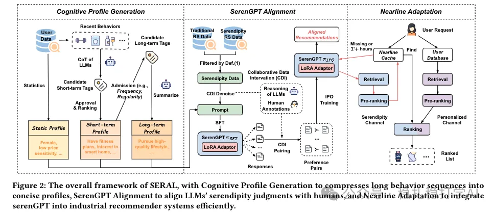

# 推荐算法paper速看！淘宝在多样性方面的新突破

> 原文：https://mp.weixin.qq.com/s?__biz=MzkzNDYyNjM1NA==&mid=2247484165&idx=1&sn=0475c91b0601afc66bd735127d6bc607&scene=21#wechat_redirect
> 作者：算法工程师刘明星（稳扎稳打学AI）| 发表于 2025-02-20

关注我，每天为你精挑细选最优质、最新鲜的推荐算法paper，陪你一起保持进步、不断精进！

[本公众号paper推荐原则](https://mp.weixin.qq.com/s?__biz=MzkzNDYyNjM1NA==&mid=2247484097&idx=1&sn=18322c279290b555eb030e12953b7c7f&scene=21#wechat_redirect)

1 Bursting Filter Bubble: Enhancing Serendipity Recommendations with Aligned Large Language Models

网址：https://arxiv.org/pdf/2502.13539

公司：阿里淘宝

方向：马太效应（Bursting Filter Bubble）+LLM

解读：

2个创新：用户行为序列的兴趣tag压缩，微调LLM实现Serendipity（意外）推荐。具体地说，

（1）长期、短期的user profile生成：模仿人类认知过程，将用户长行为序列压缩为静态、短期和长期的多层认知轮廓，便于 LLMs 处理。

（2）Serendipity（意外）推荐。微调了一个叫SerenGPT的模型，通过协同数据干预（CDI）收集数据，进行监督微调（SFT）和偏好对齐训练（IPO），使判断与人类评估一致。另外，这里有一个亮点——发明了一个增加多样性的trick——定义serendipitous item，即1）它必须被用户点击过，2）并且其原子类别在过去 N 天内用户有访问行为的有效曝光物品中未曾出现过。

（3）增量推荐：增加近线意外发现通道，用 SerenGPT 生成候选并缓存，与个性化通道结合，解决 LLMs 在线服务效率问题。

心得：（1）gpt的归纳总结能力被很多paper证明是有用的。（2）在已有架构不动的前提下，新增一个平行的推荐通道，实现上简单高效。（3）本文的serendipitous item是提高多样性的一个好手段。

可信度：生产

推荐等级：推荐看看

Figure 2: The overall framework of SERAL, with Cognitive Profile Generation to compresses long behavior sequences into concise profiles, SerenGPT Alignment to align LLMs' serendipity judgments with humans, and Nearline Adaptation to integrate serenGPT into industrial recommender systems efficiently.

说明：在该文的title里，将serendipity说成diversity，是为了让更多的读者快速的get到该paper的主要工作内容，毕竟了解serendipity推荐的并不多。

请帮忙点赞、转发，谢谢。您认为哪篇论文最有潜力应用到实际业务中？

推荐您继续阅读：

■ [推荐算法paper速看！微信在序列建模上的新突破](https://mp.weixin.qq.com/s?__biz=MzkzNDYyNjM1NA==&mid=2247484159&idx=1&sn=011e9ad100db2741e88da559d8c7655b&scene=21#wechat_redirect)

■ [推荐算法paper必看！推荐界首次深度借鉴 DeepSeek，开启创新探索之旅](https://mp.weixin.qq.com/s?__biz=MzkzNDYyNjM1NA==&mid=2247484154&idx=1&sn=8f21bd9302b484f856855241759ca345&scene=21#wechat_redirect)

■ [推荐算法周报：华为、阿里、快手等大厂最新研究成果，助你领先一步！](https://mp.weixin.qq.com/s?__biz=MzkzNDYyNjM1NA==&mid=2247484145&idx=1&sn=55e812648c7dd4342ba750b808b7d9d1&scene=21#wechat_redirect)

个人观点，仅供参考

修改于2025年2月20日
