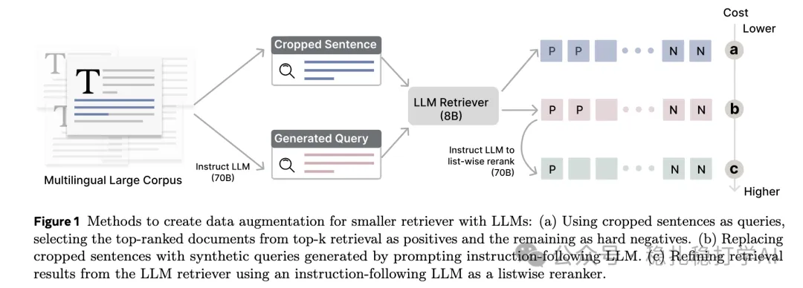

# Recommendation papers (2025.2.26): Meta DRAMA: LLM data augmentation for training smaller dense retrievers
> [中文版](2025-02-26-meta-drama.md)

> Source: WeChat post https://mp.weixin.qq.com/s?__biz=MzkzNDYyNjM1NA==&mid=2247484196&idx=1&sn=712014b56ddfca6363d076862eccf06e&scene=21#wechat_redirect, published 2025-02-26.
> Split from the roundup "Recommendation papers (2025.2.26): two industrial-style LLM papers from Meta to help you stay ahead!"; same issue: [Meta ExFM external distillation](../ml-infra/2025-02-26-meta-exfm.full.en.md), [Meta DRAMA LLM-augmented dense retrieval](../llm4rec/2025-02-26-meta-drama.full.en.md).

DRAMA: Diverse Augmentation from Large Language Models to Smaller Dense Retrievers

Link: https://arxiv.org/pdf/2502.18460

Company: Meta

Area: LLM + dense retrieval

Overview: By training an LLM on retrieval tasks and training on LLM-augmented data, the model's generalization improves. The core idea is to use the strong abilities of LLMs to generate diverse queries that augment the training data of a dense retriever.

First, queries are created by cropping sentences (cropped sentences); then synthetic queries generated by an LLM replace the cropped sentences, producing more diverse queries. Results retrieved by the LLM retriever are then reranked by an LLM to refine them, further improving retrieval quality.

Takeaways: This brings up a topic: "DeepSeek distilled ChatGPT", i.e. the DeepSeek team used answers produced by ChatGPT to train DeepSeek. No comment on that. If they really did it, it isn't called distillation either; as this paper puts it, it should be called data augmentation.

Application: offline

Recommendation: read if you have time

Figure 1 Methods to create data augmentation for smaller retriever with LLMs: (a) Using cropped sentences as queries, selecting the top-ranked documents from top-k retrieval as positives and the remaining as hard negatives. (b) Replacing cropped sentences with synthetic queries generated by prompting instruction-following LLM. (c) Refining retrieval results from the LLM retriever using an instruction-following LLM as a listwise reranker.
