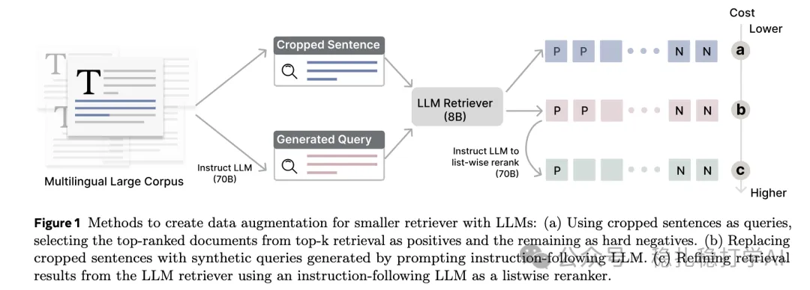

# 推荐算法(2025.2.26)：Meta DRAMA用LLM数据增强训练小型稠密检索器

> 原文：https://mp.weixin.qq.com/s?__biz=MzkzNDYyNjM1NA==&mid=2247484196&idx=1&sn=712014b56ddfca6363d076862eccf06e&scene=21#wechat_redirect
> 作者：算法工程师刘明星（稳扎稳打学AI）| 发表于 2025-02-26
> 本文拆自《推荐算法paper（2025.2.26）meta两篇工业风的LLM最新研究成果，助你领先一步！》，同期 2 篇：[Meta ExFM 外部蒸馏](../ml-infra/2025-02-26-meta-exfm.md)、[Meta DRAMA LLM 增强稠密检索](../llm4rec/2025-02-26-meta-drama.md)。

关注我，每天为你精挑细选最优质、最新鲜的推荐算法paper，陪你一起保持进步、不断精进！

> [English version](2025-02-26-meta-drama.full.en.md)

DRAMA: Diverse Augmentation from Large Language Models to Smaller Dense Retrievers

网址：https://arxiv.org/pdf/2502.18460

公司：meta

方向：LLM+dense retrieve

解读：通过在检索任务上训练LLM，LLM增强数据上进行训练，以提高模型的泛化能力。本文核心思想是利用LLM的强大能力，通过生成多样化的查询来增强密集检索器的训练数据。

首先通过截断句子（cropped sentences）来生成查询，然后使用LLM生成的合成查询来替代截断句子，生成更具多样性的查询。利用LLM检索器获取的检索结果，经过LLM重新排序来优化结果，进一步提升检索质量。

心得：由一个话题——deepseek蒸馏了chatgpt——deepseek团队使用了chatgpt产生的answers来训练deepseek。对此，不做评论。如果真的这么做了，这也不叫蒸馏，就像本文说的那样，应该叫数据增强。

应用：离线

推荐等级：有时间看看

Figure 1 Methods to create data augmentation for smaller retriever with LLMs: (a) Using cropped sentences as queries, selecting the top-ranked documents from top-k retrieval as positives and the remaining as hard negatives. (b) Replacing cropped sentences with synthetic queries generated by prompting instruction-following LLM. (c) Refining retrieval results from the LLM retriever using an instruction-following LLM as a listwise reranker.
