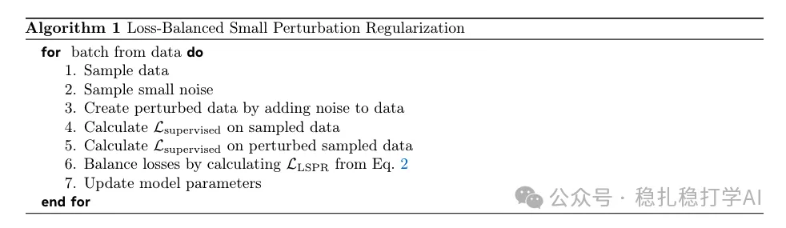
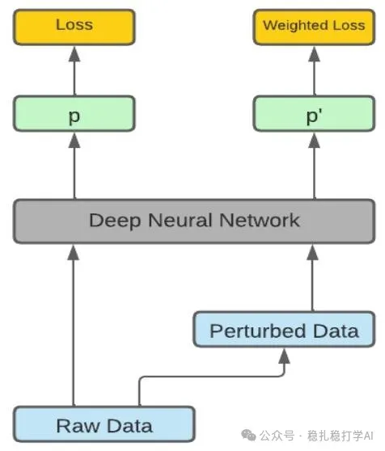

# Recommendation papers (2025.2.27): Meta training-free data augmentation: augmented samples trained jointly with low loss weight
> [中文版](2025-02-27-meta-training-free-augmentation.md)

> Source: WeChat post https://mp.weixin.qq.com/s?__biz=MzkzNDYyNjM1NA==&mid=2247484205&idx=1&sn=2bf96b05ea4f2bd60b47d4b28923cb8f&scene=21#wechat_redirect, published 2025-02-27.
> Split from the roundup "Recommendation papers (2025.2.27) quick look! New tricks from Kuaishou and Meta! DeepSeek really applied"; same issue: [Kuaishou OneRec](../generative-recommendation/2025-02-27-kuaishou-onerec.full.en.md), [Meta training-free data augmentation](../llm4rec/2025-02-27-meta-training-free-augmentation.full.en.md), [NEC MixLLM dynamic routing](../ml-infra/2025-02-27-nec-mixllm-routing.full.en.md).

Beyond Self-Consistency: Training-free Data Augmentation for LLMs?

Link: https://arxiv.org/pdf/2502.18478

Company: Meta

Area: data augmentation

Overview: Simply generate augmented data, add it to the original data, and train the model on both, with a relatively small loss weight on the augmented samples.

Takeaways: This innovation looks both "naive" (meant as a compliment) and very common practice. Generating some "fake" data to strengthen the model is something I believe many people have done.

Credibility: production

Recommendation: worth reading

