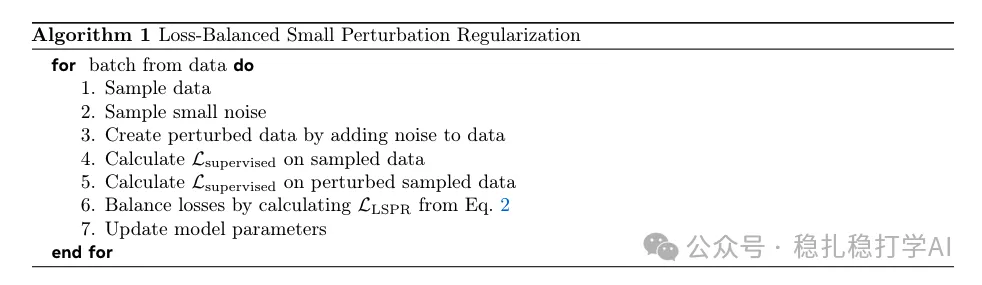
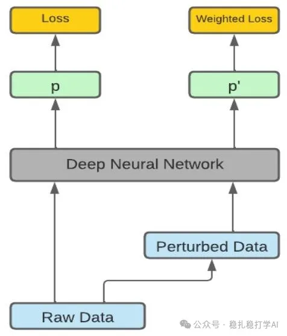

# 推荐算法(2025.2.27)：Meta免训练数据增强：增强样本低权重共同训练

> 原文：https://mp.weixin.qq.com/s?__biz=MzkzNDYyNjM1NA==&mid=2247484205&idx=1&sn=2bf96b05ea4f2bd60b47d4b28923cb8f&scene=21#wechat_redirect
> 作者：算法工程师刘明星（稳扎稳打学AI）| 发表于 2025-02-27
> 本文拆自《推荐算法paper（2025.2.27）速看！快手、meta又出黑科技！deepseek真应用》，同期 3 篇：[快手 OneRec](../generative-recommendation/2025-02-27-kuaishou-onerec.md)、[Meta 免训练数据增强](../llm4rec/2025-02-27-meta-training-free-augmentation.md)、[NEC MixLLM 动态路由](../ml-infra/2025-02-27-nec-mixllm-routing.md)。

关注我，每天为你精挑细选最优质、最新鲜的推荐算法paper，陪你一起保持进步、不断精进！

> [English version](2025-02-27-meta-training-free-augmentation.full.en.md)

Beyond Self-Consistency: Training-free Data Augmentation for LLMs?

网址：https://arxiv.org/pdf/2502.18478

公司：meta

方向：数据增强

解读：就是生成增强的数据，加入到原始数据中，共同训练模型，但是增强样本的loss权重相对较小。

心得：这个创新显得既naive（褒义），又是很普遍的做法。生成一些"假"数据，增强model，相信不少人也干过。

可信度：生产

推荐等级：推荐看看

