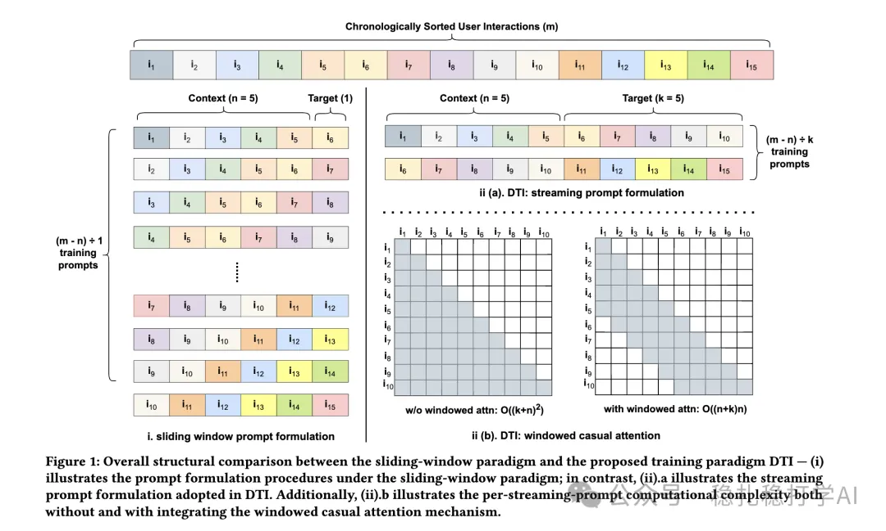

# Recommendation papers (2025.3.4): Meta efficient LLM training paradigm for CTR: streaming prompts + windowed causal attention
> [中文版](2025-03-04-meta-llm-ctr-training.md)

> Source: WeChat post https://mp.weixin.qq.com/s?__biz=MzkzNDYyNjM1NA==&mid=2247484283&idx=1&sn=179c3aae8b34adfa7cb679f5b5632af0&scene=21#wechat_redirect, published 2025-03-04.
> Split from the roundup "Recommendation papers (2025.3.4): quick look! New research from Alibaba and Meta"; same issue: [Alibaba Hierarchical Causal Transformer](../behavior-sequence-modeling/2025-03-04-ali-hct-sequential-rec.full.en.md), [Meta efficient LLM CTR training paradigm](../llm4rec/2025-03-04-meta-llm-ctr-training.full.en.md).

Towards An Efficient LLM Training Paradigm for CTR Prediction

Link: https://arxiv.org/pdf/2503.01001

Company: Meta

Area: LLM recommendation

Overview:

LLMs used as recommender systems adopt the common "sliding window" training paradigm, which has high complexity and low efficiency. To ease this computational inefficiency, the paper proposes two tricks: "windowed causal attention" and "streaming prompt formulation". Specifically:

* Streaming prompt formulation: multiple training prompts are generated in parallel; each training sample is represented by one prompt, each prompt contains a short stretch of item history, and prompts do not overlap in time, so training can be parallelized across multiple GPUs.
* Windowed causal attention: by introducing a windowed causal attention mechanism, attention computation is restricted to a small window, avoiding the quadratic complexity of attention.

Credibility: offline

Recommendation: read if you have time

Figure 1: Overall structural comparison between the sliding-window paradigm and the proposed training paradigm DTI — (i) illustrates the prompt formulation procedures under the sliding-window paradigm; in contrast, (ii).a illustrates the streaming prompt formulation adopted in DTI. Additionally, (ii).b illustrates the per-streaming-prompt computational complexity both without and with integrating the windowed causal attention mechanism.
