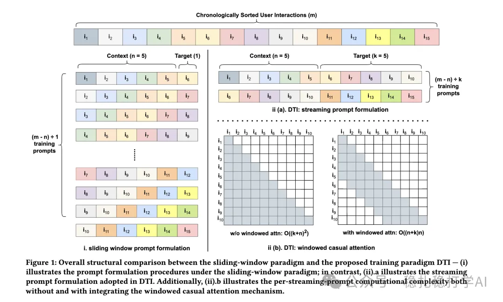

# 推荐算法(2025.3.4)：Meta高效LLM CTR训练范式：流式prompt+窗口因果注意力

> 原文：https://mp.weixin.qq.com/s?__biz=MzkzNDYyNjM1NA==&mid=2247484283&idx=1&sn=179c3aae8b34adfa7cb679f5b5632af0&scene=21#wechat_redirect
> 作者：算法工程师刘明星（稳扎稳打学AI）| 发表于 2025-03-04
> 本文拆自《推荐算法(2025.3.4)：速看！阿里Meta的最新研究成果》，同期 2 篇：[阿里层级因果 Transformer](../behavior-sequence-modeling/2025-03-04-ali-hct-sequential-rec.md)、[Meta 高效 LLM CTR 训练范式](../llm4rec/2025-03-04-meta-llm-ctr-training.md)。

关注我，每天为你精挑细选最优质、最新鲜的推荐算法paper，陪你一起保持进步、不断精进！

> [English version](2025-03-04-meta-llm-ctr-training.full.en.md)

Towards An Efficient LLM Training Paradigm for CTR Prediction

网址：https://arxiv.org/pdf/2503.01001

公司：meta

方向：LLM推荐

解读：

大语言模型（LLMs）作为下推荐系统，采用了普遍的 “滑动窗口” 训练模型，复杂度高，效率低下。为了缓解计算效率低下的问题，本文提出“引入窗口因果注意力机制”和“流式提示构建”的trick。具体的，

* 流式提示构建：通过并行生成多个训练prompt，每个训练样本用一个prompt进行表示，每个训练prompt包含一小段item历史，每个prompt之间没有时间上的重叠，这样就能够让多GPU训练并行化。
* 引入窗口因果注意力机制：通过引入窗口因果注意力机制，将attention的计算限制在一个小窗口内，从而避免了attention计算的二次方复杂度。

可信度：离线

推荐等级：有时间看看

Figure 1: Overall structural comparison between the sliding-window paradigm and the proposed training paradigm DTI — (i) illustrates the prompt formulation procedures under the sliding-window paradigm; in contrast, (ii).a illustrates the streaming prompt formulation adopted in DTI. Additionally, (ii).b illustrates the per-streaming-prompt computational complexity both without and with integrating the windowed causal attention mechanism.
