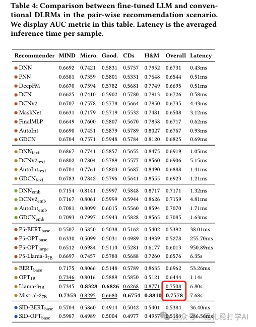

# Recommendation Algorithms (2025.3.10): Huawei shows LLMs significantly improve recommendation effectiveness

> [中文版](2025-03-10-huawei-recbench.md)

1 Benchmarking LLMs in Recommendation Tasks: A Comparative Evaluation with Conventional Recommenders

Link: https://arxiv.org/pdf/2503.05493

Company: Huawei

Area: LLM for recommendation

Overview:

The paper proposes a benchmark platform called RecBench, meant to systematically evaluate the ability of LLMs on recommendation tasks and compare them with conventional deep learning recommendation models (DLRMs). Findings: LLM-based recommendation performs better but has extremely low inference efficiency, while conventional DLRMs with LLM support (rather than relying fully on the LLM) can reach 95% of the performance of LLM recommenders.

Specifically:

(1) LLM recommendation performs better: the paper finds that LLMs, thanks to their semantic understanding and zero-shot ability, show clear advantages on recommendation tasks. LLMs improve performance by 16% and 8% on MovieLens-1M and Amazon Books respectively. This shows that even without being trained specifically for recommendation, LLMs can be strong at recommendation tasks. The LLM's advantage is its strong semantic understanding, which lets it understand the deeper relationship between user interests and item characteristics.

(2) LLM recommendation is extremely inefficient: the paper also finds that LLM inference time is roughly hundreds of times that of conventional DLRMs. The reason for this huge gap is that LLMs have billions of parameters and need a lot of compute. Even a relatively small LLM (such as Llama-3-7B) takes several seconds per inference, which is usually unacceptable in industrial recommender systems.

(3) The paper finds that conventional DLRMs with LLM support (rather than relying fully on the LLM) can reach 95% of the performance of LLM recommenders while keeping inference far faster than the LLM. The effect of this compromise had not been fully explored or quantified in earlier work. This performance/efficiency trade-off also highlights the need for further research on inference acceleration, which is critical for actually deploying LLM-based recommenders in high-throughput industrial settings.

Takeaways:

(1) This work gives me the feeling that the time for deploying LLMs in recommender systems is not fully ripe yet, or rather, a suitable scenario has not been found. Although LLM recommendation performs better, its inference efficiency is extremely low, which is usually unacceptable in industrial recommender systems.

(2) As with DeepSeek and similar work, the LLM recommendation work that will get results is the work that applies it to production in a suitable way, for example as an additional offline-cached retrieval channel.

Credibility: offline

Recommendation: read it if you have time. If you don't, knowing the conclusions above is enough.

