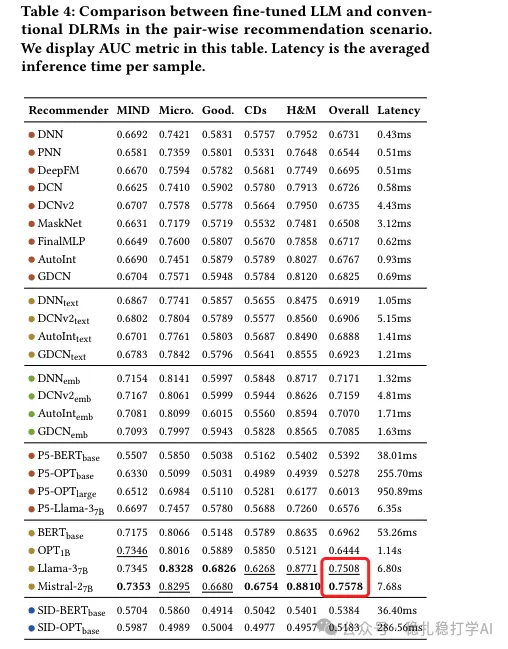

# 推荐算法(2025.3.10)：华为验证大模型显著提升推荐算法效能

> 原文：https://mp.weixin.qq.com/s?__biz=MzkzNDYyNjM1NA==&mid=2247484308&idx=1&sn=9c5c81f83473f52f1024be583cac16f2&scene=21#wechat_redirect
> 作者：算法工程师刘明星（稳扎稳打学AI）| 发表于 2025-03-10（标题已修改；修改于 2025-03-12）

嘿，记得给“稳扎稳打学AI”添加星标

关注我，每天为你精挑细选最优质、最新鲜的推荐算法paper，陪你一起保持进步、不断精进！

📄 [本公众号paper推荐原则](https://mp.weixin.qq.com/s?__biz=MzkzNDYyNjM1NA==&mid=2247484097&idx=1&sn=18322c279290b555eb030e12953b7c7f&scene=21#wechat_redirect)

1 Benchmarking LLMs in Recommendation Tasks: A Comparative Evaluation with Conventional Recommenders

网址：https://arxiv.org/pdf/2503.05493

公司：华为

方向：LLM推荐

解读：

论文提出了一种名为 RecBEnch 的基准测试平台，旨在系统性地评估 LLMs 在推荐任务中的能力，并将其与传统深度学习推荐模型（DLRMs）进行对比。发现：LLM推荐效果更好，推理效率极低，而传统 DLRMs 结合 LLM 支持（而非完全依赖 LLM）可以在性能上达到 LLM 推荐系统的 95%。

具体的：

（1）LLM推荐效果更好：本论文发现，LLM基于语义理解和零样本学习的能力，在推荐任务中表现出了显著的优势。LLM在MovieLens-1M和Amazon Books这两个数据集上分别实现了16%和8%的性能提升。这些发现表明，即使LLM没有经过专门的推荐系统训练，也能够在推荐任务中表现出强大的能力。LLM的优势在于其强大的语义理解能力，这使得它能够理解用户兴趣和物品特性之间的深层次关系。

（2）LLM推荐效率极低：本论文还发现，LLM的推理时间约为传统深度学习模型DLRMs的数百倍。这一巨大差距的原因在于LLM拥有数十亿个参数，需要大量的计算资源。即使是相对较小的LLM模型（如Llama-3-7B），其推理时间也达到数秒，这在工业推荐系统中通常无法接受。

（3）论文发现，传统 DLRMs 结合 LLM 支持（而非完全依赖 LLM）可以在性能上达到 LLM 推荐系统的 95%，同时保持远超 LLM 的推理速度。这一折中方案的效果在之前的研究中未被充分探索或量化。同时，这种性能与效率之间的权衡凸显了进一步研究推理加速技术的必要性，这对于基于大语言模型的推荐系统在高吞吐量的工业场景中的实际部署至关重要。

心得：

（1）这个工作让我感觉，大模型落地到推荐系统的时机还没有完全成熟，或者说，还没有找到一个合适的场景。虽然LLM推荐效果更好，但推理效率极低，这在工业推荐系统中通常无法接受。

（2）就跟deepseek等工作一样，一些将拿到结果的LLM推荐工作，就是将其以合适的方式应用到生产中，如作为新增的一路offline Cache的召回通路。

可信度：离线

推荐等级：有时间看看——没时间的花，知道以上的结论就够了。

请帮忙点赞、转发，谢谢。您认为哪篇论文最有潜力应用到实际业务中？

## 欢迎干货投稿 \ 论文宣传 \ 合作交流

推荐您继续阅读：

■ [推荐算法周报(2025.3.8)：行为序列与大模型领衔，亮点纷呈](https://mp.weixin.qq.com/s?__biz=MzkzNDYyNjM1NA==&mid=2247484301&idx=1&sn=ed438d08ec7160e42fffec7c27891f62&scene=21#wechat_redirect)

■ [推荐算法(2025.3.7)：腾讯再次证明相似用户和物料提升推荐效果](https://mp.weixin.qq.com/s?__biz=MzkzNDYyNjM1NA==&mid=2247484296&idx=1&sn=f24a6d6b38309f620ccbc5041cc1f32e&scene=21#wechat_redirect)

■ [推荐算法(2025.3.5)：大模型的春风吹醒，百度、阿里带来惊喜](https://mp.weixin.qq.com/s?__biz=MzkzNDYyNjM1NA==&mid=2247484290&idx=1&sn=7febb51dd122338fb676f3d5f90e934c&scene=21#wechat_redirect)

历史文章索引：https://docs.qq.com/sheet/DYXZTZ0tseHRyZGtt?tab=BB08J2

由于公众号试行乱序推送，您可能不再准时收到稳扎稳打学AI的推送。为了第一时间收到本号的干货内容， 请将本号设为星标，以及常点文末右下角的“在看”。

喜欢的话点个在看吧👇

个人观点，仅供参考

修改于2025年3月12日
