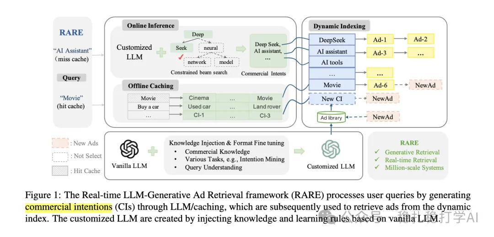

# Recommendation papers (2025.4.3): Tencent uses LLM-generated commercial intentions for real-time sponsored search ad retrieval
> [中文版](2025-04-03-tencent-llm-commercial-intention.md)

> Source: WeChat post https://mp.weixin.qq.com/s?__biz=MzkzNDYyNjM1NA==&mid=2247484400&idx=1&sn=9097b2a31975d4b210324c72e4d1ff2e&scene=21#wechat_redirect, published 2025-04-03.
> Split from the roundup "Recommendation papers (2025.4.3): intent modeling is an important way for LLMs to empower search, ads and recommendation"; same issue: [Tencent LLM commercial intention ad retrieval](../llm4rec/2025-04-03-tencent-llm-commercial-intention.full.en.md), [JD generative retrieval and alignment GRAM](../generative-recommendation/2025-04-03-jd-generative-retrieval-alignment.full.en.md).

Real-time Ad retrieval via LLM-generative Commercial Intention for Sponsored Search Advertising

Link: https://arxiv.org/pdf/2504.01304

Company: Tencent

Area: LLM retrieval + generative retrieval + intent modeling

Overview:

(1) Commercial intention generation

The LLM's strong generation ability can directly generate commercial intentions for sponsored-search queries. For example, "New Year Flower Deals" might generate "holiday flower gifts", "ordering flower delivery", "seasonal flower discounts".

This way the LLM can generate multiple ad-related commercial intentions, which can be matched against ad information to improve ad retrieval.

(2) Online retrieval and offline indexing

The commercial intentions generated by the LLM are used to build an offline index matched against ad information. Online, the LLM-generated commercial intentions are used to build a query index matched against ad information.

Takeaways: LLM-generated content must be combined with the business scenario.

Credibility: production

Recommendation: worth reading

