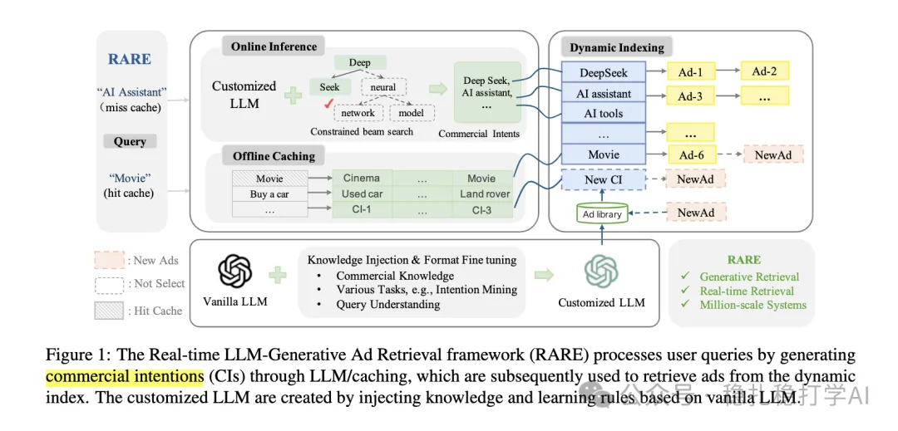

# 推荐算法(2025.4.3)：腾讯用LLM生成商业意图做搜索广告实时召回

> 原文：https://mp.weixin.qq.com/s?__biz=MzkzNDYyNjM1NA==&mid=2247484400&idx=1&sn=9097b2a31975d4b210324c72e4d1ff2e&scene=21#wechat_redirect
> 作者：算法工程师刘明星（稳扎稳打学AI）| 发表于 2025-04-03（修改于 2025-04-06）
> 本文拆自《推荐算法(2025.4.3)：意图建模是LLM赋能搜广推的重要方式》，同期 2 篇：[腾讯 LLM 商业意图广告召回](../llm4rec/2025-04-03-tencent-llm-commercial-intention.md)、[京东生成式检索与对齐 GRAM](../generative-recommendation/2025-04-03-jd-generative-retrieval-alignment.md)。

关注我，每天为你精挑细选最优质、最新鲜的推荐算法paper，陪你一起保持进步、不断精进！

> [English version](2025-04-03-tencent-llm-commercial-intention.full.en.md)

Real-time Ad retrieval via LLM-generative Commercial Intention for Sponsored Search Advertising

网址：https://arxiv.org/pdf/2504.01304

公司：腾讯

方向：LLM召回+生成式召回+意图建模

解读：

（1）商业意图生成

LLM 的强大生成能力可以直接生成针对搜索广告的查询（query）的商业意图（commercial intention），例如，“New Year Flower Deals”可能生成“holiday flower gifts”“ordering flower delivery”“seasonal flower discounts”。

通过这种方式，LLM 能够生成与广告相关的多个商业意图，这些意图可以与广告信息进行匹配，从而提高广告的检索效果。

（2）在线检索与离线索引

LLM 生成的商业意图被用于构建离线索引，与广告信息进行匹配。在线上，LLM 生成的商业意图被用于构建查询索引，与广告信息进行匹配。

心得：LLM生成的内容要和业务场景结合。

可信度：生产

推荐等级：推荐看看

