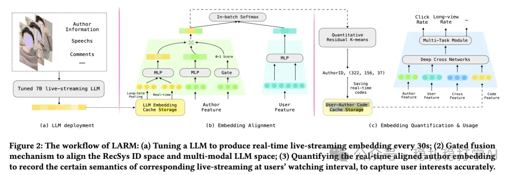

# Recommendation Algorithms (2025.4.9): Kuaishou again shows similar items improve recommendation

> [中文版](2025-04-09-kuaishou-llm-alignment.md)

1 LLM-Alignment Live-Streaming Recommendation

Link: https://arxiv.org/pdf/2504.05217

Company: Kuaishou

Area: user interest modeling

Overview:

The idea is to add the embedding of the current item's group of similar items into the ranking model. UIE does the same thing; the main difference is that this paper is UIE + LLM.

The key part is (c) in the figure below: for the current item, search the k-means clusters of all items for the nearest cluster and add it to the ranking model to strengthen it. As UIE says, this does little for very popular items; it mainly helps new items and long-tail items. That is easy to understand: they have few interactions and few samples, so the model learns little about them, and with the group information it can roughly locate the item's profile.

Because of the business setting, multimodality, and inspiration from QARM, some extra processing was done.

(1) Business setting

Because this is live streaming, the item's latest information needs to be fetched every 30 seconds.

(2) Multimodality

An LLM is fine-tuned to produce video embeddings. To improve embedding quality, they are aligned with the recommender system (RecSys).

(3) QARM

Three discrete IDs are obtained.

Takeaways: the most similar cluster is a set of similar items, so Kuaishou has again shown that similar items can improve model performance.

Credibility: production

Recommendation: worth a look

