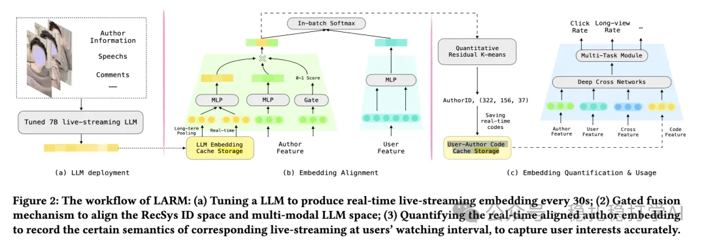

# 推荐算法(2025.4.9)：快手再次证明相似物料提升推荐效果

> 原文：https://mp.weixin.qq.com/s?__biz=MzkzNDYyNjM1NA==&mid=2247484431&idx=1&sn=c0598c45d25962ffad3b9f281d169f1e&scene=21#wechat_redirect
> 作者：算法工程师刘明星（稳扎稳打学AI）| 发表于 2025-04-09（修改于 2025-04-09）

嘿，记得给“稳扎稳打学AI”添加星标

关注我，每天为你精挑细选最优质、最新鲜的推荐算法paper，陪你一起保持进步、不断精进！

> [English version](2025-04-09-kuaishou-llm-alignment.full.en.md)

📄 [本公众号paper推荐原则](https://mp.weixin.qq.com/s?__biz=MzkzNDYyNjM1NA==&mid=2247484097&idx=1&sn=18322c279290b555eb030e12953b7c7f&scene=21#wechat_redirect)

1 LLM-Alignment Live-Streaming Recommendation

网址：https://arxiv.org/pdf/2504.05217

公司：快手

方向：用户兴趣建模

解读：

就是将当前item的相似群组的embedding，加入到ranking模型中。UIE也是这么做的，主要区别是本文是UIE+LLM。

重点是在下图的（c），就是将当前item，再全部item的kmeans聚类的cluster中，搜索出来最近的cluster，加入到ranking模型里，来增强模型。就像UIE里说的，对于高热item的效果不大，主要是促进新物料和长尾物料的效果。这个好理解，因为它们的交互少，样本少，对其学习的少，借助群组信息，可以基本定位该item的大概profile。

因为业务背景、多模态和QARM的启发等原因，做了一一些处理。

（1）业务背景

因为是直播，所以需要30秒获取一下item的最新信息。

（2）多模态

微调LLM模型，获取视频的embedding。为了提高embed质量与ReSys做了对齐处理。

（3）QARM

获取了离散的三个ID。

心得：最相似的cluster是相似item的集合，所以说快手再次证明了相似物料可以提高模型效果。

可信度：生产

推荐等级：推荐看看

请帮忙点赞、转发，谢谢。您认为哪篇论文最有潜力应用到实际业务中？

## 欢迎干货投稿 \ 论文宣传 \ 合作交流

推荐您继续阅读：

■ [推荐算法paper](https://mp.weixin.qq.com/s?__biz=MzkzNDYyNjM1NA==&mid=2247484024&idx=1&sn=b6c0bc04592d62da52ce1cfe36e84d1a&scene=21#wechat_redirect)

历史文章索引：https://docs.qq.com/sheet/DYXZTZ0tseHRyZGtt?tab=BB08J2

由于公众号试行乱序推送，您可能不再准时收到稳扎稳打学AI的推送。为了第一时间收到本号的干货内容， 请将本号设为星标，以及常点文末右下角的“在看”。

喜欢的话点个在看吧 👇

个人观点，仅供参考

修改于2025年4月9日
