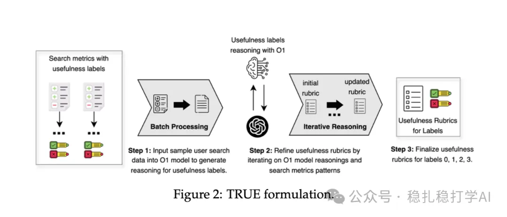

# Recommendation Algorithms (2025.4.22): Meta applies LLMs to search usefulness evaluation

> [中文版](2025-04-22-meta-true.md)

1 Meta TRUE: Harnessing LLMs for Search Usefulness Evaluation

Link: https://arxiv.org/pdf/2504.17126

Company: Meta

Area: search, LLM

Overview: the paper proposes an LLM-based method for evaluating search usefulness (TRUE), used to assess how useful search results are. By using an LLM to generate evaluation rules and then using these rules to evaluate search results, TRUE effectively improves the accuracy of search usefulness evaluation.

Core method:

(1) Rule generation: use an LLM to generate evaluation rules that describe how to combine multiple signals to assess the usefulness of a search result.

(2) Rule application: apply the generated rules when evaluating search results; the LLM scores the search results, giving the usefulness assessment.

The rule set TRUE generates provides guidelines that tell the LLM how to combine multiple signals (rather than a single metric) to reason about a document's usefulness. For example, a rule might say "if the document is highly relevant but the user's dwell time is short, it may be of low usefulness". These rules are not direct evaluation metrics; they serve as "supporting notes" for the LLM's reasoning, helping it take more context into account when evaluating.

Takeaways:

(1) Applying LLMs to search usefulness evaluation has broad prospects and is worth watching.

(2) TRUE's core innovation is using an LLM to generate evaluation rules and then using these rules to evaluate search results.

Credibility: offline

Recommendation: read it if you have time

