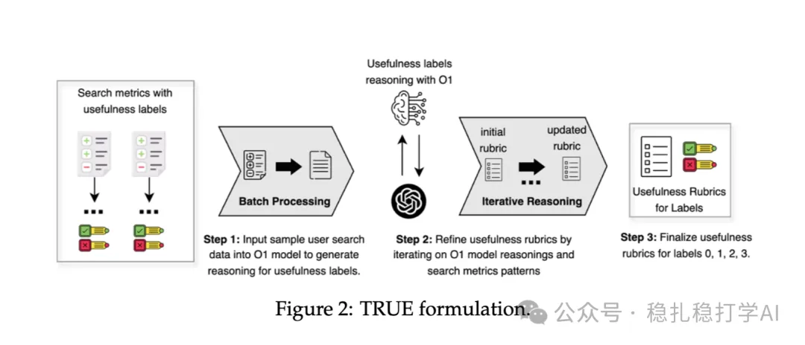

# 推荐算法(2025.4.22)：Meta 将LLM应用于搜索有用性评估

> 原文：https://mp.weixin.qq.com/s?__biz=MzkzNDYyNjM1NA==&mid=2247484565&idx=1&sn=068c6a26b1e752d855fcebd54c83288c&scene=21#wechat_redirect
> 作者：算法工程师刘明星（稳扎稳打学AI）| 发表于 2025-04-22

嘿，记得给“稳扎稳打学AI”添加星标

关注我，每天为你精挑细选最优质、最新鲜的推荐算法paper，陪你一起保持进步、不断精进！

> [English version](2025-04-22-meta-true.full.en.md)

📄 [本公众号paper推荐原则](https://mp.weixin.qq.com/s?__biz=MzkzNDYyNjM1NA==&mid=2247484097&idx=1&sn=18322c279290b555eb030e12953b7c7f&scene=21#wechat_redirect)

1 Meta TRUE: Harnessing LLMs for Search Usefulness Evaluation

网址：https://arxiv.org/pdf/2504.17126

公司：Meta

方向：搜索、LLM

解读：本文提出了一种基于LLM的搜索有用性评估方法（TRUE），用于评估搜索结果的有用性。通过使用LLM生成评估规则，并利用这些规则对搜索结果进行评估，TRUE 能够有效提升搜索结果的有用性评估的准确性。

核心方法：

（1）规则生成：使用LLM生成评估规则，这些规则描述了如何综合多种信号来评估搜索结果的有用性。

（2）规则应用：将生成的规则应用于搜索结果的评估，通过LLM对搜索结果进行打分，从而得到搜索结果的有用性评估。

TRUE生成的规则集提供指导原则，告诉LLM如何综合多种信号（而非单一指标）来推理文档的有用性。例如，规则可能描述"如果文档相关性高但用户停留时间短，则可能为低有用"。这些规则不是直接的评价指标，而是作为LLM推理的"辅助说明"，帮助LLM在评估时考虑更多的上下文信息。

心得：

（1）LLM在搜索有用性评估中的应用前景广阔，值得关注。

（2）TRUE的核心创新在于使用LLM生成评估规则，并利用这些规则对搜索结果进行评估。

可信度：离线

推荐等级：有时间看看

请帮忙点赞、转发，谢谢。您认为哪篇论文最有潜力应用到实际业务中？

## 欢迎干货投稿 \ 论文宣传 \ 合作交流

推荐您继续阅读：

■ [推荐算法周报(2025.4.21)：有7篇大厂论文值得关注](https://mp.weixin.qq.com/s?__biz=MzkzNDYyNjM1NA==&mid=2247484559&idx=1&sn=c143dccb329dba0d3e214b1d3d4ee146&scene=21#wechat_redirect)

■ [推荐算法月报(2025.3)：行为序列和生成式的两大主题](https://mp.weixin.qq.com/s?__biz=MzkzNDYyNjM1NA==&mid=2247484550&idx=1&sn=ba23fdddd4d0c81b22f274cf27199918&scene=21#wechat_redirect)

■ [推荐算法(2025.4.18)：阿里的多目标双塔召回](https://mp.weixin.qq.com/s?__biz=MzkzNDYyNjM1NA==&mid=2247484506&idx=1&sn=f409f9b7619a82bc29457562e5a6e937&scene=21#wechat_redirect)

历史文章索引：https://docs.qq.com/sheet/DYXZTZ0tseHRyZGtt?tab=BB08J2

由于公众号试行乱序推送，您可能不再准时收到稳扎稳打学AI的推送。为了第一时间收到本号的干货内容，请将本号设为星标，以及常点文末右下角的“在看”。

喜欢的话点个在看吧👇

个人观点，仅供参考
