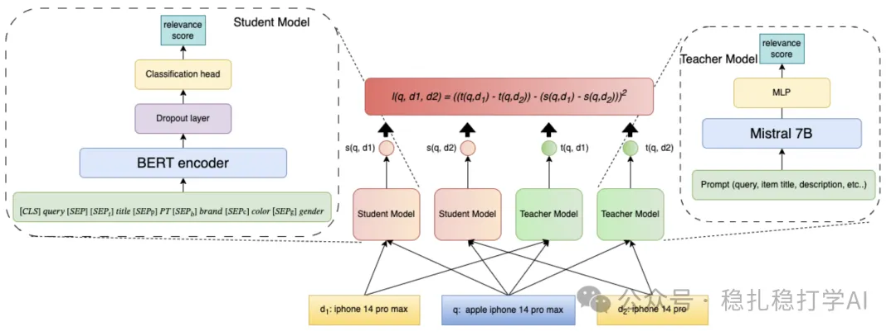

# Recommendation papers (2025.5.13): Walmart distills an LLM into a cross-encoder for search relevance
> [中文版](2025-05-13-walmart-llm-distill-cross-encoder.md)

> Source: WeChat post https://mp.weixin.qq.com/s?__biz=MzkzNDYyNjM1NA==&mid=2247484648&idx=1&sn=ba92085c8ad14ae822333e6dd23a00b3&scene=21#wechat_redirect, published 2025-05-13.
> Split from the roundup "Recommendation papers (2025.5.13): Taobao and Walmart with strong A/B results"; same issue: [Taobao SORT-Gen generative ranking](../generative-recommendation/2025-05-13-taobao-sort-gen.full.en.md), [Walmart LLM distillation for search relevance](../llm4rec/2025-05-13-walmart-llm-distill-cross-encoder.full.en.md).

Distilling Large Language Models for Cross-Encoder based Relevance Modeling

Link: https://arxiv.org/pdf/2505.06722

Company: Walmart

Area: LLM

Overview: This paper presents a method that uses large language model (LLM) distillation to improve search relevance modeling. Traditional cross-encoder models perform well at search relevance modeling, but they are computationally expensive and slow at inference. The Walmart team proposes a distillation method that transfers the LLM's knowledge into a small model (such as BERT), keeping the relevance modeling quality while greatly reducing compute cost.

Core method:

(1) The teacher model (a 7B-parameter LLM, such as Llama2-7B or Mistral-7B) is trained for classification with soft targets, which makes its single-output prediction more effective. The student model learns the teacher's soft-label outputs through an extended Margin-MSE loss, keeping relevance modeling quality while lowering compute cost.

(2) Training data for the student is large-scale unlabeled data generated from user logs and labeled by the teacher, avoiding dependence on ground-truth labels. Experiments show that as training data grows (from 50M to 170M query-item pairs), student performance keeps improving, even surpassing the teacher on some metrics.

The A/B results are also good, so here they are: session add-to-cart rate +0.8%, visitor add-to-cart rate +1.2%, abandonment rate -0.6%, average clicks to add-to-cart -1.1%.

Takeaways:

(1) Large language models can label data and do data augmentation, so they can act as a teacher (model) that trains a student (model).

(2) Distillation is also a good way to get LLMs into production.

Credibility: production

Recommendation: worth reading

