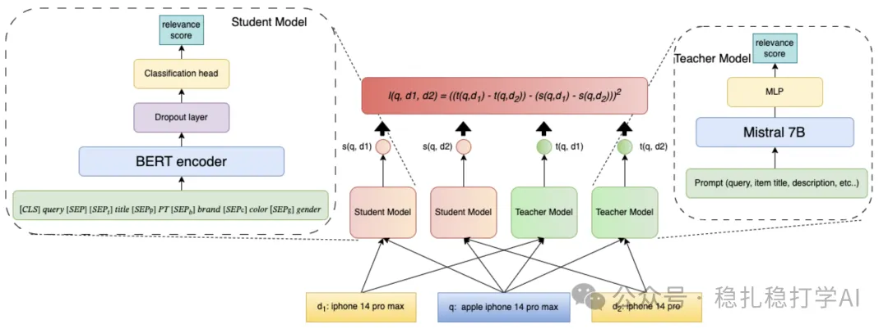

# 推荐算法(2025.5.13)：沃尔玛把LLM蒸馏到交叉编码器做搜索相关性

> 原文：https://mp.weixin.qq.com/s?__biz=MzkzNDYyNjM1NA==&mid=2247484648&idx=1&sn=ba92085c8ad14ae822333e6dd23a00b3&scene=21#wechat_redirect
> 作者：算法工程师刘明星（稳扎稳打学AI）| 发表于 2025-05-13
> 本文拆自《推荐算法(2025.5.13)：淘宝、沃尔玛的AB效果不错》，同期 2 篇：[淘宝 SORT-Gen 生成式排序](../generative-recommendation/2025-05-13-taobao-sort-gen.md)、[沃尔玛 LLM 蒸馏搜索相关性模型](../llm4rec/2025-05-13-walmart-llm-distill-cross-encoder.md)。

关注我，每天为你精挑细选最优质、最新鲜的推荐算法paper，陪你一起保持进步、不断精进！

> [English version](2025-05-13-walmart-llm-distill-cross-encoder.full.en.md)

Distilling Large Language Models for Cross-Encoder based Relevance Modeling

网址：https://arxiv.org/pdf/2505.06722

公司：沃尔玛

方向：LLM

解读：本文介绍了一种利用大语言模型（LLM）蒸馏技术提升搜索相关性建模的方法。传统的交叉编码器（Cross-Encoder）模型在搜索相关性建模中表现出色，但其计算成本高、推理速度慢。沃尔玛团队提出了一种蒸馏方法，将大语言模型（LLM）的知识迁移到小模型（如BERT）中，从而在保持相关性建模效果的同时，大幅降低计算成本。

核心方法：

（1）教师模型（7B参数的LLM，如Llama2-7B或Mistral-7B）使用软标签（soft targets）进行分类训练，增强了单输出预测的有效性。学生模型通过扩展的Margin-MSE损失函数，学习教师模型的软标签输出，从而在保持相关性建模效果的同时，降低计算成本。

（2）学生模型的训练数据从用户日志生成大规模未标记数据，并由教师模型标注，避免了对真实标签的依赖。实验表明，随着训练数据规模的增加（从50M到170M个查询-商品对），学生模型性能持续提升，甚至在某些指标上超越了教师模型。

A/B效果也不错，贴一下：会话加购率+0.8%，访客加购率+1.2%，放弃率-0.6%，点击到加购的平均次数-1.1%。

心得：

（1）大型语言模型能够标注数据，实现数据增强，从而可以作为老师（模型），带学生（模型）。

（2）蒸馏也是LLM落地业务的一个好方法。

可信度：生产

推荐等级：推荐看看

