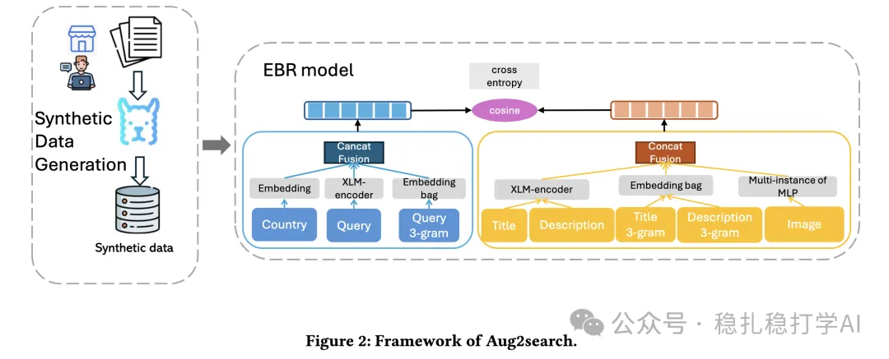

# Recommendation Algorithms (2025.5.23): Meta's data augmentation method works quite well

> [中文版](2025-05-23-meta-aug2search.md)

1 Aug2search: Data Augmentation for Multimodal Search Ranking

Link: https://arxiv.org/pdf/2505.14724

Company: Meta

Area: search, data augmentation

Overview: this work looks at applying data augmentation to multimodal search ranking and proposes a new data augmentation method that improves the search ranking model by using synthetic data.

The core of the method is to generate synthetic data with a large model and filter it with a retrieval model, which ensures the quality of the synthetic data. This effectively improves the performance of the search ranking model.

Concretely, a large model generates synthetic data, and a retrieval model filters it to ensure its quality. This effectively improves the performance of the search ranking model.

A/B: in the online A/B test, the search ranking model improved significantly: click-through rate on search results +0.5%, and conversion rate on search results +1.2%.

Takeaways:

(1) Data augmentation is a very effective way to improve model performance.

(2) The quality of the synthetic data is the key; it needs to be filtered with a retrieval model.

Credibility: production

Recommendation: practical value

Figure 2: Framework of Aug2search.
