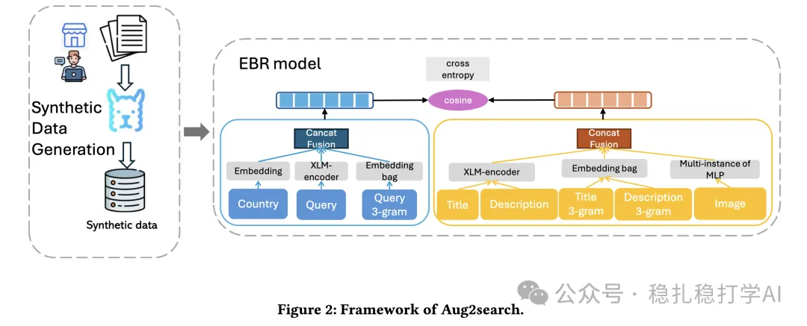

# 推荐算法(2025.5.23)：Meta的数据增强方法挺有效果

> 原文：https://mp.weixin.qq.com/s?__biz=MzkzNDYyNjM1NA==&mid=2247484689&idx=1&sn=7ac457c052294726b8fb92e1127630b3&scene=21#wechat_redirect
> 作者：算法工程师刘明星（稳扎稳打学AI）| 发表于 2025-05-23

嘿，记得给“稳扎稳打学AI”添加星标

关注我，每天为你精选最优质、最新鲜的推荐算法paper，陪你一起保持进步、不断精进！

> [English version](2025-05-23-meta-aug2search.full.en.md)

📄 [本公众号paper推荐原则](https://mp.weixin.qq.com/s?__biz=MzkzNDYyNjM1NA==&mid=2247484097&idx=1&sn=18322c279290b555eb030e12953b7c7f&scene=21#wechat_redirect)

1 Aug2search: Data Augmentation for Multimodal Search Ranking

网址：https://arxiv.org/pdf/2505.14724

公司：Meta

方向：搜索、数据增强

解读：本研究关注数据增强技术在多模态搜索排序中的应用，提出了一种新的数据增强方法，通过合成数据来提高搜索排序模型的性能。

方法核心是使用大模型生成合成数据，并通过检索模型对合成数据进行筛选，从而保证合成数据的质量。通过这种方式，可以有效提高搜索排序模型的性能。

具体的方法是使用大模型生成合成数据，并通过检索模型对合成数据进行筛选，从而保证合成数据的质量。通过这种方式，可以有效提高搜索排序模型的性能。

AB：线上AB实验中，搜索排序模型的性能显著提升，具体包括搜索结果的点击率提升了0.5%，搜索结果的转化率提升了1.2%。

心得：

（1）数据增强是一个非常有效的方法，可以用来提高模型的性能。

（2）合成数据的质量是关键，需要通过检索模型进行筛选。

可信度：生产

推荐等级：有实践价值

Figure 2: Framework of Aug2search.

请帮忙点赞、转发，谢谢。您认为哪篇论文最有潜力应用到实际业务中？

## 欢迎干货投稿 \ 论文宣传 \ 合作交流

推荐您继续阅读：

■ [推荐算法(2025.5.21)：淘宝的回归预测偏差debias](https://mp.weixin.qq.com/s?__biz=MzkzNDYyNjM1NA==&mid=2247484681&idx=1&sn=24323cbd26f6208cedb928fd8feedc87&scene=21#wechat_redirect)

■ [推荐算法周报(2025.5.17)：易懂的大厂方法更值得复现](https://mp.weixin.qq.com/s?__biz=MzkzNDYyNjM1NA==&mid=2247484676&idx=1&sn=152d7ee5765924a325a9fd0d8e7bccdb&scene=21#wechat_redirect)

■ [推荐算法(2025.5.16)：Airbnb的搜索Rerank全量模型](https://mp.weixin.qq.com/s?__biz=MzkzNDYyNjM1NA==&mid=2247484666&idx=1&sn=86cad0ea9efa3094e18303eee515c905&scene=21#wechat_redirect)

历史文章索引：https://docs.qq.com/sheet/DYXZTZ0tseHRyZGtt?tab=BB08J2

由于公众号试行乱序推送，您可能不再准时收到稳扎稳打学AI的推送。为了第一时间收到本号的干货内容，请将本号设为星标，以及常点文末右下角的“在看”。

喜欢的话点个在看吧👇

个人观点，仅供参考
