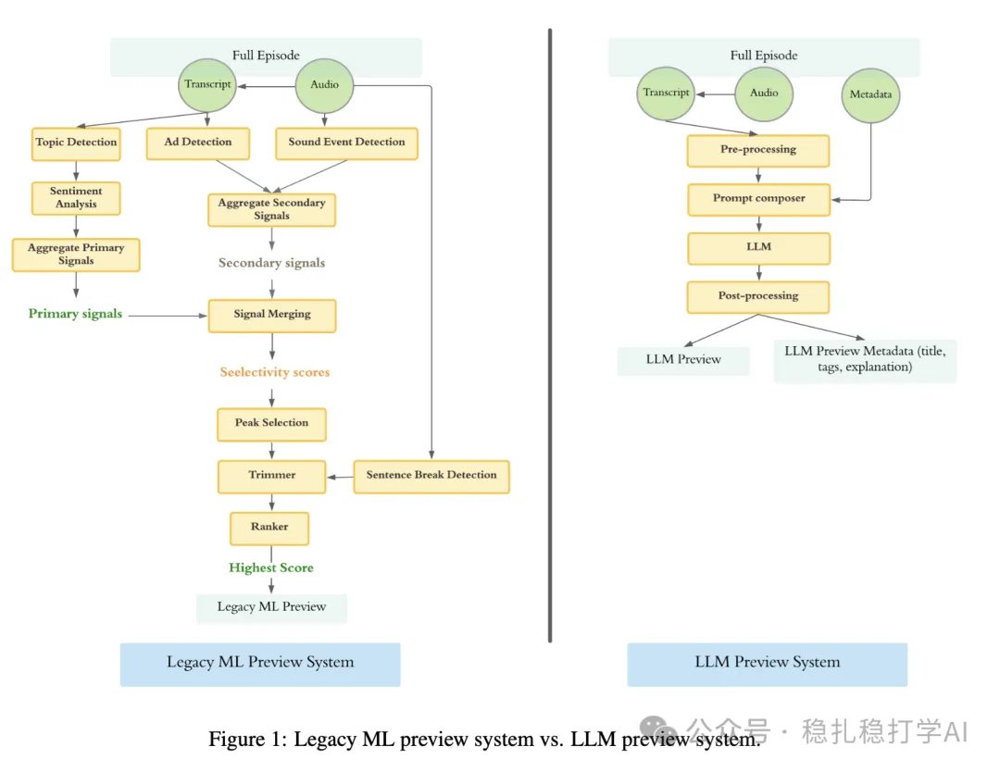

# Recommendation Algorithms (2025.6.3): Spotify's LLM application, with clear gains

> [中文版](2025-06-03-spotify-podcast-preview-llm.md)

1 Transforming Podcast Preview Generation: From Expert Models to LLM-Based Systems

Link: https://arxiv.org/pdf/2505.23908

Company: Spotify

Area: LLM

Overview:

LLM-based preview generation: the paper proposes using a large language model (LLM, specifically Gemini 1.5 Pro) to generate previews from a podcast's metadata (title, description) and transcript. That is, it picks a continuous 1-minute clip out of the audio as the pitch for a podcast episode.

(1) Preprocessing: split the transcript into sentences and tag them with timestamps, so the LLM can pick the preview segment precisely.

(2) Prompt engineering: structured reasoning, preview requirements (e.g. about 1 minute long, avoid ads, emotional resonance) and few-shot learning guide the LLM to produce high-quality previews. The LLM is used as-is, with no fine-tuning.

(3) Postprocessing: adjust the preview length to about 1 minute and make sure it is coherent.

The A/B results are excellent, so here they are: a 6-week test in 67 English-speaking countries covering all users, with 34% of podcast episodes using LLM previews. Results show higher user engagement: total time users spent evaluating previews +4.6%, and average evaluation time per preview +4%, indicating that LLM previews are more engaging and valuable.

Takeaways: an off-the-shelf large model needs no training; a little effort on the prompt gives this big an improvement, which is encouraging.

Credibility: production

Recommendation: practical value

