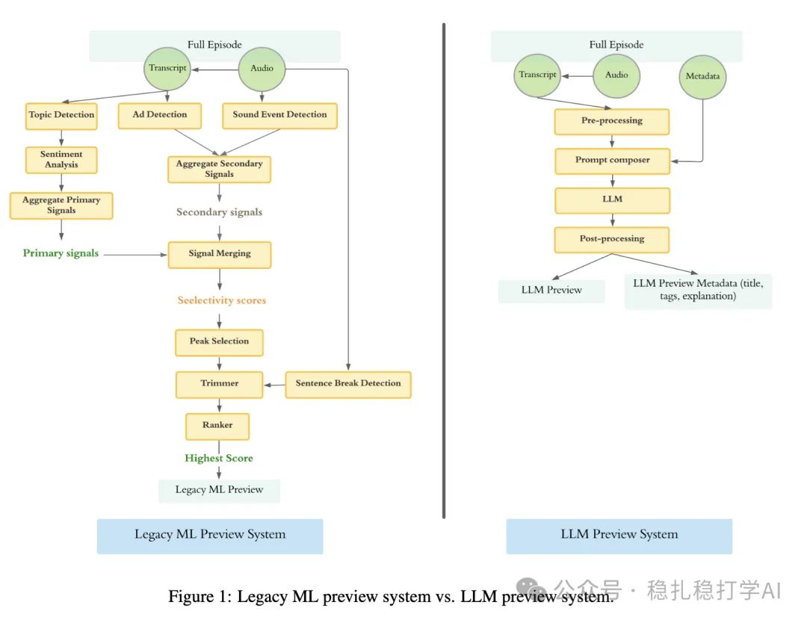

# 推荐算法(2025.6.3)：Spotify的LLM应用，效果明显

> 原文：https://mp.weixin.qq.com/s?__biz=MzkzNDYyNjM1NA==&mid=2247484739&idx=1&sn=427bd6b06eb2c005e7ce0eac79f30f3d&scene=21#wechat_redirect
> 作者：算法工程师刘明星（稳扎稳打学AI）| 发表于 2025-06-03

嘿，记得给“稳扎稳打学AI”添加星标

关注我，每天为你精挑细选最优质、最新鲜的推荐算法paper，陪你一起保持进步、不断精进！

> [English version](2025-06-03-spotify-podcast-preview-llm.full.en.md)

👆 [本公众号paper推荐原则](https://mp.weixin.qq.com/s?__biz=MzkzNDYyNjM1NA==&mid=2247484097&idx=1&sn=18322c279290b555eb030e12953b7c7f&scene=21#wechat_redirect)

1 Transforming Podcast Preview Generation: From Expert Models to LLM-Based Systems

网址：https://arxiv.org/pdf/2505.23908

公司：Spotify

方向：LLM

解读：

基于LLM生成预览：提出使用大型语言模型（LLM，具体为Gemini 1.5 Pro）基于播客的元数据（标题、描述）和转录文本生成预览。即从音频里调出连续1分钟的音频片段作为一次播客的推介。

（1）预处理：将转录文本按句子分割并标注时间戳，便于LLM精确选择预览片段。

（2）提示工程：通过结构化推理、预览要求（如时长约1分钟、避免广告、情感共鸣等）及少样本学习（few-shot learning）引导LLM生成高质量预览。这里LLM模型直接用原生的。

（3）后处理：调整预览时长至约1分钟，确保连贯性。

AB优秀，贴一下：在67个英语国家进行为期6周的测试，覆盖所有用户，34%的播客集使用LLM预览。结果表明，提升了用户参与度：用户评估预览的总时间增加4.6%，每条预览的平均评估时间增加4%，表明LLM预览更具吸引力和价值。

心得： 原生大模型不需要训练，在prompt上下点小功夫，就有这么大的提高，振奋人心。

可信度：生产

推荐等级：有实践价值

请帮忙点赞、转发，谢谢。您认为哪篇论文最有潜力应用到实际业务中？

## 欢迎干货投稿 \ 论文宣传 \ 合作交流

推荐您继续阅读：

■ [推荐算法(2025.6.1)：快手的长序列建模挺有趣](https://mp.weixin.qq.com/s?__biz=MzkzNDYyNjM1NA==&mid=2247484733&idx=1&sn=85ffc9a50c38da3f3862e2f8af0269a3&scene=21#wechat_redirect)

■ [推荐算法(2025.5.31)：阿里证明相似物料提升推荐效果](https://mp.weixin.qq.com/s?__biz=MzkzNDYyNjM1NA==&mid=2247484727&idx=1&sn=b1a72be48cec890839cdf23735fe1189&scene=21#wechat_redirect)

■ [推荐算法(2025.5.30)：腾讯的增强双塔粗排有良好效果](https://mp.weixin.qq.com/s?__biz=MzkzNDYyNjM1NA==&mid=2247484722&idx=1&sn=e760ad3274d52ff38c471914c19d9404&scene=21#wechat_redirect)

历史文章索引：https://docs.qq.com/sheet/DYXZTZ0tseHRyZGtt?tab=BB08J2

由于公众号试行乱序推送，您可能不再准时收到稳扎稳打学AI的推送。为了第一时间收到本号的干货内容， 请将本号设为星标，以及常点文末右下角的“在看”。

喜欢的话点个在看吧👇

个人观点，仅供参考
