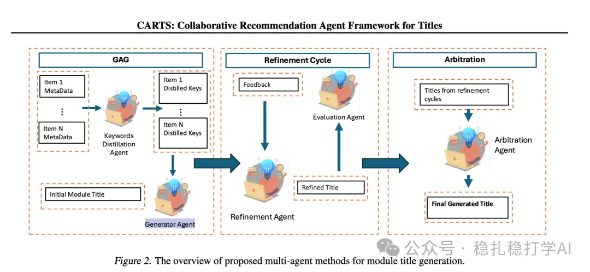

# Recommendation Algorithms (2025.6.24): Walmart's LLM-generated titles work remarkably well

> [中文版](2025-06-24-walmart-carts.md)

1 CARTS: Collaborative Agents for Recommendation Textual Summarization

Link: https://arxiv.org/pdf/2506.17765

Company: Walmart

Area: LLM

Overview:

In a display area for a group of related products, for example showing a user several summer dresses, a concise summary is needed that highlights their shared features (such as versatile, stylish and comfortable). This paper's method generates titles that are highly relevant to these items, concise, and within a strict length limit.

(1) Generation-augmented generation: the initial title, produced through keyword distillation and an augmented prompt, is a piece of text meant to concisely summarize the shared features of the recommended items while meeting the length constraint.

(2) Refinement loop: in this stage, the Evaluation Agent gives natural-language feedback on the candidate titles proposed by the Generator Agent. The feedback covers: whether the title meets the length limit (e.g. K characters); how relevant the title is to each recommended item, pointing out which items are not well covered. This feedback guides the generator agent to iteratively improve the title, increasing coverage and meeting the constraints.

(3) Arbitration: the candidate titles produced in each cycle of the refinement loop are collected and sent to the Arbitration Agent. This agent picks the best title as the final result based on criteria such as relevance and length compliance.

The agents in the framework are usually built on off-the-shelf pretrained large language models (LLMs) such as GPT-4o, with their functions implemented through specific prompt design and role assignment, without training from scratch.

The A/B results are good, so here they are: the generated titles significantly improved click-through rate (CTR +0.8%), add-to-cart rate (ATCR +6.28%) and gross merchandise value (GMV +3.78%).

Credibility: production

Recommendation: worth a look

